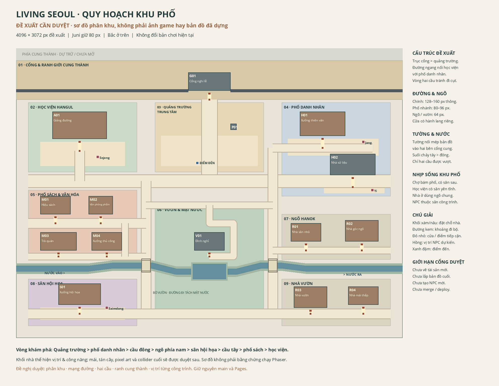

# Latest review — Living Korea full connected world

New isolated entry: **full-world-review.html**. Five destinations, analog landscape controls and real-input review evidence. Read [review instructions](docs/full-world/REVIEW.md), [actual engine board](docs/full-world/review-board.png), [full native map](docs/full-world/quality/full-map-overview.png). Download [portable playable package](docs/full-world/playable-review.zip), extract entire folder, `python3 start.py` (Windows `py start.py`), open printed HTTP URL. No Node needed to view. Artwork awaits user review; no public deployment/main merge. Previous worlds/source/Juni remain intact.

## Preserved previous review/history

# Current review — Living Korea first Namsan increment

[View the current review and evidence](docs/living-korea/REVIEW.md). Repaired northern boundaries/frontage, editable four-destination plan, ONE playable Namsan-inspired park and full-viewport landscape mobile. The other three destinations remain planned; stop for visual/gameplay approval before mass production. No main merge or public deployment.

Download `docs/living-korea/playable-review.zip`, extract the ENTIRE folder and run `python3 start.py` (Windows `py start.py`). Open the printed HTTP URL ending `/3D-pharse5-/living-korea-review.html`. For software-GPU use `--canvas`; optional phone-on-same-WiFi review uses `--lan`. Python3 required, no Node needed to VIEW. Never file:// or HTML source viewer. Cloud localhost is internal, not a user preview URL.

Developers: `bash tools/setup.sh` validates stored assets/types/lint/format/unit/build/browser; it never generates art. `npm run dev` or `npm run preview` serves the new entry under `/3D-pharse5-/`. Existing entries/Juni144frames/source/assets/checkpoints remain intact. [Mobile compatibility](docs/living-korea/MOBILE.md), [measured performance](docs/living-korea/PERFORMANCE.md), [actual Forge workflow](docs/living-korea/FORGE.md). Physical phone/Safari testing is still required.

## Historical reviews below

# Current review: compact Living Seoul

Stage B final polish is completed at `checkpoint/stage-b-final-polish-verified-20261016`. The next user-authorized review adds a meaningful palace court/main hall, compact Academy/workshop/museum routes and one modern book-and-tea corner, preserving the old town and Juni144frames. It is **not publicly released** and does not replace main.

Run `bash tools/setup.sh` for offline asset integrity, types/lint/format/unit/build/browser checks (never generates artwork). Run `npm run dev`, open the printed local server under `/3D-pharse5-/refinement-review.html`; software-GPU machines can add `?renderer=canvas`. Cloud localhost is not a public preview URL. For a no-Node review, use `docs/world-refinement/playable-review.zip`, extract the entire folder and run `python3 start.py` (Windows `py start.py`). Open the printed HTTP URL, never file:// or the HTML source viewer.

See [review and evidence](docs/world-refinement/REVIEW.md), [actual Forge route](docs/world-refinement/FORGE.md), [walking times](docs/world-refinement/TRAVEL.md) and [performance](docs/world-refinement/PERFORMANCE.md). Final verified source/CI/clean-clone identity belongs in the immutable checkpoint tag after observation. Stop for visual/gameplay approval before broader modern districts or remaining NPCs. No paid APIs, main merge or deployment.

## Retained history

Current candidate: [Stage B final terrain/courtyard polish](docs/stage-b-polish/REVIEW.md). Accepted architecture and Juni are preserved; native before/after and a separate portable local review are provided. Stage C/D and public deployment require later approval.

# Korean Arena — Living Pixel Seoul

Original Korean-inspired pixel-town art review, built with **Phaser4.2.1, TypeScript and Vite**. Juni/B and the existing Gwanghwamun artwork are the accepted working baseline; Bori/A and Nari/C remain future avatar styles. The latest connected first slice has not received district visual approval. Multiplayer, full TOPIK quests, fair PvP and voluntary rewarded ads remain roadmap items, not delivered services.

## Current gate: review the refined masterplan

The user provisionally accepts the overall zoning and requires a final urban-planning refinement before map production. Review the [new zoning proposal](docs/urban-zoning/PLAN.md), [placement rules](docs/urban-zoning/placement-rules.md) and [future main-promotion policy](docs/urban-zoning/PROMOTION.md).



The overall4096×3072zoning is **provisionally accepted**; the refined masterplan is **awaiting approval and not built**. Review the [distinct footprint/roof board](docs/urban-zoning/building-footprints.png), [historical references](docs/urban-zoning/HISTORICAL_REFERENCES.md) and [functional discoveries](docs/urban-zoning/DISCOVERY_DENSITY.md). Final map art/assembly is still gated on approval. Current runtime remains2048×768outdoor plus one768×576Academy reading room. Historical NPC positions on the diagram are planned, not newly animated characters.

## Play the retained first-slice review

[Actual Phaser review/evidence](docs/living-seoul/REVIEW.md) · [normal-speed gameplay MP4](docs/living-seoul/exploration-gameplay.mp4) · [download playable ZIP](docs/living-seoul/playable-review.zip).

Extract **Korean-Arena-Living-Seoul-Review**, run `python3 start.py` (Windows:`py start.py`), open the printed HTTP URL ending `/3D-pharse5-/district-review.html`. Python3required; Node is not needed to view the package. Opening HTML in a source viewer or with file:// does not run the app correctly.

WASD/arrows walk; Shift/Run runs; E/Explore enters the Academy, opens the reading activity or returns through the south doorway. Match three Hangul **letter names**, with retry/local progress and storage-denial fallback. Touch controls, zoom, evening, pause, OS reduced-motion and Canvas fallback remain. The preserved original town is available through the brand link / index.html; its rejected older character art is a recovery baseline. Older `plaza-review.html` and `character-review.html` remain available.

The first-slice review has144Juni animation frames and one letter-name activity; no new historical NPC artwork was produced there. See [honest tool/QA limits](docs/living-seoul/TOOLCHAIN.md), including source extraction warnings, the room marker diagnostic failure and earlier Juni weak-motion warnings. Numeric tests are not artistic approval; mobile captures are emulated, not physical-phone FPS certification.

## Develop and verify

Node24+, Python3.12 and Pillow12.3.0. Keep the existing exact package lock. No API keys or backend required for setup/build/viewing.

```sh
npm ci --ignore-scripts
bash tools/setup.sh
npm run dev
```

Dev uses4200, production `npm run preview` uses4201, base `/3D-pharse5-/`. The current connected review entry is `district-review.html`. Servers must restart after cloud snapshots. A cloud loopback address is not a public preview link.

```sh
npm run assets:check
npm run typecheck
npm run lint
npm run format:check
npm test
npm run build
npm run test:e2e
```

Use installed Chromium or Playwright's supported browser install. Setup validates retained assets and never generates artwork. Authoring is separate: read [AGENTS.md](AGENTS.md), [mandatory skill registry](docs/ART_SKILL_REGISTRY.md), all four STUDIO records and the actual upstream skills before any map/art/animation work. Optional pinned Forge/Creator caches stay outside the application; no paid provider route is authorized.

`src/` retains engine/controller/UI; `assets-src/` contains editable source/provenance and layered map data; `public/assets` and `public/review` contain the retained runtime/review assets. Current evidence lives in `docs/living-seoul`; the new proposal lives in `docs/urban-zoning`. Preserve all source, history and [recovery tags](docs/RECOVERY.md).

`main` stays stable; development continues on **rebuild/pixel-social-rpg-v3**. Prepare a main PR only after completed district visual approval, gameplay tests and clean-clone verification; merge requires separate explicit authorization. CI verifies only. GitHub Pages remains the separately deployed oldv0.5 site; no new game deployment is authorized.
