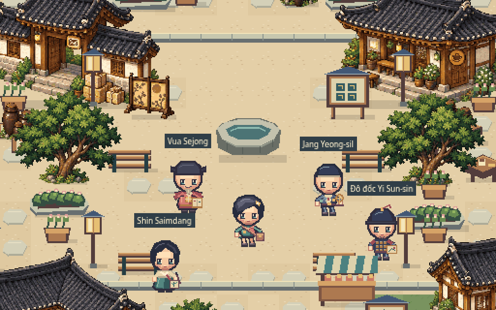

# Current gate: choose a completely new character

Previous player and NPC designs are **rejected**. New original A/B/C concepts, four directions and actual Phaser comparisons are ready in [the character reboot review](docs/character-reboot/REVIEW.md).


[Download the separate character review](docs/character-reboot/playable-review.zip): extract Korean-Arena-Character-Review, run `python3 start.py` (Windows `py start.py`), open the printed HTTP URL. The review page offers four directions and 1×/2× camera scales, and links back to the intact existing game. These are **static design candidates**, not an approved animation set. No new NPCs or publication before your selection.

Development: `npm run dev`; open the repository base plus `character-review.html`. Production build emits both that review and the existing game. Original gameplay/actors/world/UI sources and dependency lock are unchanged. See the new Forge execution/QA report for actual image routes, commands, warnings and limits. All four STUDIO records track this current gate.

## Preserved game baseline — earlier review, character art now rejected

# Korean Arena — Living Pixel Seoul

An original, local-play pixel social-town review built with Phaser, TypeScript and Vite. Provisionally accepted chibi/town art, improved distance-driven animation, layered outfits and four fictional historical guest interpretations. Animation/NPC visual approval is pending. No online players, full quests, backend, ads or new public deployment.



- [Character/NPC review board](docs/review/avatar-review-board.png)
- [Actual before/after Phaser animation video](docs/review/animation-review.mp4)
- [Playable review ZIP](docs/review/playable-review.zip): extract, enter Korean-Arena-Review, run `python3 start.py` (Windows `py start.py`), open printed HTTP URL. Python3 required; Node not needed to view. Do not open HTML in a source viewer or through file://.
- [Latest verified results](docs/review/verification.json), [cleanup report](CLEANUP_REPORT.md), [Git recovery](docs/RECOVERY.md), [Forge execution report](docs/SPRITE_FORGE_USAGE.md).

## Development

Node24+, Python3.12/Pillow12.3.0. Reuse the exact lock. The Forge authoring pipeline additionally uses numpy2.3.5 and ffmpeg; all are installed in the current cloud environment. No API keys/services required.

```sh
npm ci
npm run dev
# Existing Vite app, port4200, repository base /3D-pharse5-/
```

WASD/arrows walk; Shift run; E talks to a nearby historical guest; Space waves. Buttons and mobile touch controls also work. Hair/outfit/bag and four expressions are selectable; optional evening tint, integer zoom, pause and operating-system reduced-motion support remain. Guest dialogues are original Vietnamese-first educational sketches with Korean words, not certified lessons.

```sh
npm run assets:check
npm run typecheck
npm run lint
npm run format:check
npm test
npm run build
npm run test:e2e
```

Playwright uses installed Chromium or `npx playwright install chromium`. `npm run preview` serves the production build on4201. `bash tools/setup.sh` validates the environment without regenerating art. `npm run assets:chibi` intentionally exports actors; `npm run assets` copies exact editable world PNG/Tiled source and exports actors. Generated per-frame authoring/QA/capture intermediates stay in ignored.cache, not Git.

## Current source

- src: input, fixed-registration/distance-driven animation, scene, local NPCs, accessible HTML UI/content.
- assets-src/actors: editable native PNG atlases/master frames, metadata and palette; tools/avatar_art.py and guest_art.py are original native pixel geometry, no image model.
- assets-src/world: accepted native world source/placement/Tiledmap and original source atlas/provenance. World bytes are preserved, not regenerated for this milestone.
- public/assets: the one runtime asset tree. public/licenses retains original/Phaser/Zod MIT notices.
- tests, tools, docs/current and docs/review: current checks, authoring, handoff and one latest review package.

Historical3D, rejected2D and superseded evidence are in immutable recovery tags; no force-push/history rewrite. Full-history Git download remains large; a shallow clone of the current tip excludes obsolete active-tree files. See docs/RECOVERY.md.

Only read-only verification CI is present. GitHub Pages remains the separately deployed oldv0.5 artifact until a new release is explicitly approved. Do not publish this review build automatically. Future design-only learning/minigame/social roadmap: docs/PRODUCT_ROADMAP.md and MINIGAMES.csv.
