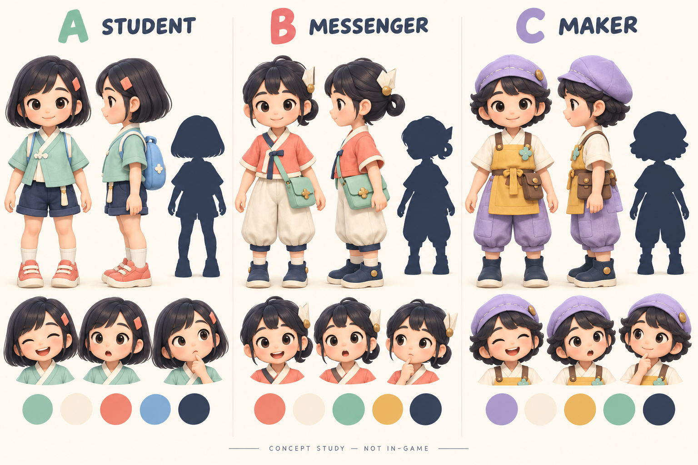
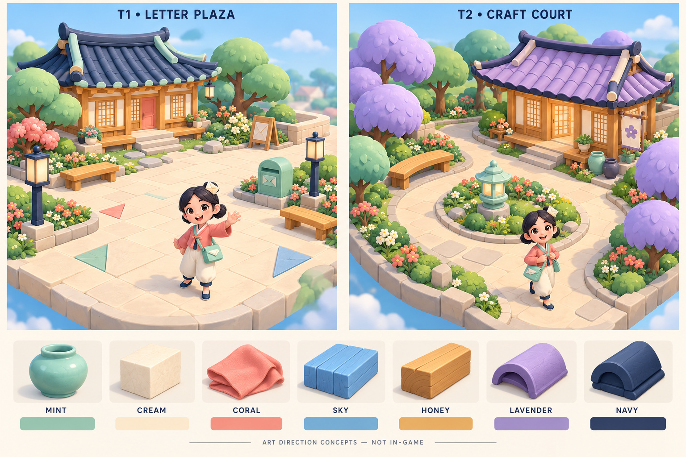

# v0.6 — Playful Hangeul Town · Duyệt hướng nghệ thuật

**Đề xuất: B — Nari đưa thư + T1 — Letter Plaza. Chưa được người dùng duyệt.**

Đây là concept để chọn hướng, chưa phải model, hoạt cảnh hay bản game v0.6. Website v0.5 vẫn giữ nguyên. Phạm vi dừng theo mục4/12 của [yêu cầu](../../docs/reviews/ART_PIVOT_V06_USER_REQUEST.md): “Present the concepts to the user. STOP and wait for approval.” Lựa chọn A của v0.5 không chọn thay phương án v0.6.

## Ba Nari chibi

Mỗi phương án có front/side, silhouette đặc, Happy/Surprised/Thinking và palette. Mục tiêu production2,5–3đầu, khoảng1,05m cao; tỷ lệ chính xác cần khóa trong turnaround/graybox sau duyệt. Không lấy minh họa làm bằng chứng skin/rig. Cả ba cần khuỷu/gối thật và bàn tay/bàn chân tách rõ.

| Hướng | Bản sắc / màu chủ đạo | Khả năng animation / rủi ro | Độ phức tạp dự kiến |
|---|---|---|---|
| **A · Student explorer** | Tóc bob, kẹp san hô, áo cổ chéo mint, quần short navy, balô xanh trời; gần gũi học sinh khám phá | Chân/sneaker rõ khi chạy, tóc bob thành vài khối; balô cần khóa vào thân và kiểm tra lúc vẫy tay. Bản sắc Hàn dựa cổ áo, không đồng phục sao chép | Vừa-thấp ·3/5;6.500–8.500tri;4–5primitives;0,7–0,9MB GLB |
| **B · Hangeul messenger** | Tóc vòng thấp, kẹp hanji gấp lệch, áo jeogori ngắn coral, baji cream, túi thư mint; giữ ký ức Nari | Áo ngắn giúp nhìn khuỷu/gối; túi nằm cao ở hông trái, dây ngắn. Phải kiểm tra tay xuyên túi, baji che gối và chân trượt; kẹp giấy/tóc chỉ một secondary joint khi cần | Vừa ·3,5/5;8.000–9.500tri;4–6primitives;0,8–1,1MB GLB |
| **C · Craft-town maker** | Mũ mềm lavender có đường may cong, yếm honey, huy hiệu gốm mint, dáng tròn và vững | Dáng mũ dễ nhận ra từ sau; yếm ngắn, tách vùng háng, không váy dài. Túi dụng cụ và yếm cần kiểm tra khi ngồi/nhảy; không dùng mô phỏng vải | Vừa-cao ·4/5;8.500–10.000tri;5–7primitives;0,9–1,2MB GLB |

Các con số trên là **ngân sách thiết kế chưa đo**, tính một nhân vật với skin, biểu cảm và clips dự kiến; không phải kích thước đã xuất. Số primitive không tự bằng số draw của cả frame.

B có silhouette riêng nhờ kẹp giấy/tóc vòng và túi phong thư, màu coral nổi trên sân cream/mint, phù hợp việc khám phá. A dễ gần nhất với chủ đề học; C hợp người dân/NPC tương lai nhưng không xây NPC ở gate này. Chi tiết hoa trang trí trên minh họa chỉ là gợi ý, không khóa huy hiệu/thương hiệu cuối cùng.

## Hai quảng trường và bảng vật liệu

| Hướng | Bố cục và trải nghiệm | Chi phí / đánh đổi dự kiến |
|---|---|---|
| **T1 · Letter Plaza — đề xuất** | Một Hanok ở sau-trái, sân cream mở phía trước, cây/ghế/đèn ở rìa, hộp thư mint và dấu gấp giấy. Đường chạy không bị bồn cây chia đôi; dễ thấy Nari và hướng cửa | World30–38ktri;1,8–2,6MB; Medium toàn cảnh gồm Nari/đồ trang trí/shadow dự kiến70–95draw. Thấp hơn T2 về che khuất/cost; cần tạo điểm nhấn mà không làm sân trống |
| **T2 · Craft Court** | Một Hanok sau-phải, mái lavender, lối vòng quanh đảo hoa/đèn gốm; ghế cong, tán cây ôm hai bên. Cảm giác gặp gỡ yên ấm hơn | World34–40ktri;2,2–2,8MB; Medium toàn cảnh dự kiến85–110draw. Có nguy cơ vượt mục tiêu100; gom/instance hoa, giảm tán và shadow casters trước khi thêm chi tiết |

Hai ảnh là style/layout concepts; chưa chứng minh tường sau, liên kết mái hoặc collision. Nhà production vẫn có đủ bốn mặt, mái đặc được cột/dầm đỡ, floor/hiên/bậc nối nhau, cửa trượt dùng thật. Giản lược kiến trúc bằng khối lớn và vật liệu rõ, không xóa tường. Giữ đường mái/khung gỗ/hanji gợi Hanok; kiểm tra bốn phía ở prototype, không suy ra kết cấu từ một góc ảnh đẹp.

Mật độ hoa, gờ mái và vân gỗ trong tranh **không** phải yêu cầu sao chép bằng polygon/PBR. Bản dựng dùng cụm lá bo khối, hoa instance có giới hạn, ngói nhóm theo dải và lattice nét lớn. Không có skyline chi tiết/HDRI/bloom/shader đắt.

| Màu chuẩn đề xuất | Hex sRGB | Vai trò / vật liệu production dự kiến |
|---|---|---|
| Celadon mint | `#88C9B3` | Túi, hộp thư, vài đồ gốm; roughness0,5–0,65, không phản chiếu như kính |
| Warm cream | `#FFF0D8` | Hanji, sân, baji; roughness0,85–0,95 |
| Coral | `#F18478` | Áo Nari/điểm tương tác; matte, không phát sáng toàn bộ |
| Sky blue | `#89B7D8` | Nền và gỗ sơn phụ; giữ độ tương phản mặt |
| Honey yellow | `#E9BB69` | Dầm, ghế, cổ đèn; grain rất nhẹ hoặc vertex color |
| Lavender | `#B2A0D2` | Hoa/tán cây phụ hoặc mái T2, không phủ đồng loạt |
| Deep navy | `#293C55` | Mái T1, giày, nét nhấn; tránh mảng đen mất đọc ban đêm |

Tranh có sai lệch màu do shading; bảng hex trên là chuẩn khi dựng. Da/tóc dùng thêm màu tự nhiên. Ưu tiên palette/vertex color và một atlas khuôn mặt512px; atlas world512–1024px chỉ khi thực sự cần, chia sẻ vật liệu, hạn chế normal maps. Không cần thay ART_DIRECTION.md cũ trước khi người dùng duyệt. Đêm dùng fill xanh sáng, đèn cream/honey, mặt vẫn đọc được; chưa có bản render đêm v0.6 để nghiệm thu.

## Baseline đã đo và mục tiêu

Đo lại **website v0.5 đang công khai**, exact HTML082c661b, Chromium/SwiftShader1280×1100, canvas902×610CSS, reduced-motion để giữ cùng pose. Nguồn: [browser.json](../../quality-reports/v0.6/baseline/browser.json), [assets.json](../../quality-reports/v0.6/baseline/assets.json), [Blender audit](../../quality-reports/v0.6/baseline/blender.json). Đã mở xem ảnh day/night/Nari thực tế; hai GLB Validator0errors/0warnings.

| Chỉ số | v0.5 thực đo | v0.6 B+T1 mục tiêu, chưa đo |
|---|---:|---:|
| World triangles, không nhân shadow |75.514|30.000–38.000, trần định hướng40.000|
| Nari triangles |23.794|8.000–9.500, trần định hướng10.000|
| Tổng hai GLB raw bytes |8.638.328B|2,6–3,7MB, hướng tới≤4.000.000B|
| Medium frame draws, gồm shadow |133|70–95, ưu tiên<100|
| Low frame draws / triangles |57 /99.012|Chưa đo; ít cây/hoa, DPR1, không dynamic shadow|
| Medium/High frame triangles |195.524 /195.524|Chưa đo; cast shadow có chọn lọc, một shadow map|
| Hardware CPU/GPU/FPS |Không có thiết bị phù hợp|Phải đo khi có thiết bị; không hứa30/60FPS|

v0.5 world5.714.488B + Nari2.923.840B. Raw GLB trên đĩa khác HTTP wire transfer: bản v0.5 HTML13.543.219B còn chứa engine, base64 và fallback; chưa đo Content-Encoding/first-load latency ở đây. v0.6 cần đo riêng GLB/JS/wire load, animation CPU và mobile memory khi có prototype. Ngân sách50ktri/4MB tương đương giảm khoảng50%geometry/54%raw bytes so v0.5, là mục tiêu chứ chưa đạt. Không cần gắn decoder mới để đạt số đẹp.

## Giữ lại và thích nghi từ v0.5

| Hệ thống thực có | Cách tiếp tục sau duyệt |
|---|---|
| `preview/src/reforge/physics.ts` fixed-step, acceleration/deceleration, jump, capsule collision, keyboard/touch | Giữ thuật toán/input. Floor/stairs/bounds đang hard-code và capsule1,4m: chuyển sang cấu hình plaza/chibi sau khóa kích thước; không bê nguyên collision lệch hình |
| `Nari.tsx` mixer/crossfade/LoopOnce→Idle,28bones,20clips,10morphs | Giữ controller/clip contract, skeleton naming và morph semantics khi hữu ích. Remodel topology/skin cho đầu lớn/tay chân ngắn; retarget rồi **chỉnh lại gait**, không scale GLB cũ thành chibi. Dance chưa có trong20clips: author sau duyệt, không tuyên bố đã hỗ trợ |
| `footPlacement.ts` terrain IK | Dùng tiếp cơ chế, đổi chiều dài chân/foot offset/tread samples; kiểm tra foot contact thực, root stride và walk/run speed |
| `Scene.tsx` bounded orbit/follow/obstruction/context-loss | Dùng tiếp, fit lại hero/collider/camera target theo chibi và nhà nhỏ; bớt góc cao làm mặt bé. Camera input/zoom giữ do người dùng điều khiển |
| `World.tsx` day/evening/night, door transform gốc, lantern picking, bounded particles | Dùng cơ chế, vật liệu matte/palette đơn giản; semantic IDs thay vùng click cứng. Giữ cửa thật và một lantern response cho prototype |
| `App.tsx` reduced-motion/paused/visibility, touch, fallback và quality | Giữ accessibility và WebGL fallback. Main preview chuyển sang Play/Explore, metrics vào panel phụ sau duyệt; fallback phải chụp từ **model v0.6 thật**, không dùng concept làm giả gameplay |
| Blender export/GLTF Transform/Validator/hash/provenance/package/Pages | Giữ pipeline với đường dẫn mới `assets/v0.6`, `exports/v0.6`, `preview/src/town` và artifact riêng. Không chạy script v0.5 có output cố định lên tài sản duyệt |

Eye gaze/pupil tracking, squash/stretch và chibi secondary motion cần thêm/tune sau duyệt; v0.5 quay thân theo camera không tự chứng minh eye tracking. Giữ hợp đồng biểu cảm/blink, kiểm tra nhìn thẳng/nghiêng/từ sau và ba biểu cảm rõ trên điện thoại. Không nâng framework, cài service hay thêm backend/multiplayer/audio trả phí.

## Phạm vi tiếp theo, chỉ sau khi duyệt

1. Khóa B+T1 hoặc lựa chọn thay thế; turnaround front/side/rear và palette chính xác. Giữ source/phát hành v0.5 ở recovery tag, paths cũ byte-identical.
2. Một chibi + một nhà bốn mặt + một sân mở. Graybox tỷ lệ/collision/cửa trước material polish; modular roof/wall/door/lamp/tree/path/bench dùng lại về sau.
3. Rig/skin/facial morph mới tương thích controller. Idle/Walk/Run/JumpStart-Air-Land/Greeting; Happy, Surprised, Celebration là ba cảm xúc của prototype. Timing, anticipation/landing, mắt chớp/gaze và squash có giới hạn. Các clip còn lại/dance làm theo thứ tự sau khi prototype chơi ổn.
4. Prototype chỉ có walk/run/jump, một đèn phản hồi, camera thật, Low/Medium/High và fallback. Không dựng trọn thị trấn, NPC/multiplayer/học API/district tiếp theo. Ghế/hoa/biển là module; sit/hidden-object không hứa là interaction hoàn thành.
5. Sau mỗi block lưu bốn records/nguồn/export/checkpoint. QA thật: front/side/rear, walk/run/jump + ba mặt, nhà bốn phía, plaza day/night, desktop/mobile, Low/Med/High counts, fallback/reduced-motion, animation/console/Validator/build và before/after v0.5. Concept sheet không thay thế bất kỳ bằng chứng nào trong số đó.

Độ khó B+T1 tổng thể **vừa**, tập trung công ở retopology/weights/retiming chân ngắn và đọc mặt; không cần viết lại engine. Có năm block nghiệm thu trên, không ước lượng FPS hay hứa số giờ chưa có dữ liệu. Sau prototype được xem xét mới tiếp tục polish; **công bố v0.6 cần phê duyệt xuất bản riêng** (mục16).

## Trạng thái cổng duyệt

Đã có: ba character concepts, hai town concepts, material board, baseline thật, chi phí/complexity và reuse plan; giữ nguyên v0.5. Chưa có: lựa chọn của người dùng, model/Blender/GLB/animation/prototype v0.6 hoặc release. **Chờ chọn B+T1, hoặc A/B/C kết hợp T1/T2.**
