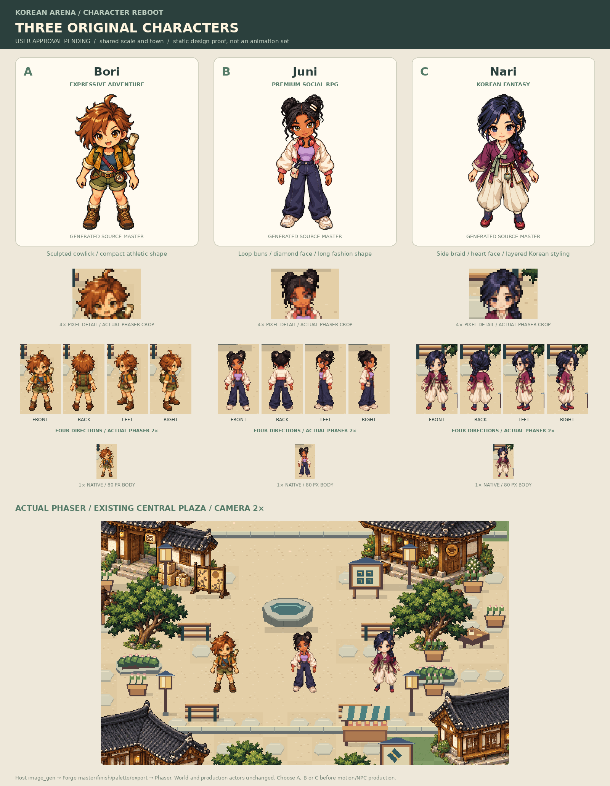

# Character reboot — choose one design before animation

**Status: READY FOR USER DESIGN REVIEW, NOT APPROVED.** The prior player and all four historical NPC designs are rejected. This gate produces only three new original player concepts and four static directions each. No redesigned NPCs or action animation sets have been produced.

| Choice | Character design | Distinct construction |
| --- | --- | --- |
| A — Bori | Expressive Adventure Chibi | Compact athletic proportions, rounded triangular face, lively amber eyes/open smile, sculpted auburn cowlick, rolled field jacket, shorts, map backpack and compass. |
| B — Juni | Premium Social RPG Chibi | Longer fashion proportions, warm-brown diamond face, raised brows/hazel-gold eyes/dimple, loop buns, cropped bomber, wide trousers, headphones and hip pouch. |
| C — Nari | Korean Fantasy Chibi | Balanced flared silhouette, heart-shaped face/quiet sapphire eyes, thick side braid/crescent pin, contemporary jeogori-inspired jacket, pleated culottes and norigae-inspired pendant. Original fantasy clothing, not a historical reconstruction. |

All three were newly generated without rejected actor art as a reference. Their faces, anatomy, hair and costume construction differ; they are not recolors. Production art and code were not substituted. Appeal and final consistency still require the user's visual decision.

## Actual viewing

- [Collage](avatar-review-board.png): source masters clearly labelled; pixel-detail, four-direction, native and scene panels are actual Phaser crops.
- [Front](phaser-front.png), [back](phaser-back.png), [left](phaser-left.png), [right](phaser-right.png), [native 1×](phaser-native.png), [mobile Canvas](mobile.png), [full review page](review-page.png).
- [Download static review ZIP](playable-review.zip). Extract **Korean-Arena-Character-Review**, run `python3 start.py` (Windows `py start.py`), open the printed HTTP URL ending in `/3D-pharse5-/character-review.html`. Python 3 required; no Node needed to view. Do not open HTML through file:// or a source-code viewer. The page links to the unchanged working game.
- Development/production: normal Vite commands; `character-review.html` is a separate entry, not a replacement for index.html. Cloud loopback addresses are internal verification only, not public preview links.

Proposed native body height is **80 px**, on an80×104 canvas/root40,96, shared across A/B/C. Camera1× presents native pixels;2× is the gameplay comparison;4× head details are explicitly enlarged review crops. This is a proposed new character scale, not an approved production replacement. Production actors retain their original dimensions.

ZIP: **1,134,701 bytes**, SHA256 `d7399a46b8fabe03813b70a62218084c8b81da29acf15c0bccab4f0337ee8841`. Exact extracted Python launcher/browser checks pass desktop and mobile DPR2/Canvas; all six screenshot hashes match the visually inspected production captures. No missing requests or critical console errors. Physical phone performance and Windows GUI launch are not certified.

## Real Sprite Forge execution

Official remote HEAD matched pinned `5324342fdfab72430f4e9604f3fe427009f8596d`. All five skill directories and vendored dependencies verified; relevant four SKILL.md sources read. No reinstall of working packages. resvg is absent/unneeded because no SVG art generation is used.

Actual image generation route: **host image_gen**, ten calls including original masters, referenced turnarounds and narrow fixes. Not API generation or code-drawn geometry. Model/version and dollar estimate are not exposed by the host tool; not invented. Paid provider API routes disabled (`FORGE_MAX_PAID_REQUESTS=0`); no provider-key calls or billable CLI route invoked.

`generate2dsprite/master_still.py prompt` generated the master briefs. The host tool used those briefs. `master_still.py approve` normalized the selected stills and direction cells; its verb does NOT mean the user approved any concept. `video2dsprite/finish_frames.py` performed actual image finishing. The first64px standard aggressive pixel finish lost facial detail and was rejected visually. The selected supported route is premultiplied area finish at80px plus `palette_tool.py quantize-seq --colors40 --orphans0 --no-despeckle`, shared across each concept's four directions. This preserves generated facial pixels, with binary alpha and no dithering. Source art was not replaced by code geometry.

`codeart2d/pixel_qa.py` actually inspected all twelve final frames: three PASS envelopes, no WARN/FAIL in those envelopes. It is QA only. `video2dsprite/engine_export.py package` actually exported all three PNG atlases and standard manifests. Every atlas rectangle was compared byte-for-byte with its native source frame and rendered in Phaser. The reviewed pipeline invocation records **28 actual processing commands** in [forge-execution.json](forge-execution.json), including expected unsupported PNG-only verification. [tools/character_reboot.py](../../tools/character_reboot.py) reproduces processing from the retained original source images; it never calls an image/video provider.

### Warnings and unavailable steps — explicit

- Each raw turnaround has the same published check: `id=safe_frame`, `status=warn`, `value=3`, `threshold=0`, `cells=[[0,0],[0,1],[0,2]]`, note: **"owned art closer than 8% of the cell to its edge; ask for more margin next time"**. These are raw still margins, not cuts: cross-cell spill/edge-cut checks pass. Normalized masters/final native canvases have safe padding and no clipped parts. The raw warning is retained, not suppressed or advertised as a full pass. Future motion takes require their own safe envelope.
- Initial B magenta master:2.5% key-leaning costume colors; changed to a green-key host edit. Final B master has zero key warnings. B eyes were strengthened for native readability; B/C asymmetric hair ornaments were corrected through actual reference edits.
- `engine_export.py verify` exits1: **"verify needs an encoded transport; package with --formats webm and/or packed or --tiers"**. It cannot verify PNG-only still collections. No fake movie of direction changes was manufactured. Pixel equality and actual browser renders validate these static exports. Standard manifest timeline fields are unused, not a motion clip.
- Video generation diagnostic: **NO_ROUTE**. ffmpeg7.1.5 VP9 alpha/libx264 functional. `sprite_set.py plan --help` checks CLI availability only; no plan/run/accept action-generation calls were made. Full animation and a new animation demonstration are deferred until the user approves a design and an authorized route is available. Old rejected-character footage is not presented as reboot motion.
- Pixel-QA outline heuristics and engine selection/registration hash checks that are not applicable remain explicitly SKIPPED in the machine report. Numeric checks do not approve personality, anatomy or animation quality.

## Verification and recovery

Production build, typecheck, lint, formatting,8 unit tests and7 actual browser flows pass. Five browser flows exercise the retained game (movement, collision, emotes, customization/persistence, NPC dialogue, reduced motion, touch/DPR and genuine Canvas fallback); two exercise the new static review. These do not claim new action animations exist.

[Preservation proof](preservation.json):130 protected source/asset/UI/lock files byte-identical to baseline33360ed, including the entire accepted world and existing production actors. Only a separate review entry, candidate assets, tools, tests and documentation were added/updated. Vite emits both pages; original gameplay source is unchanged. Recovery tag `recovery/before-character-reboot-20261015` -> `33360ed1989e4db9fc3fc4e3686ca385e0b00908`, pushed and independently peeled on origin before changes. Source checkpoint stays on `rebuild/pixel-social-rpg-v3`; main and public Pages are not promoted/deployed. Final exact SHA/CI are recorded in annotated checkpoint tag `checkpoint/character-reboot-concepts-20261015`.

**STOP. Choose A, B or C (or request specific design changes).** Only after explicit selection may the new animation system and then historical NPC redesign begin. Do not treat the user's earlier unrelated A/B/T1 replies as this approval.
