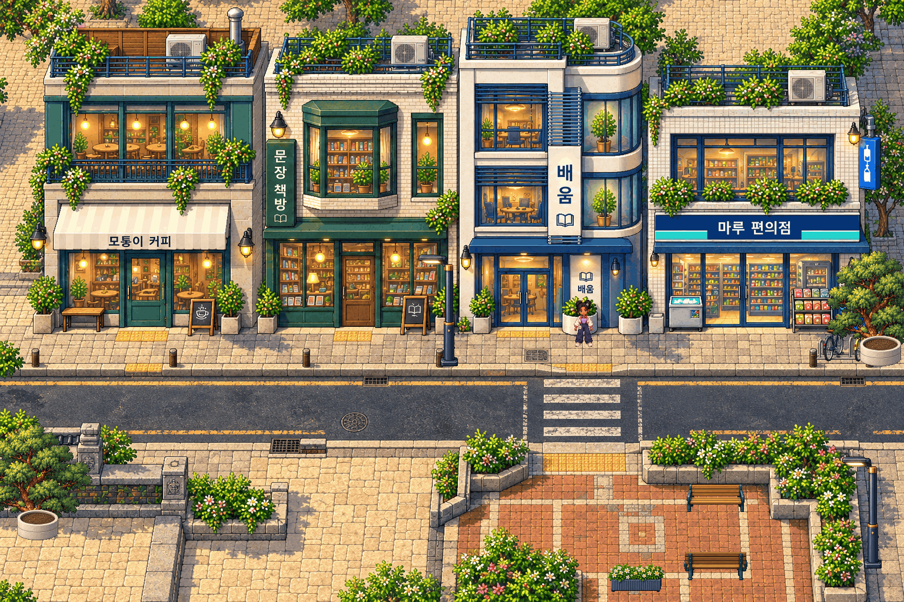

# Gate 1 — Phố Muneum, initial street sample

**Awaiting the user's visual decision. Gate2 remains locked.** This is one playable street, not another southern-world rebuild. Initial sample; user-feedback correction passes used:0 of1.

Open the original files for pixel assessment:

- [Native Phaser PNG,1536×1024](GATE1_STREET_NATIVE.png) · [exact nearest-neighbor2×](GATE1_STREET_2X.png).
- [North–South comparison, equal pixel scale](GATE1_NORTH_VS_SOUTH.png): both panels1024×768, same80px Juni, no resampling.
- [Architecture/material board](GATE1_ARCHITECTURE_BOARD.png): labelled **native source-art details**, not a gameplay mockup.
- [Actual keyboard gameplay,29 seconds](GATE1_GAMEPLAY.mp4): normal entry, four shopfronts, E venue cards, crossing into the public court and greeting; no QA placement, frame injection or speedup.
- [Playable ZIP](GATE1_PLAYABLE.zip): extract, run `python3 start.py` (Windows: `py start.py`). WASD/arrows, Shift, E, Space; landscape mobile joystick included. Python3 required, Node not needed to play.
- [Sources/actual skill execution](GATE1_SOURCE_AND_SKILLS.md), [gameplay checks](gameplay-qa.json), [package verification](package-verification.json), [preservation/readback proof](offline-validation.json).

## What this sample demonstrates

Four original, adjoining contemporary Korean frontages share a continuous sidewalk: teal-steel café, ivory-brick bookstore with green bay window, blue-white glass learning venue, white-tile convenience shop. Deep openings, visible interiors, awning undersides, material joints, balcony planting and different window rhythms replace detached miniature-model composition. A narrow street and one crossing connect to an enclosed brick gathering court with opposing benches. Warm heritage stone and a low carved boundary make a small transition on the left; two unchanged approved northern trees provide a direct vegetation benchmark. Separate native furniture/tree layers use Y-sort and small support colliders around the unchanged animated Juni.

The final image-model foundation is1536×1024. This exceeds the approximate1024×768 target: its four complete adjoining frontages and roughly100px shop doors are kept at **one source pixel per world pixel**, rather than shrinking architecture around Juni's80px body. Normal gameplay uses a1024×768 maximum1× follow camera, with a higher view toward the frontages; `?overview` shows the complete native slice on a large display. The full native PNG includes that whole extent. This is a documented scale adjustment for this sample only, not permission to expand the world.

## Diagnostic art review — not approval

| Category | Self-rating /5 | Visual evidence and remaining weakness |
| --- | --- | --- |
| A. Architecture |4 | [Architecture board](GATE1_ARCHITECTURE_BOARD.png): distinct brick, glazed bay, metal sunshades, awning and roof silhouettes; shop recesses/interiors have depth. The upper elevations still read more frontally than the historical architecture. |
| B. Composition |4 | [Native scene](GATE1_STREET_NATIVE.png): one continuous street wall, narrow sidewalk/road, framed court and legible crossing. Whole-slice width exceeds the original target; a regular camera cannot show all four complete façades at once. |
| C. Environment |4 | [Native/2×](GATE1_STREET_2X.png): curbs, drains, tactile approaches, planted edges, trees, lights, bikes and opposing seats have specific uses. Some foliage density and baked decorative details still deserve human inspection. |
| D. Color |4 | [Native scene](GATE1_STREET_NATIVE.png): warm stone/amber interiors with deep greens, clear blue-white glazing and terracotta court. Always-warm shop lighting is an art choice, not a simulated lighting system. |
| E. Pixel quality |3.5 | [Exact2×](GATE1_STREET_2X.png): architecture/ground retain1:1 spatial pixels;255-color finish/binary alpha; no dither. Support props use declared uniform native finishing. These are model originals with pixel finishing, not a claim of hand-authored strict-grid art; delicate lettering/texture can remain illustrative. |
| F. Gameplay |4 | [Video](GATE1_GAMEPLAY.mp4) and [QA](gameplay-qa.json): actual continuous keyboard traversal, four entrances, court, collision, unchanged144-frame Juni, landscape touch and Canvas/WebGL. Doors open local venue cards; interior rooms are outside this sample. Physical phones are untested. |
| G. North–South consistency |3 | [Equal-scale board](GATE1_NORTH_VS_SOUTH.png): same Juni and protected tree art, warm stone, detailed recesses and layered planting belong to a common palette language. The modern street's frontal vertical emphasis and larger commercial elevations still differ from the north's stronger overhead roof presentation. I do **not** consider complete style equivalence established by tests or this score. |

The strongest improvement is the continuous, materially distinct street composition at actual character scale. The main unresolved art question is whether its modern perspective and illustrative detail genuinely match the approved north closely enough. Only the user can decide that. No full-world work, new district, NPC system, main merge or deployment has been done.

Technical observations:12 existing unit tests passed;8 real Gate1 browser cases passed; five navigation targets reachable with0 pockets/thin gaps after the closed off-slice forecourt boundary was classified; Tiled readback0different pixels;336 protected files and the full approved graybox/shared code remain unchanged. The newly captured north is pixel-identical to the approved reference. Extracted ZIP normal-entry desktop/mobile works and all29 shipped files match the build. These results establish technical reviewability, not artistic acceptance.

## Decision and correction limit

Review branch: `art-gate/final-korean-town`, based on approved graybox `3c323bc1d844c80b3e0ca0d62df3f1806a7a972f`. GitHub-hosted images/video/ZIP are committed beside this report; remote verification receipts describe the actual retrieval method and any HTTP access limitation.

If approved, Gate2 may begin only in a later authorized task, using a frozen accepted art specification. If rejected, at most one focused correction based on the user's specific feedback is permitted. No third sample or silent full-map continuation.

**Do you approve this visual quality as the mandatory art standard for the final Korean Arena world?**
