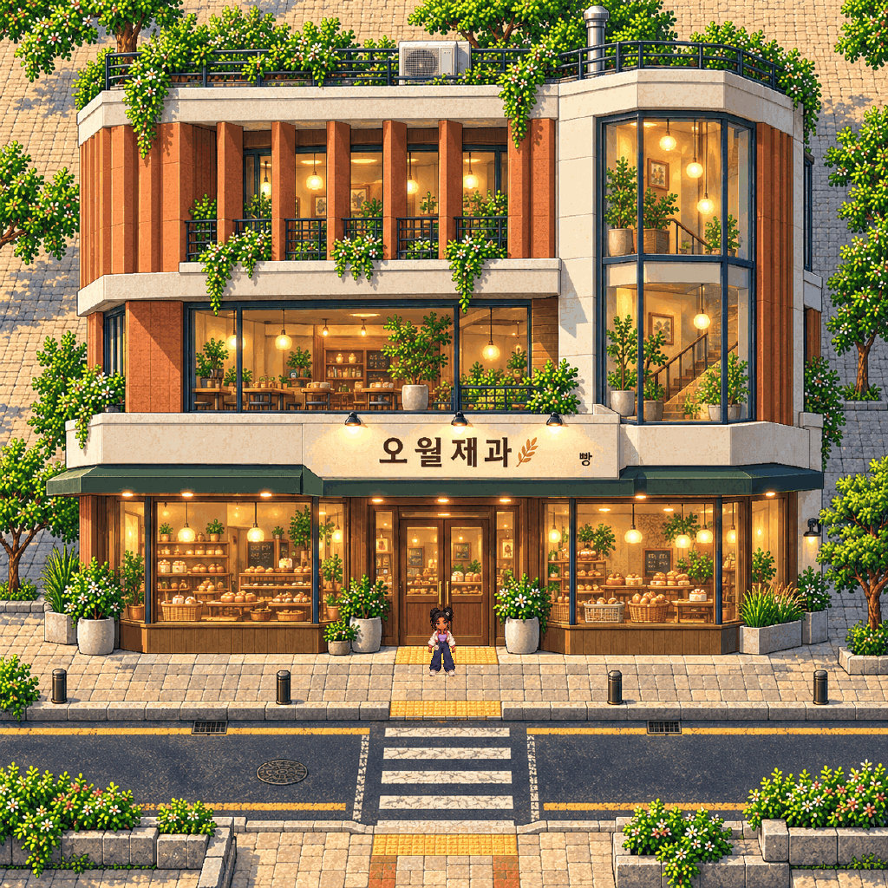
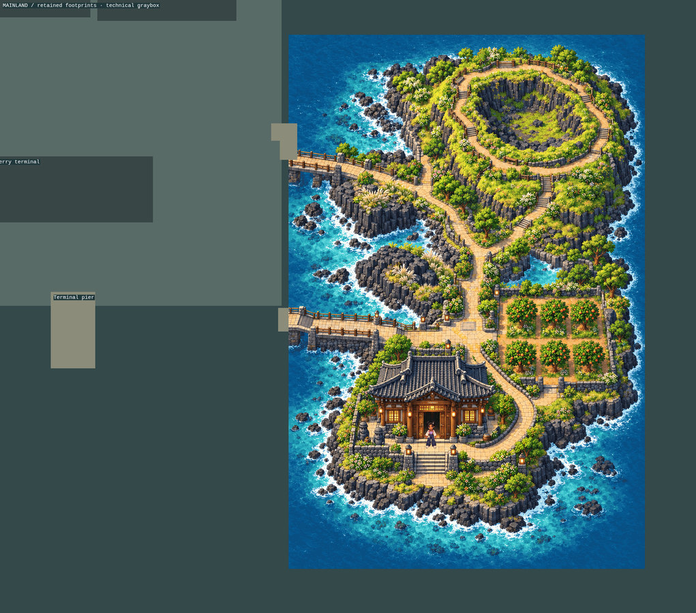
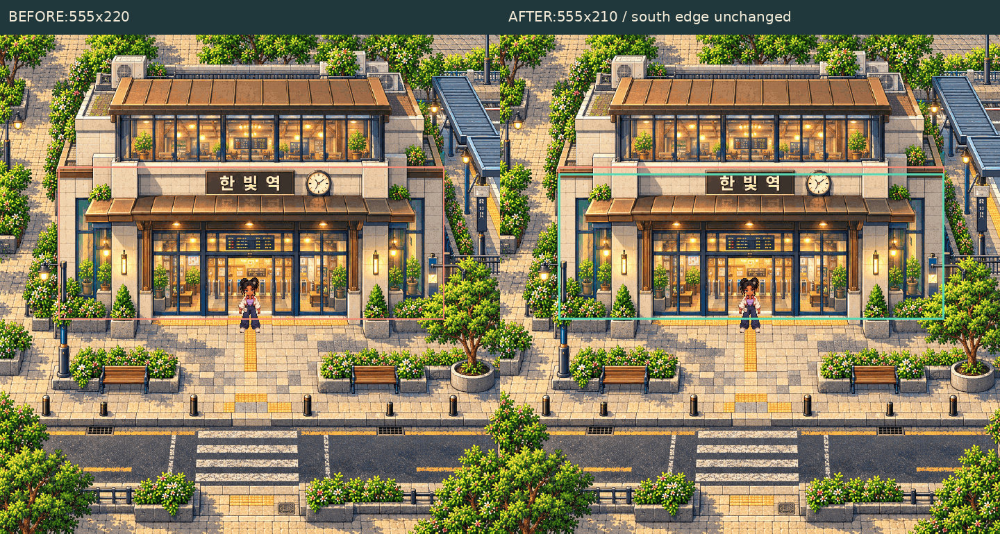
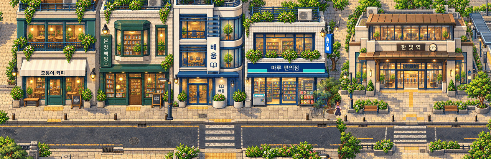
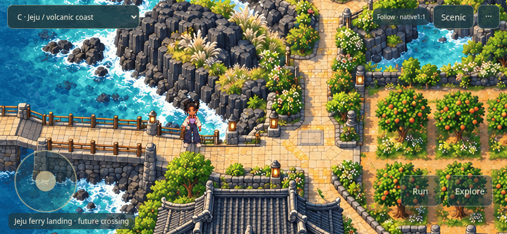
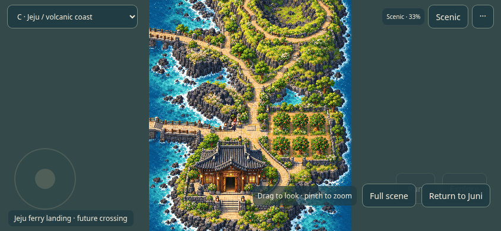
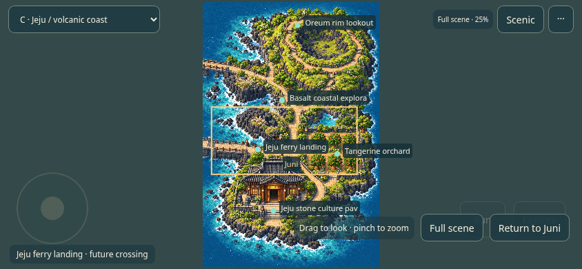

# Gate 2 — five-task acceptance package

The overall direction is accepted **for validation**. Final human artistic approval is still pending. **Gate3 remains locked.** This delivery contains one new commercial building, localized fit corrections, one independent asset join and a mobile camera prototype; no whole-world production, main merge, public deployment or separate-app change.

[Download the playable acceptance ZIP](../ACCEPTANCE_PLAYABLE.zip) · [11-second real camera recording](../ACCEPTANCE_MOBILE_CAMERA.mp4) · [technical/artistic judgments](REPORT.md) · [source and fit verification](source-and-fit-verification.json).

Extract the ZIP, run `python3 start.py`, and open the localhost URL printed. No dependencies to install. The selector opens the new bakery, original A/B/C/transition scenes, refined station, independent street/station join and the Jeju candidate-fit graybox. WASD/arrows, Shift, E and Space remain; mobile has joystick, Run and Explore.

## 1 · Exactly one original commercial building

[Native1024×1024 with Juni](ORIGINAL_NATIVE_1X.png) · [lossless1:1 entrance crop](ORIGINAL_PIXELS_1X.png) · [Muneum comparison](ORIGINAL_VS_MUNEUM.jpg) · [provenance](new-art-provenance.json).

**오월제과** is a new single-building bakery with terracotta ceramic fins, offset floors, a glazed stairwell and detailed bakery frontage. It does not use a recolored or rearranged Muneum facade. Muneum remains reused in SliceB and in the integration proof, openly labelled. The new bakery’s craftsmanship match requires your artistic judgment.

The host returned1254×1254; the new asset alone received an explicit uniform authoring finish to1024×1024. Its doorway is approximately140px tall beside Juni’s approximately80px body. No approved art was resized. Exactly one host-image call was made under this directive; no paid provider API was called.

## 2 · Jeju localized world-fit candidate

[Native2002×1764 proof](JEJU-FIT_NATIVE_1X.png) · [separate candidate masterplan](../../../assets-src/gate2/acceptance/world-fit-candidate.json) · [shoreline guard](shoreline-guard.json).

The candidate uses canvas4352×4864 and the unchanged1024×1536 Jeju source frame at[3180,3200]. Existing mainland/north buildings, southwest Namsan and southeast amusement geometry remain fixed. Jeju paths, cultural-house reservation and landmark coordinates are registered to the actual native artwork. The accepted entrance paving is preserved.

The mainland route is retained through[3160,3480], then a50px technical connector joins the native bridge at[3180,3560]. The native bridge path continues to the island. The mainland ferry terminal stays at[2560,4100]; the candidate island landing is[3180,4020], with a continuous boarding collar. Sea between piers is blocked. No ferry gameplay exists.

**The approved Gate1 masterplan is unchanged.** This is a separate candidate and a walkable localized graybox registration, not final mainland/bridge production art or structural engineering approval. The island’s authoritative walking surface is the native restricted-path mask; reservation rectangles are not shoreline polygons.

## 3 · Station exact fit

[Native720×720 with Juni](STATION_NATIVE_1X.png) · [lossless1:1 crop](STATION_PIXELS_1X.png) · [fit decisions](fit-decisions.json).

The source-space conservative blocker changes from[84,190,555,220] to[84,200,555,210]. It excludes10px of upper facade projection while keeping the south ground-contact edge at410 and the entire artwork unchanged. This refines collision rather than shrinking the building or extending into the plaza.

The registered555×210 footprint fits inside the approved560×210 reservation. The native threshold connects to the unchanged forecourt; actual input reaches it and stops against the facade. Both platform reservations remain clear. No train system or interior gameplay was added.

## 4 · One small independent integration proof

[Native2208×720](SEAM_NATIVE_1X.png) · [lossless1:1 join crop](JOIN_PIXELS_1X.png) · [actual crossing QA](small-join-qa.json) · [registration](../../../assets-src/gate2/acceptance/small-join-registration.json).

Two independent approved sources—Muneum street and the station forecourt—are registered at native scale with a48px masked overlap. Only source RGB pixels are used; no new artwork, recoloring, feather blur or asset resizing. The street source is cropped vertically for this small proof, not changed in SliceB. Juni walks across the join to the station threshold. Camera perspective and baked daylight are compatible, collision is tested and the composite has no transparent gaps.

This proves one urban connection. It does not establish a general tile kit, arbitrary seamless joins or full-world streaming readiness.

## 5 · Mobile follow, Scenic, overview and landmark moments

[Follow PNG](MOBILE_C_FOLLOW.png) · [Scenic PNG](MOBILE_C_SCENIC.png) · [overview PNG](MOBILE_C_OVERVIEW.png) · [Muneum mobile views](MOBILE_B_OVERVIEW.png) · [desktop/mobile Jeju comparison](DESKTOP_MOBILE_C.jpg) · [desktop/mobile Muneum comparison](DESKTOP_MOBILE_B.jpg) · [north-edge HUD](MOBILE_NORTH_EDGE.jpg) · [real in-engine recording](../ACCEPTANCE_MOBILE_CAMERA.mp4).

Regular gameplay stays at native zoom1. The full-height camera uses gentle directional look-ahead and aspect-aware vertical framing. Scenic freezes movement controls and accepts one-finger drag and two-finger pinch. Reciprocal zoom levels100%,50%,33⅓% and25% use nearest sampling and aligned world edges. Return to Juni uses a brief Phaser fade to restore native follow without teleporting Juni. Reduced motion skips that animation.

Full scene fits the current environment and marks Juni, destinations and the previous follow viewport. **Its reduced scale is for orientation; it is not native art-quality evidence.** At the northern clamp the HUD reduces to a bottom Scenic button to avoid covering Juni. Safe-area CSS and common landscape ratios are covered by emulation.

Options(···) offers **Landmark moments**, off by default. A stationary first arrival can trigger one brief showcase; movement or Skip cancels it. It never teleports Juni, does not repeat per landmark in the tab session, and is suppressed by reduced motion. No showcase artwork was generated.

See [REPORT.md](REPORT.md) for measured viewport coverage, raw browser intervals, memory limits and PASS/FAIL judgments. Physical-device performance remains untested.

[Published-file verification](published-verification.json): 38 downloaded review files match their local SHA-256, images decode, the ZIP passes CRC/manifest checks and protected remote refs remain intact.

**STOP: awaiting explicit human artistic/acceptance approval. Gate3, merge and deployment remain prohibited.**
