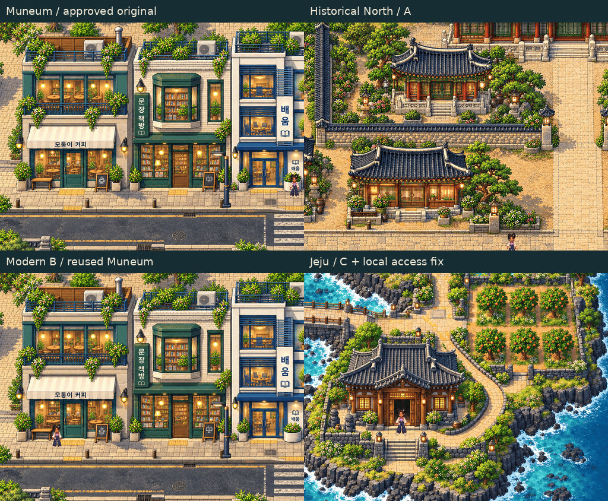
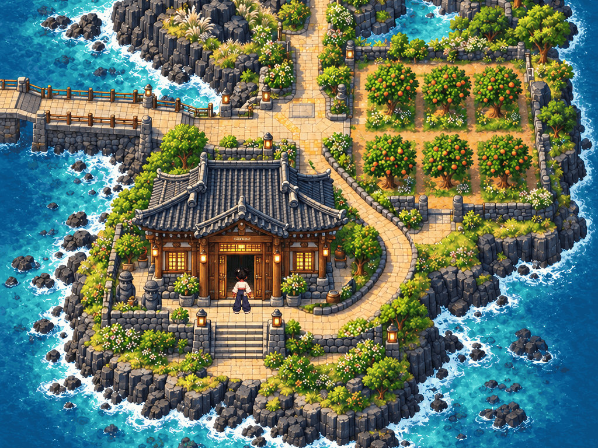
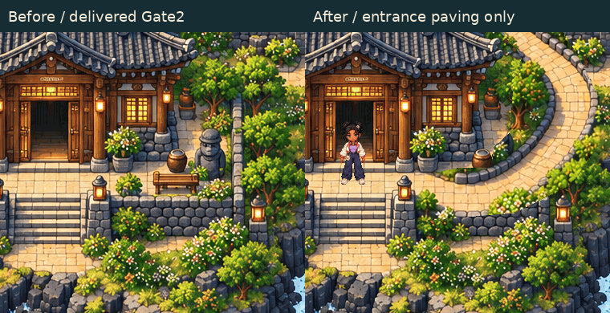

# Gate 2 — accessible final art review

**Human artistic approval is not granted. Gate3 remains locked.** No scene was rebuilt. The only artwork change is the requested localized Jeju pedestrian approach, rendered as a separate masked paving layer with a matching local walk-mask amendment. Original native PNGs, source artwork and the approved Gate1 masterplan are preserved.

## Lightweight review images

All nine JPEG previews below are under550KB each. They are resized/lossy viewing copies; use the lossless native crops below for pixel-quality judgments.

| Review | Lightweight image |
| --- | --- |
| Muneum vs Historical North vs Modern Street vs Jeju | [Comparison board](01_COMPARISON.jpg) |
| Historical-to-modern transition | [Transition](02_TRANSITION.jpg) |
| Railway station beside Juni | [Station](03_STATION_JUNI.jpg) |
| Jeju architecture, terrain and Juni | [Island overview](04_JEJU_TERRAIN_JUNI.jpg) |
| Jeju entrance approach beside Juni | [Gameplay view](05_JEJU_ACCESS_JUNI.jpg) |
| Jeju entrance before/after | [Before/after](06_ACCESS_BEFORE_AFTER.jpg) |
| Larger Jeju reservation before/proposed after | [Reservation overlay](07_JEJU_RESERVATION_OVERLAY.jpg) |
| Bridge and ferry arrival alignment | [Arrival overlay](08_ARRIVAL_ALIGNMENT.jpg) |
| Station10px collision-depth discrepancy | [Station overlay](09_STATION_DEPTH_OVERLAY.jpg) |

The approach now visibly leaves the main island path, follows the house’s east side and turns into the front courtyard/steps. Juni can walk the route continuously and reach the entrance steps. This is an exterior access correction; no interior interaction/gameplay was added. The house silhouette and orchard foreground assets are retained. The model’s full edit output is archived, but only the localized technical mask is admitted into the actual scene; it does not replace the background.

## Original-resolution pixel evidence

Each lossless crop is448×336 at exactly1 image pixel per source/game pixel, with no resampling, palette change or JPEG compression. Open at100% rather than browser “fit.” Each crop is under360KB.

[Muneum](MUNEUM_PIXELS_1X.png) · [Historical A](A_PIXELS_1X.png) · [Modern B](B_PIXELS_1X.png) · [Transition](TRANSITION_PIXELS_1X.png) · [Station/Juni](STATION_PIXELS_1X.png) · [Jeju house/Juni](JEJU_HOUSE_PIXELS_1X.png) · [Jeju basalt terrain](JEJU_TERRAIN_PIXELS_1X.png).

Updated actual Phaser captures: [full native1024×1536](JEJU_ACCESS_NATIVE_1X.png), [native gameplay1024×768](JEJU_ACCESS_GAMEPLAY_1X.png). These larger source-evidence files intentionally exceed1MB; the lightweight copies and crops avoid that download for initial inspection. The gameplay crop follows actual keyboard traversal; the full native overview uses disclosed QA placement at the same entrance for framing.

Original delivered PNGs remain unchanged: [A](../A_NATIVE_1X.png), [B](../B_NATIVE_1X.png), [C before access fix](../C_NATIVE_1X.png), [transition](../TRANSITION_NATIVE_1X.png), [station](../STATION_NATIVE_1X.png). Earlier videos/packages document the prior delivery and predate this local entrance amendment.

## Originality, fit and feasibility

[Read the concise assessment and unresolved PASS/FAIL table](FEASIBILITY_AND_OPEN_ITEMS.md).

**Slice B contains no newly authored commercial building artwork.** Its four buildings and streetscape reuse Muneum. New shared technical work and the separate station study do not demonstrate original southern commercial-building production. A future production method is described only; no Gate3 art or integration has begun.

The spatial overlays compare approved data with proposals only. Jeju’s larger reservation and arrival realignment, and the station’s10px discrepancy, are unresolved. No proposed after-state is applied to the masterplan.

[File sizes / hashes / decoded-memory inventory](review-files.json) · [native-source preservation and exact-crop verification](verification.json) · [actual-input entrance QA](access-qa.json) · [local amendment and provenance](../../../assets-src/gate2/access-fix/amendment.json).

**STOP: awaiting explicit human artistic review. Gate3, merge, deployment and protected-checkpoint alteration remain prohibited.**
