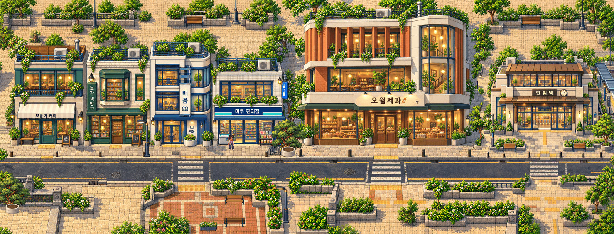
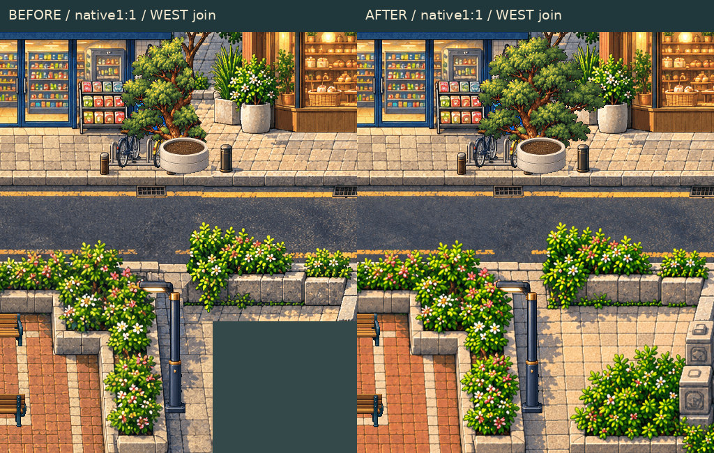
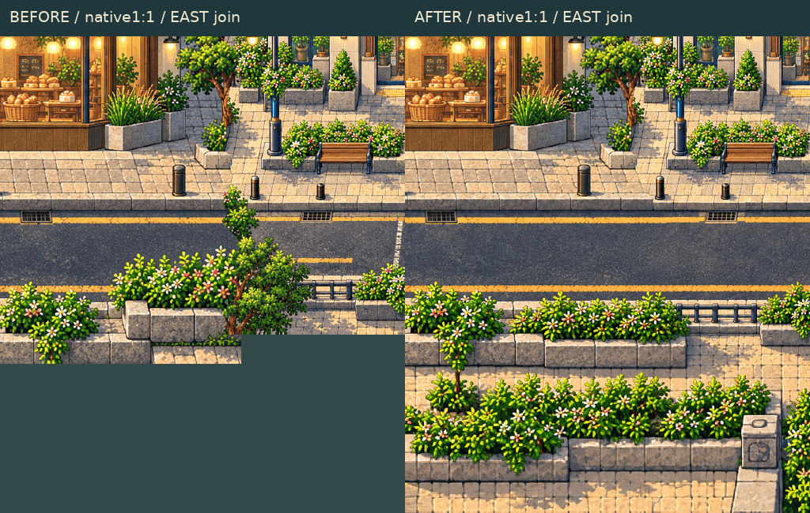
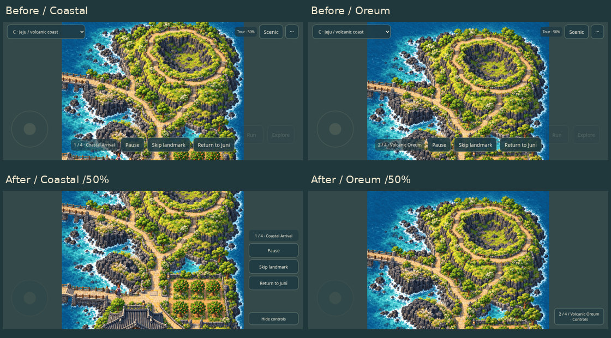

# Gate2.5 final visual polish — approval requested

Localized district terrain/seam continuation and existing Jeju tour polish only. Gate3 remains locked; no full-world generation, main merge, public deployment or separate-app change.

[**Single updated playable ZIP**](GATE25_POLISH_PLAYABLE.zip) · [actual district crossing video](DISTRICT_CROSSINGS.mp4) · [actual Jeju tour video](JEJU_TOUR.mp4) · [PASS/FAIL/NOT TESTED](REPORT.md) · [concise phone checklist/export workflow](MOBILE_CHECKLIST.md).

Extract, run `python3 start.py`, open the printed URL. The default is **Polished district**. Choose **C Jeju → Scenic → Start Tour** for cinematic review. For private physical-phone testing on the same trusted Wi-Fi, use `python3 start.py --lan` and substitute the computer's LAN IP. No public deployment.

## District — missing terrain completed at native scale

[Before native3184×1214](BEFORE_NATIVE_1X.png) · [after native3184×1214](AFTER_NATIVE_1X.png) · [before lightweight view](BEFORE_NATIVE_1X_REVIEW.jpg).

Missing upper rear-courtyard and lower garden/pavement areas now continue the existing environment. Approved facade/door pixels and established building/player/entrance coordinates are unchanged. Runtime remains3 independently loaded native1:1 chunks; the full PNG is an evidence export, not a monolithic runtime background.

## Both joins — native before/after

[West before lossless1:1 crop](WEST_BEFORE_CROP_1X.png) · [west after lossless1:1 crop](WEST_AFTER_CROP_1X.png).

The original west tree and planter are whole again at their original coordinates:6,764 tree-alpha pixels and13 planter-alpha pixels were restored. Original bikes, lamps and other foreground sprites are retained whole. The lower stone garden border, flower beds, pavement transition and road-edge treatment are locally finished. Ground-contact collision covers the complete restored supports.

[East before lossless1:1 crop](EAST_BEFORE_CROP_1X.png) · [east after lossless1:1 crop](EAST_AFTER_CROP_1X.png).

The sliced painted foreground tree that protruded across the road is replaced locally with a complete low bounded planter/flowers. The existing upright tree beside the buildings, lamp, bench, facade and doors stay in place. Curb/road paint, lower stone edges and planted borders continue across the join. No oversized tree or arbitrary prop conceals it.

[Actual bidirectional crossing/route QA](browser-qa.json) · [foreground restoration inventory](foreground-restoration.json) · [local edit masks and facade proof](art-preservation.json) · [new-art/source provenance](../../assets-src/gate25-polish/provenance.json) · [retained-source hashes](preservation.json).

## Jeju — distinct compositions and quiet controls

[Coastal arrival PNG](TOUR_1.png) · [oreum PNG](TOUR_2.png) · [orchard PNG](TOUR_3.png) · [house PNG](TOUR_4.png) · [collapsed controls PNG](TOUR_COLLAPSED.png) · [expanded controls PNG](TOUR_EXPANDED.png) · [740×360 landscape PNG](UX_740x360.png).

All four stops stay at50%. At844×390 the coastal view starts at sourceY260; oreum starts atY0, a260px separation instead of the earlier45px. Coast prioritizes bridge/basalt/arrival paths; oreum prioritizes the crater and rim. Jeju artwork/entrance and Juni are unchanged.

Controls use the side gutters when space permits and collapse after2.4s inactivity. The small landmark-labelled **Controls** button remains visible; tap it or the scene to restore the toolbar. Pause/Resume, Skip and Return stay reachable. Keyboard focus keeps controls open; reduced motion keeps static selections and disables automatic collapse. Paused tour supports manual drag/pinch. Joystick isolation and cancellation remain intact.

## Approval checkpoint

Automated/emulated behavior and packaging are checked separately from visual and mobile acceptance. Physical Android Chrome/iPhone Safari remain **NOT TESTED**; the existing long-session handoff is retained with a concise checklist/export workflow. Native PNGs are original-resolution Phaser exports/crops; JPEGs are lossy review copies and video is actual timestamped gameplay.

**Please explicitly approve or reject this Gate2.5 polish after reviewing the two joins and cinematic tour. We stop here. Gate3 remains locked.**
