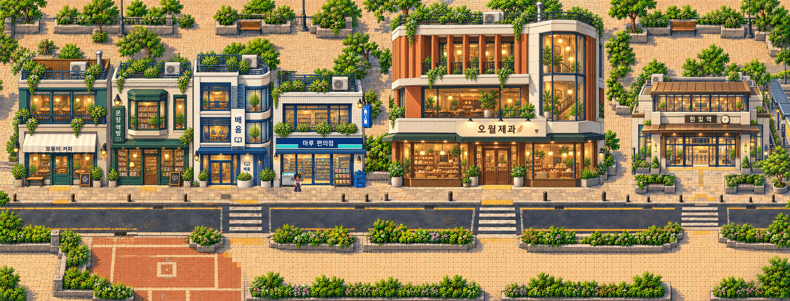

# Gate2.5 — reconstructed district for human review

**Previous polish: REJECTED. This candidate: awaiting explicit human artistic review. Gate3 LOCKED.**

Only the existing district environment was reconstructed. Muneum, 오월제과 bakery and station architecture, Juni, entrances, coordinates, northern Korea, Jeju and camera/tour source remain protected. [Concise report / unresolved checks](REPORT.md) · [Separate visual inspection](VISUAL_INSPECTION.md) · [User directive](../current/GATE25_RECONSTRUCTION_DIRECTIVE.md).

[Original actual Phaser screenshot:3184×1214, 1:1](AFTER_NATIVE_1X.png) · [Rejected before at1:1](BEFORE_NATIVE_1X.png). The image above is reduced for accessibility; native PNGs are unmodified exports.

## Both joins, full height

| Join | Matching before/after review | Native AFTER | Native BEFORE |
| --- | --- | --- | --- |
| West · X1512 | [Full-height comparison](WEST_FULL_HEIGHT_BEFORE_AFTER.jpg) | [640×1214](WEST_FULL_HEIGHT_AFTER_1X.png) | [640×1214](WEST_FULL_HEIGHT_BEFORE_1X.png) |
| East · X2488 | [Full-height comparison](EAST_FULL_HEIGHT_BEFORE_AFTER.jpg) | [640×1214](EAST_FULL_HEIGHT_AFTER_1X.png) | [640×1214](EAST_FULL_HEIGHT_BEFORE_1X.png) |

All crops below are from actual in-engine exports. The comparison panels retain native1:1 pixel dimensions; browser display may scale them, so download/open at100% for pixel review.

| Band | West comparison / native after / native before | East comparison / native after / native before |
| --- | --- | --- |
| Upper · Y0–400 | [Compare](WEST_UPPER_BEFORE_AFTER.jpg) · [After](WEST_UPPER_AFTER_1X.png) · [Before](WEST_UPPER_BEFORE_1X.png) | [Compare](EAST_UPPER_BEFORE_AFTER.jpg) · [After](EAST_UPPER_AFTER_1X.png) · [Before](EAST_UPPER_BEFORE_1X.png) |
| Middle · Y400–850 | [Compare](WEST_MIDDLE_BEFORE_AFTER.jpg) · [After](WEST_MIDDLE_AFTER_1X.png) · [Before](WEST_MIDDLE_BEFORE_1X.png) | [Compare](EAST_MIDDLE_BEFORE_AFTER.jpg) · [After](EAST_MIDDLE_AFTER_1X.png) · [Before](EAST_MIDDLE_BEFORE_1X.png) |
| Lower · Y850–1214 | [Compare](WEST_LOWER_BEFORE_AFTER.jpg) · [After](WEST_LOWER_AFTER_1X.png) · [Before](WEST_LOWER_BEFORE_1X.png) | [Compare](EAST_LOWER_BEFORE_AFTER.jpg) · [After](EAST_LOWER_AFTER_1X.png) · [Before](EAST_LOWER_BEFORE_1X.png) |

[Annotated 11-defect diagnosis](SEAM_DEFECT_MAP.jpg) · [Severity/correction list](diagnosis.json) · [Final protected architectural image](PROTECTED_ARCHITECTURE.jpg) · [Exact final mask](../../assets-src/gate25-reconstruction/architecture-protection-final.png).

## Play and watch

**[Download the single updated playable ZIP](GATE25_RECONSTRUCTION_PLAYABLE.zip)**. Extract; run `python3 start.py`; open the printed local URL. Select **CURRENT · reconstruction / review pending**. For a real phone on trusted Wi-Fi, use `python3 start.py --lan` and your computer's LAN IP. Nothing is publicly deployed.

| Evidence | Actual capture |
| --- | --- |
| Both joins, full-height1× camera | [Mouse-drag pan video](NATIVE_CAMERA_PAN.mp4) · [view coverage / source](camera-pan.json) |
| Landscape play crossing both joins | [Walk video](DISTRICT_CROSSINGS.mp4) · [West screenshot](PLAYER_1552.png) · [East screenshot](PLAYER_2548.png) · [Station/Juni](PLAYER_2824.png) |
| Foreground sorting and collision | [Above pole](FOREGROUND_ABOVE.png) · [Below pole](FOREGROUND_BELOW.png) · [real-input receipt](foreground-qa.json) |
| Preserved four-stop Jeju tour | [Actual tour video](JEJU_TOUR.mp4) · [Coast](TOUR_1_REVIEW.jpg) · [Oreum](TOUR_2_REVIEW.jpg) · [Orchard](TOUR_3_REVIEW.jpg) · [House](TOUR_4_REVIEW.jpg) |
| Quiet mobile controls | [Collapsed](TOUR_COLLAPSED_REVIEW.jpg) · [Expanded](TOUR_EXPANDED_REVIEW.jpg) |

Walk/tour captures use Chromium mobile-layout emulation, **not physical-device evidence**. The camera pan uses desktop normal entry at1×, with two vertical bands covering all1214pixels. No invisible seam overlay, debug layer, player teleport or expanded prop conceals a join.

## Verification and remaining decisions

[Browser QA](browser-qa.json) · [Source/collision proof](source-and-collision.json) · [Immutable-input hashes](protected-before.json) · [Preservation](preservation.json) · [Native crop/ownership checks](evidence-checks.json) · [Package integrity](package.json) · [Extracted package QA](package-qa.json) · [Art/source provenance](../../assets-src/gate25-reconstruction/provenance.json).

Technical checks PASS; previous artistic candidate FAIL/rejected. This candidate's A–F artistic acceptance, independent human inspection and physical Android/iPhone acceptance are **NOT TESTED / pending**. This author's separate inspection is documented honestly; no independent reviewer was invented. The new background uses nearest finishing and deserves native pixel-cadence review against retained facades.

[Real-device checklist and JSON export workflow](MOBILE_CHECKLIST.md) · [Retained Android/iPhone procedure](../gate25/DEVICE_TESTING.md).

**Please explicitly review the two joins and approve or reject this candidate artistically. STOP: no Gate3, world expansion, merge or deployment.**
