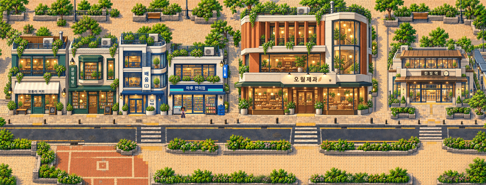

> **Update: human-approved district visual prototype.** [Approval](../current/GATE25_REFINEMENT_APPROVAL.md) · [Checkpoint and device-review handoff](../gate25-device-review/README.md). Approval covers this prototype's artistic refinement only. Physical Android Chrome/iPhone Safari NOT TESTED; Gate3 LOCKED. The report below records the pre-approval capture-time state.

# Final district composition refinement — awaiting human visual approval

Two purposeful pedestrian passages and four subtle planting accents; approved architecture, Juni, scale and major coordinates retained. **Gate3 LOCKED.** [Report and QA](REPORT.md) · [Authorized scope](../current/GATE25_COMPOSITION_DIRECTIVE.md).

**[Final unannotated native1:1 Phaser screenshot —3184×1214](AFTER_NATIVE_1X.png)** · [Before native](BEFORE_NATIVE_1X.png). The preview above is reduced; original native PNGs are retained unchanged.

| Required detail | Native screenshot | Before/after review |
| --- | --- | --- |
| Muneum → Bakery pedestrian alley | [West close-up,500×780 at1:1](WEST_AFTER_CLOSEUP_1X.png) | [Comparison](WEST_BEFORE_AFTER.jpg) |
| Bakery → Station garden connector | [East close-up,500×780 at1:1](EAST_AFTER_CLOSEUP_1X.png) | [Comparison](EAST_BEFORE_AFTER.jpg) |
| Four lower planting accents | Visible in full native screenshot | [Native pocket comparison](PLANTING_BEFORE_AFTER.jpg) |

## Actual gameplay

- **[Both district joins, both directions, station entrance approach — video](DISTRICT_TRAVERSAL.mp4)**.
- **[Both pedestrian passages and return trips — video](PEDESTRIAN_PASSAGES.mp4)**. Inside the passages Juni uses normal walking; no teleport, speed override or sprite resizing.
- [West passage / Juni](WEST_PASSAGE_500_REVIEW.jpg) · [West rear approach](WEST_PASSAGE_180_REVIEW.jpg) · [Station connector / Juni](EAST_PASSAGE_500_REVIEW.jpg) · [Station rear approach](EAST_PASSAGE_300_REVIEW.jpg).

These are actual Phaser captures in Chromium with mobile landscape layout. They do not certify a physical Android/iPhone. [Raw movement/camera evidence](browser-qa.json).

## Playable review

[Download the updated playable ZIP](GATE25_COMPOSITION_PLAYABLE.zip). Extract; run `python3 start.py`; open its printed local URL. Choose **CURRENT · final composition / approval pending**. Normal WASD/arrows and mobile joystick remain available. Historical scenes remain recoverable.

For a physical phone on trusted Wi-Fi use `python3 start.py --lan`. The retained [mobile checklist](../gate25-polish/MOBILE_CHECKLIST.md) and [Android/iPhone procedure](../gate25/DEVICE_TESTING.md) apply; use the current composition scene, then **Options(···) → Export test report**. Attach actual device model, OS/browser and recorded device evidence. No public deployment.

[Protected pixels and local edit proof](asset-proof.json) · [Source preservation](preservation.json) · [Native crop verification](evidence-checks.json) · [Art/source provenance](../../assets-src/gate25-refinement/provenance.json) · [ZIP manifest/CRC](package.json) · [Extracted runtime QA](package-qa.json) · [Published file verification](published-verification.json).

Technical checks PASS. Human artistic acceptance and physical-device acceptance remain **NOT TESTED / pending**. Please explicitly approve or reject this final composition before further work. **STOP: no Gate3, merge or deployment.**
