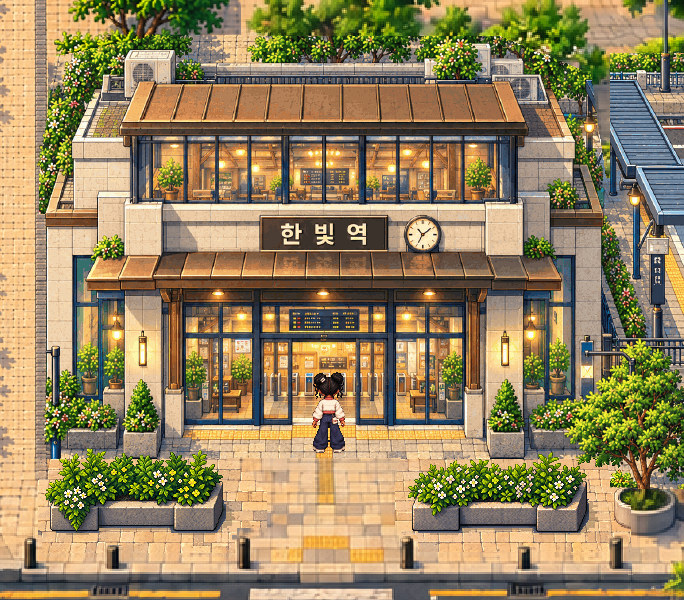

# Two station planters — repair candidate for human inspection

**Latest Gate2.5 decision: NOT fully approved. Gate3 LOCKED.** Only the two low station planters and associated local floor/shadow/foot reservations were repaired. [Diagnosis and QA](REPORT.md) · [User directive](../current/GATE25_PLANTER_DEFECT.md).

[Original native frontage PNG with Juni](STATION_FRONTAGE_WITH_JUNI_1X.png) · **[Unannotated full district Phaser screenshot,3184×1214 at1:1](AFTER_NATIVE_1X.png)** · [Before full native](BEFORE_NATIVE_1X.png).

## Both planters before / after

| Object | Clearly enlarged lossless comparison | Native original crops | Lightweight comparison |
| --- | --- | --- | --- |
| Left | [Nearest2× PNG](LEFT_BEFORE_AFTER_2X.png) | [Before1×](LEFT_BEFORE_1X.png) · [After1×](LEFT_AFTER_1X.png) | [JPEG](LEFT_BEFORE_AFTER_REVIEW.jpg) |
| Right | [Nearest2× PNG](RIGHT_BEFORE_AFTER_2X.png) | [Before1×](RIGHT_BEFORE_1X.png) · [After1×](RIGHT_AFTER_1X.png) | [JPEG](RIGHT_BEFORE_AFTER_REVIEW.jpg) |

Native crops contain actual exported Phaser pixels. Review JPEGs are for accessibility; use PNGs at100% for pixel quality. [Original Muneum source craft reference](../../assets-src/gate25-station-planters/muneum-native-reference.png) · [Original station source detail](../../assets-src/gate25-station-planters/station-native-craft-reference.png) · [Corrected native sprites on light/dark backgrounds, nearest2×](ALPHA_LIGHT_DARK_2X.png). Reference/sprite boards are labeled source diagnostics, not gameplay.

## Actual gameplay and geometry

[Recorded station traversal and both planter collision checks](STATION_GAMEPLAY.mp4) · [Juni behind left](BEHIND_LEFT.png) · [Juni behind right](BEHIND_RIGHT.png) · [Normal station gameplay](STATION_WITH_JUNI_GAMEPLAY.png).

[Actual input trace/state](browser-qa.json) · [Foot solids,89px entrance strip and unchanged coordinates](asset-proof.json) · [Rendered RGB equality, alpha and sampling receipts](sampling-and-alpha.json) · [Original-asset preservation](preservation.json). Existing Juni movement silhouettes remain at native scale and fit the preserved strip; no avatar resizing.

The video is actual normal-input Phaser play in desktop Chromium using mobile landscape layout; physical Android Chrome/iPhone Safari remain **NOT TESTED**.

## Playable review

[Download the updated review ZIP](GATE25_STATION_PLANTERS_REVIEW.zip). Extract, run `python3 start.py`, then open the printed local URL. Current scene: `district-planter-repair`. No public deployment. On a private LAN use `python3 start.py --lan` and your computer's LAN IP.

This package reuses the existing compiled application; only the scene catalog and five new scene assets/data files are applied. Earlier checkpoints, artwork and packages remain unchanged. [Package integrity](package.json) · [Extracted package smoke check](package-qa.json) · [Source provenance](../../assets-src/gate25-station-planters/provenance.json).

Technical evidence is supplied separately from artistic judgment. **Planter craftsmanship and integration await direct human approval; the task is not marked artistically PASS.** Please inspect both native objects and the full frontage before approving. **STOP: Gate3, full-world generation, main merge and deployment stay locked.**
