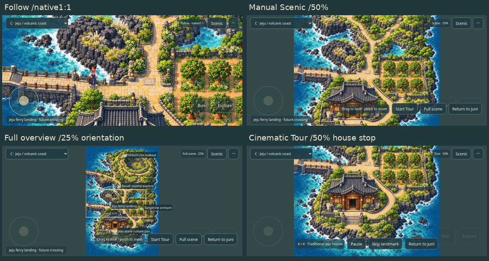
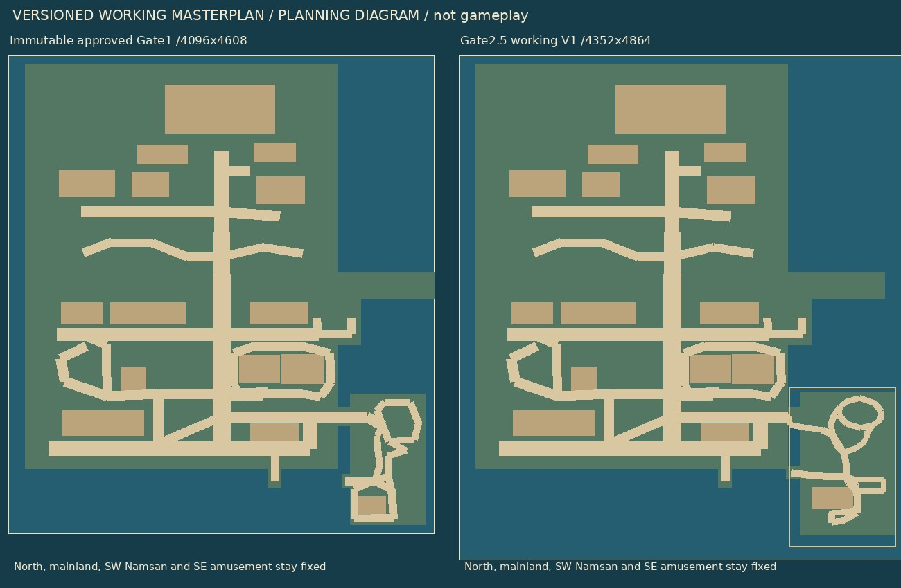
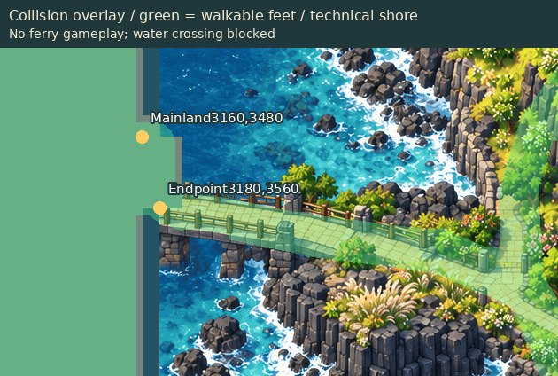
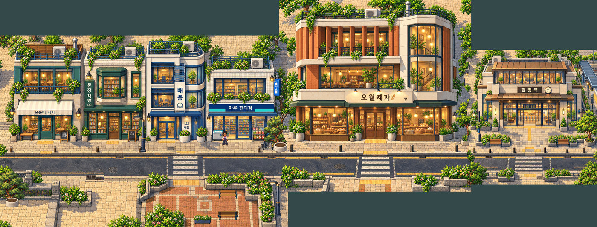

# Gate2.5 — cinematic mobile and integration validation

The existing artistic foundation and localized Jeju enlargement are approved for validation. No source artwork, Juni atlas or Gate1 checkpoint was replaced. No new art was generated. **Gate3 remains locked.**

[Playable ZIP](GATE25_PLAYABLE.zip) · [Jeju Tour video](JEJU_TOUR.mp4) · [district walking video](DISTRICT_WALK.mp4) · [bridge crossing video](JEJU_BRIDGE.mp4) · [PASS/FAIL/NOT TESTED report](REPORT.md) · [physical-device handoff](DEVICE_TESTING.md).

Extract, run `python3 start.py`, open the printed localhost URL. For a real phone on the same trusted Wi-Fi use `python3 start.py --lan` and the computer's LAN IP. This is a private test server, not a public deployment.

## Cinematic Jeju tour

C Jeju → **Scenic → Start Tour**. Coast→oreum→orchard→traditional house. Each stop uses50% nearest sampling,2s eased travel and2.1s pause; framing clamps to native source bounds/aspect ratio. Juni stays at the actual gameplay position. No tall-world squeeze or artwork distortion.

Pause/Resume, Skip landmark and Return to Juni are visible during the tour. Paused tours accept manual drag/pinch; Resume restores the authored50% framing. Movement intent cancels automatic control. Reduced motion uses static landmark selection. Follow remains native1:1, Scenic remains manual and Full scene remains a labelled orientation overview. Only one additional short Muneum demo is provided to prove reuse.

[Coastal stop](TOUR_1_REVIEW.jpg) · [oreum](TOUR_2_REVIEW.jpg) · [orchard](TOUR_3_REVIEW.jpg) · [house/accepted entrance](TOUR_4_REVIEW.jpg) · [Muneum demo](MUNEUM_TOUR_REVIEW.jpg) · [original screenshot PNGs](review-images.json). The manual Scenic comparison uses an actual two-finger pinch to50%.

## Approved Jeju working amendment

[Working masterplan V1](../../assets-src/gate25/world-plan-v1.json) adopts4352×4864 and native Jeju1024×1536 at[3180,3200]. Original Gate1 stays immutable; northern/mainland landmarks, southwest Namsan, southeast amusement, station reservations and the accepted house entrance remain intact.

[Ferry alignment/collision](FERRY_COLLISION.jpg) · [native actual Phaser proof](JEJU25_NATIVE_1X.png) · [lightweight gameplay review](JEJU25_NATIVE_1X_REVIEW.jpg) · [geometry/preservation checks](plan-and-preservation.json).

The mainland[3160,3480] connects to the native bridge endpoint[3180,3560]. Both boarding areas connect to land: mainland[2560,4100], island[3180,4020]. Actual player traversal is recorded. Pedestrian sea crossing is blocked. Shore/connector graybox is technical geometry, explicitly not final bridge artwork. No ferry/train gameplay exists.

## Three-source playable district

[Full native3184×1214 with Juni](DISTRICT_NATIVE_1X.png) · [Juni beside bakery, native camera](DISTRICT_1998.png) · [Juni at station](DISTRICT_2824.png) · [first join1:1](MUNEUM_BAKERY_CROP_1X.png) / [nearest2×](MUNEUM_BAKERY_2X.png) · [second join1:1](BAKERY_STATION_CROP_1X.png) / [nearest2×](BAKERY_STATION_2X.png).

Muneum1536×1024 at[0,190], original bakery1024×1024 at[1488,0], station720×720 at[2464,267]. All source RGB and dimensions remain exact; overlaps use binary ownership only. The station is registered13px north of the initial trial to align its upper asphalt line with the bakery. No architecture is resized and no decorative object hides the joins.

Grounds remain three independent textures. Initial Muneum+bakery load is followed by adjacent station prefetch, then a bounded three-texture cache avoids repeated decoding. Overview waits for its required chunks. Movement is gated from any chunk not ready. Foreground ownership and translated Y-sort are retained. This is a small bounded prototype, not general full-world streaming.

**Unpainted upper/lower source margins remain visible outside the native image envelopes.** They are blocked technical boundaries. Sidewalk paving patterns and road markings are not yet a production modular kit. See the exact limitations/localized proposals in the report rather than interpreting technical traversal as final seamless-world approval.

## Verification and stop

[Main browser/route/video results](browser-qa.json) · [mode/cache/touch/ratio/depth checks](modes-qa.json) · [nearest pixel samples](zoom-probes.json) · [source/collision checks](collision-source-report.json) · [physical availability](physical-devices.json) · [exported emulated session](emulated-session-export.json).

Native PNGs are untouched exports/crops; lightweight JPEGs are review derivatives. Video is actual normal-entry Phaser/CDP recording with real input and retained timestamps, not static artwork or a QA teleport sequence. Explicit QA placements are confined to the labelled occlusion diagnostic.

[Published-file verification](published-verification.json):54 remote review files match SHA-256; images decode; playable ZIP CRC/manifest pass; main, approved planning branch and checkpoint remain intact.

**STOP. Physical Android/iPhone acceptance is NOT TESTED; human cinematic/visual/UX approval is pending. No Gate3, whole-world production, main merge or public deployment.**
