# Final surgical native review

**Human visual acceptance pending.** Main retains old station; new station is isolated. No main merge/deployment. All previews<1MB, native originals untouched. No missing-reviewer-image dependency in this self-contained directive.

[Playable ZIP](G3D_FINAL_SURGICAL_REVIEW.zip) · [QA](QA.md) · [Source/scope](out-of-scope-audit.json) · [Farm metadata](FARM_PLOTS.json) · [Actual movement video](world-traversal-review.mp4)

## Approved craftsmanship / native1x detail comparison

Original Muneum and Gate2.5 references beside current isolated station and same historical house. This does not grant artistic approval.

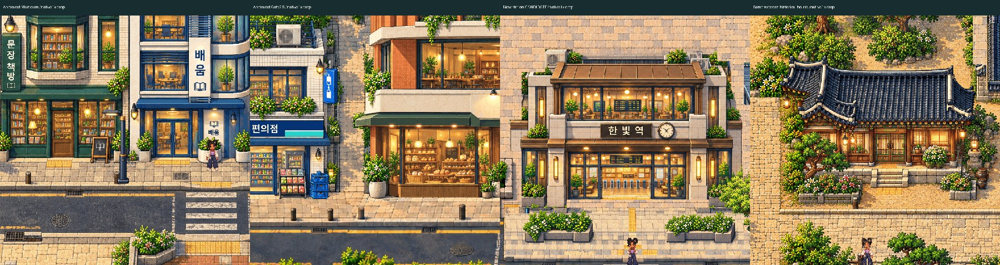

[Original native1x board](craftsmanship-native-board.png)

## farm / final MAIN retains old station

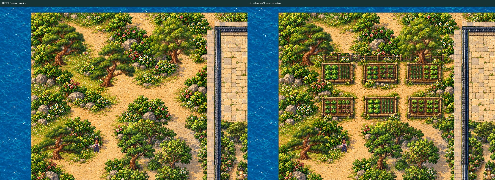

[Original BEFORE](farm-before-native.png) · [Original candidate](farm-after-native.png)

## western-house / final MAIN retains old station

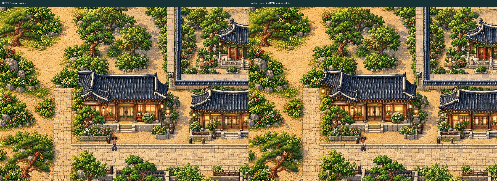

[Original BEFORE](western-house-before-native.png) · [Original candidate](western-house-after-native.png)

## western-courtyard / final MAIN retains old station

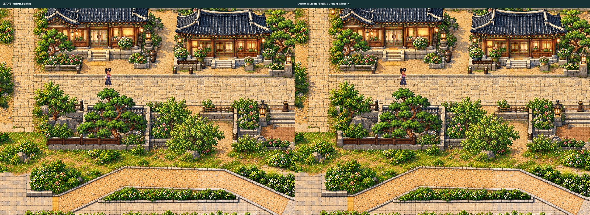

[Original BEFORE](western-courtyard-before-native.png) · [Original candidate](western-courtyard-after-native.png)

## house-court / final MAIN retains old station

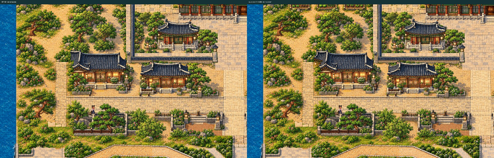

[Original BEFORE](house-court-before-native.png) · [Original candidate](house-court-after-native.png)

## station-precinct / final MAIN retains old station

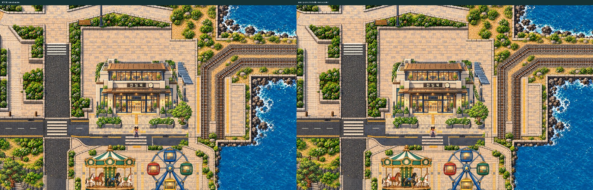

[Original BEFORE](station-precinct-before-native.png) · [Original candidate](station-precinct-after-native.png)

## station-upper / final MAIN retains old station

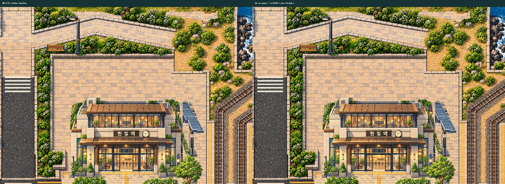

[Original BEFORE](station-upper-before-native.png) · [Original candidate](station-upper-after-native.png)

## station-front / final MAIN retains old station

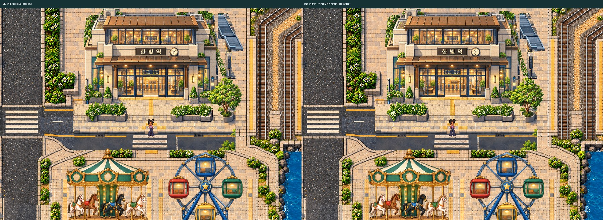

[Original BEFORE](station-front-before-native.png) · [Original candidate](station-front-after-native.png)

## station-right / final MAIN retains old station

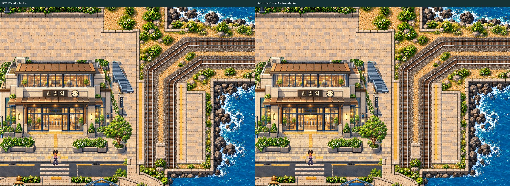

[Original BEFORE](station-right-before-native.png) · [Original candidate](station-right-after-native.png)

## bridge-mainland / final MAIN retains old station

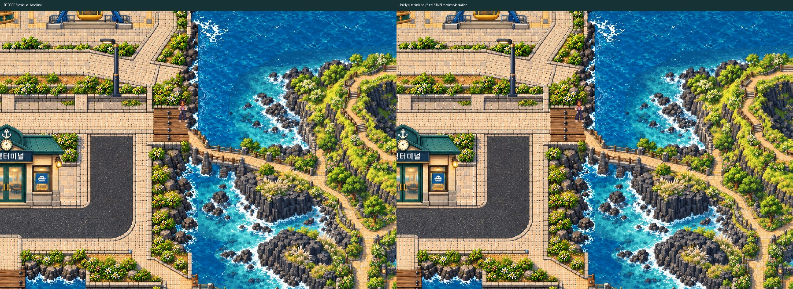

[Original BEFORE](bridge-mainland-before-native.png) · [Original candidate](bridge-mainland-after-native.png)

## bridge-island / final MAIN retains old station

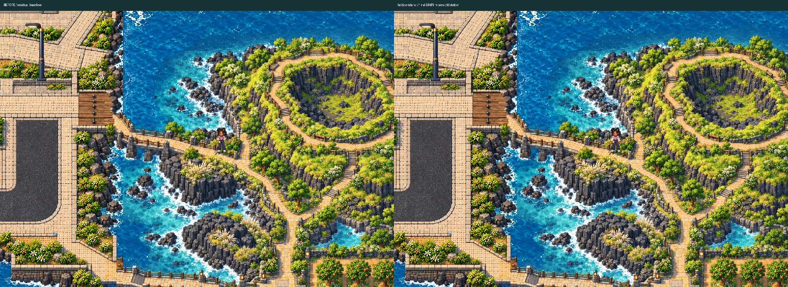

[Original BEFORE](bridge-island-before-native.png) · [Original candidate](bridge-island-after-native.png)

## bridge-full / final MAIN retains old station

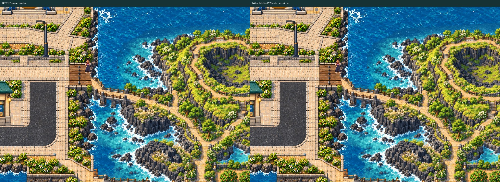

[Original BEFORE](bridge-full-before-native.png) · [Original candidate](bridge-full-after-native.png)

## coast-middle / final MAIN retains old station

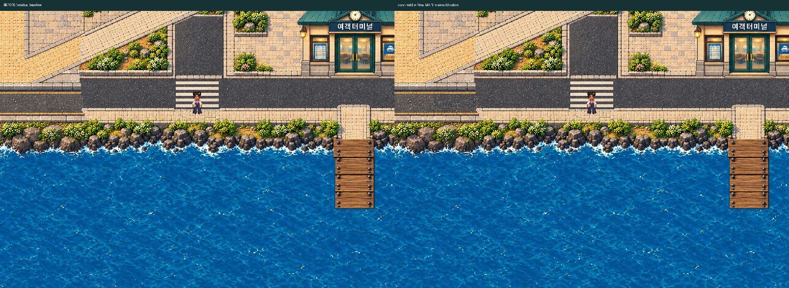

[Original BEFORE](coast-middle-before-native.png) · [Original candidate](coast-middle-after-native.png)

## palace-entrance / final MAIN retains old station

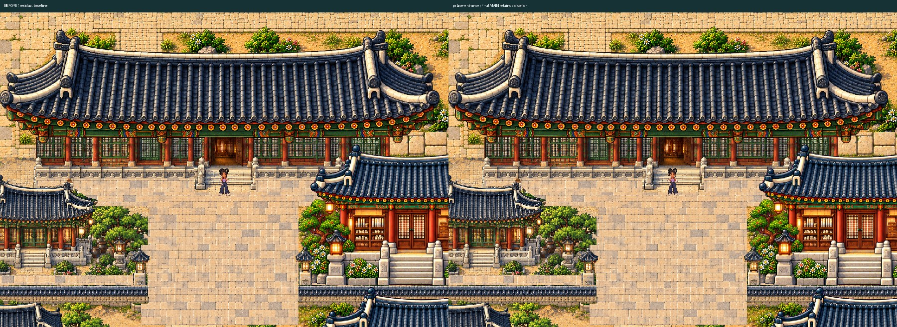

[Original BEFORE](palace-entrance-before-native.png) · [Original candidate](palace-entrance-after-native.png)

## retail-block / final MAIN retains old station

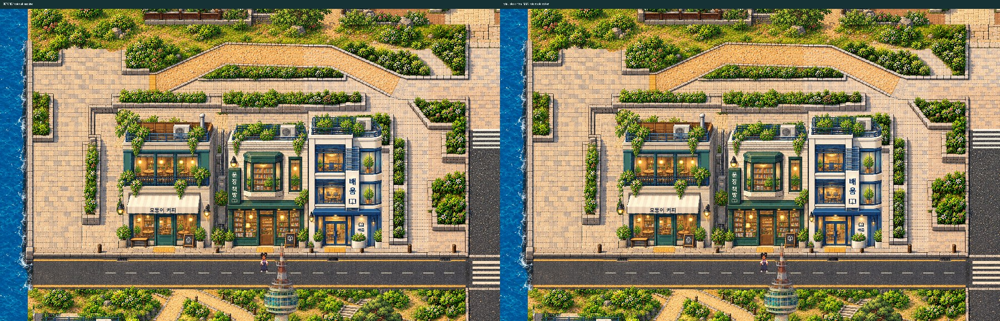

[Original BEFORE](retail-block-before-native.png) · [Original candidate](retail-block-after-native.png)

## station-precinct / NEW candidate NOT ADOPTED

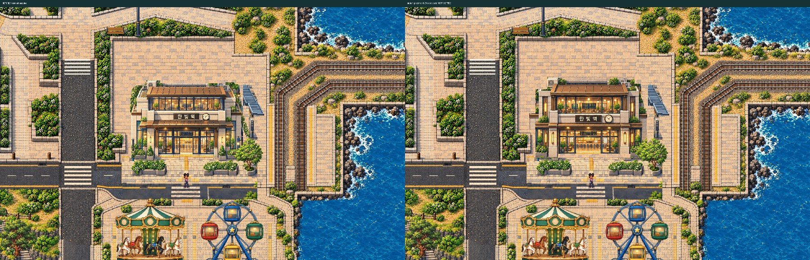

[Original BEFORE](station-precinct-before-native.png) · [Original candidate](station-precinct-station-candidate-native.png)

## station-upper / NEW candidate NOT ADOPTED

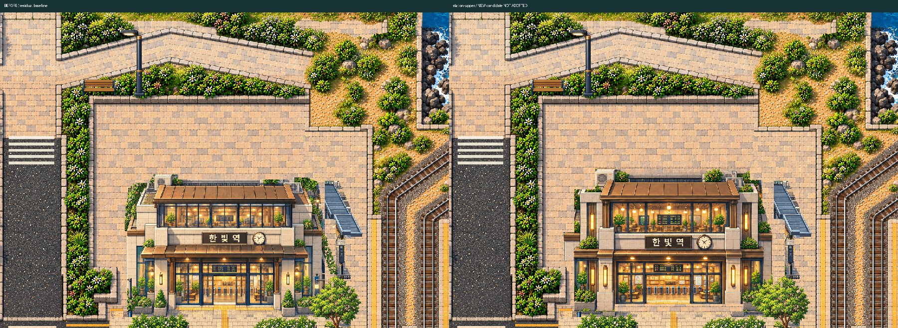

[Original BEFORE](station-upper-before-native.png) · [Original candidate](station-upper-station-candidate-native.png)

## station-front / NEW candidate NOT ADOPTED

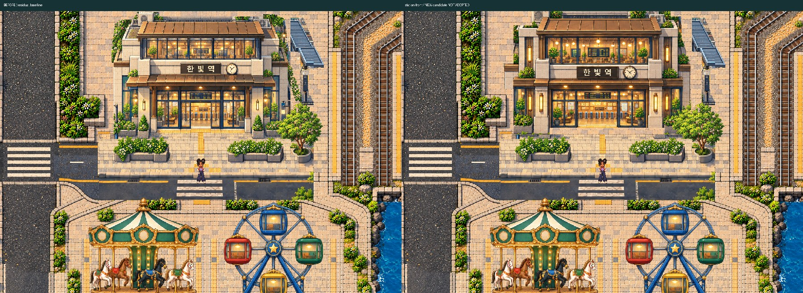

[Original BEFORE](station-front-before-native.png) · [Original candidate](station-front-station-candidate-native.png)

## station-right / NEW candidate NOT ADOPTED

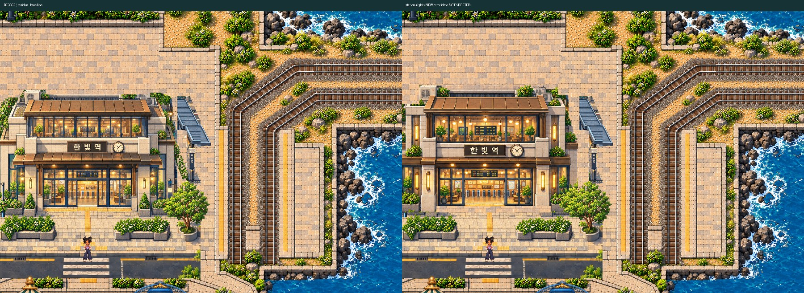

[Original BEFORE](station-right-before-native.png) · [Original candidate](station-right-station-candidate-native.png)

## AFTER MAIN / overview context only

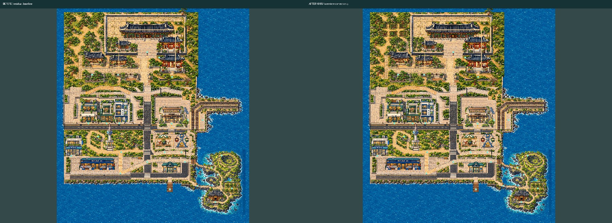

[Original BEFORE](world-before-overview-phaser.png) · [Original candidate](world-after-overview-phaser.png)

## NEW STATION candidate / overview context only

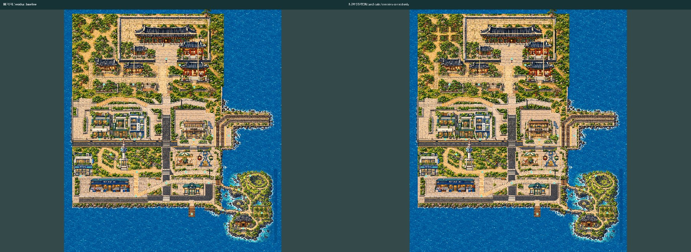

[Original BEFORE](world-before-overview-phaser.png) · [Original candidate](world-station-candidate-overview-phaser.png)

## Ground stage: no OLD or NEW architecture, canonical props retained

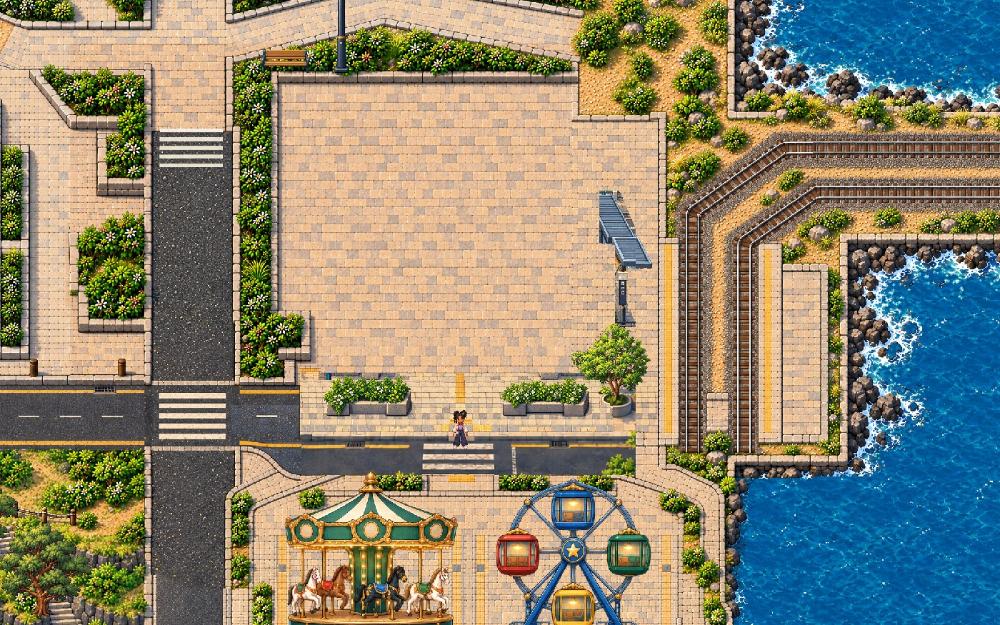

## Source roof / upper architecture / facade owners, NOT gameplay

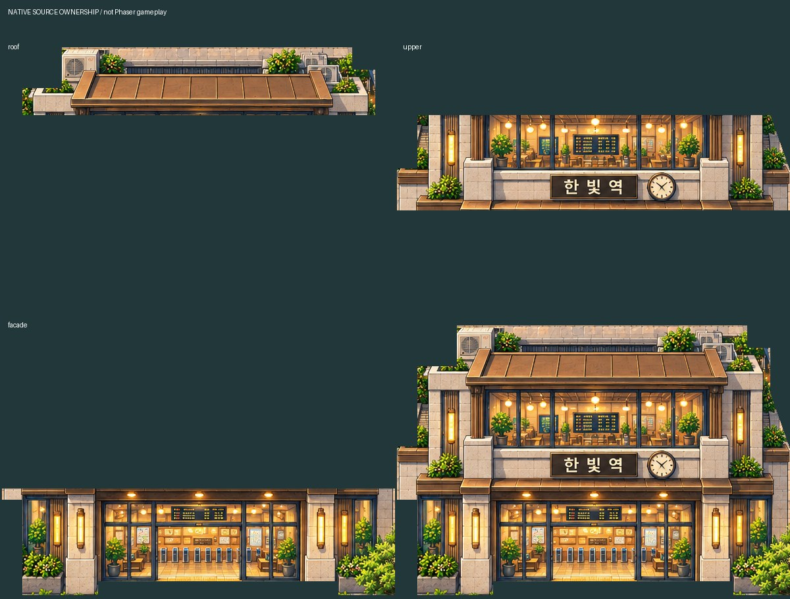

## Six plot reservations and interaction anchors: diagnostic overlay

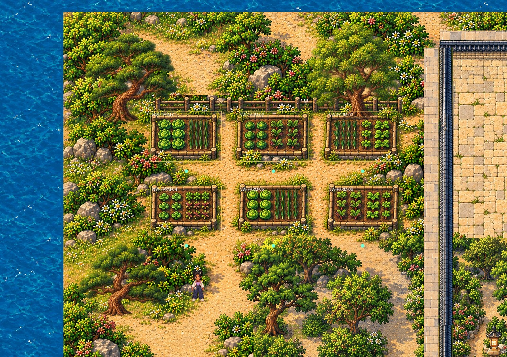

## Actual native stop/turn evidence

Red diagnostic dots indicate unsupported projected native foot-contact pixels. These are real observed poses, not manually selected sprite frames. Bridge complete contact remains FAIL.

**pose-01-complete-bridge-to-jeju-turn-native /turn-1 /NO_FAILURE_IN_CAPTURED_POSE_ONLY**

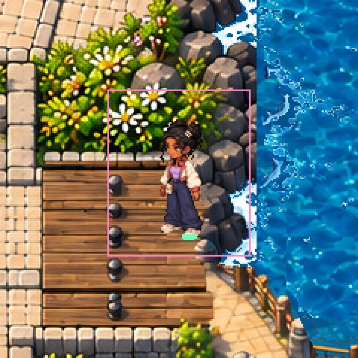

[Clean native1x](pose-01-complete-bridge-to-jeju-turn-native-crop-1x.png) · [Native contact overlay](pose-01-complete-bridge-to-jeju-turn-native-contact-crop-1x.png)

**pose-02-complete-bridge-to-jeju-stop-native /stop-front-0 /NO_FAILURE_IN_CAPTURED_POSE_ONLY**

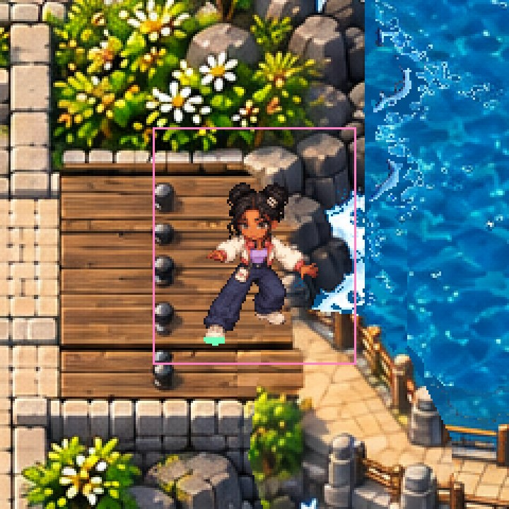

[Clean native1x](pose-02-complete-bridge-to-jeju-stop-native-crop-1x.png) · [Native contact overlay](pose-02-complete-bridge-to-jeju-stop-native-contact-crop-1x.png)

**pose-03-complete-bridge-to-jeju-turn-native /turn-5 /NO_FAILURE_IN_CAPTURED_POSE_ONLY**

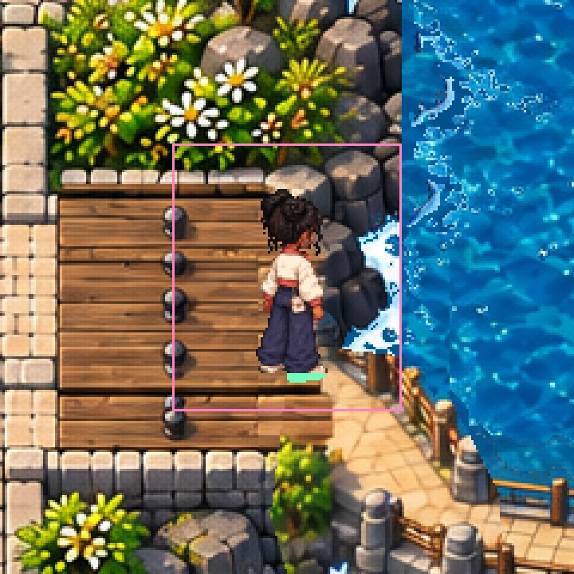

[Clean native1x](pose-03-complete-bridge-to-jeju-turn-native-crop-1x.png) · [Native contact overlay](pose-03-complete-bridge-to-jeju-turn-native-contact-crop-1x.png)

**pose-04-complete-bridge-to-jeju-stop-native /stop-right-0 /FAIL**

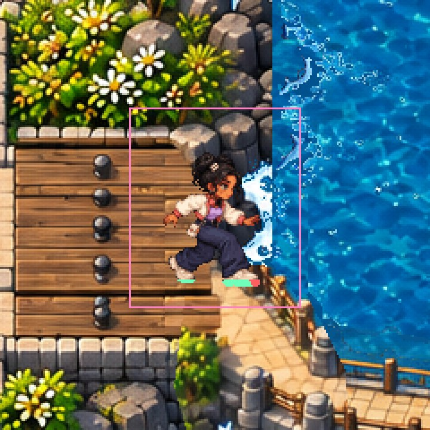

[Clean native1x](pose-04-complete-bridge-to-jeju-stop-native-crop-1x.png) · [Native contact overlay](pose-04-complete-bridge-to-jeju-stop-native-contact-crop-1x.png)

**pose-05-complete-bridge-to-jeju-turn-native /turn-7 /FAIL**

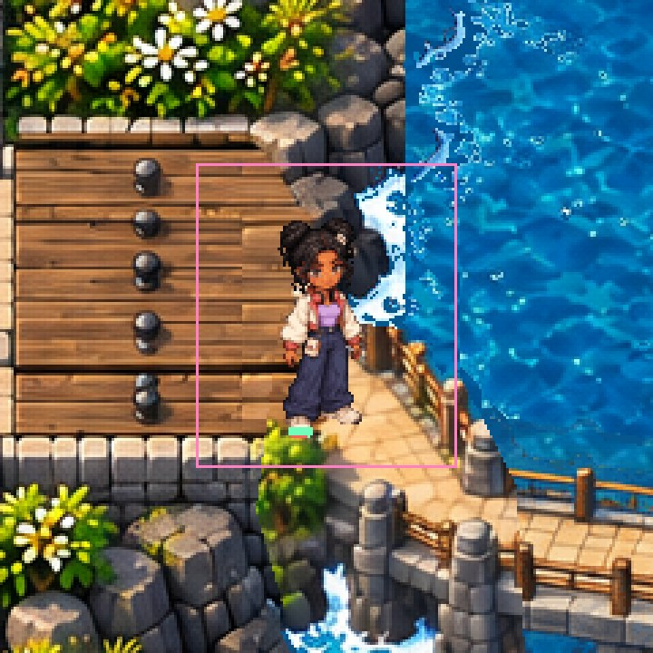

[Clean native1x](pose-05-complete-bridge-to-jeju-turn-native-crop-1x.png) · [Native contact overlay](pose-05-complete-bridge-to-jeju-turn-native-contact-crop-1x.png)

**pose-06-complete-bridge-to-jeju-stop-native /stop-right-0 /FAIL**

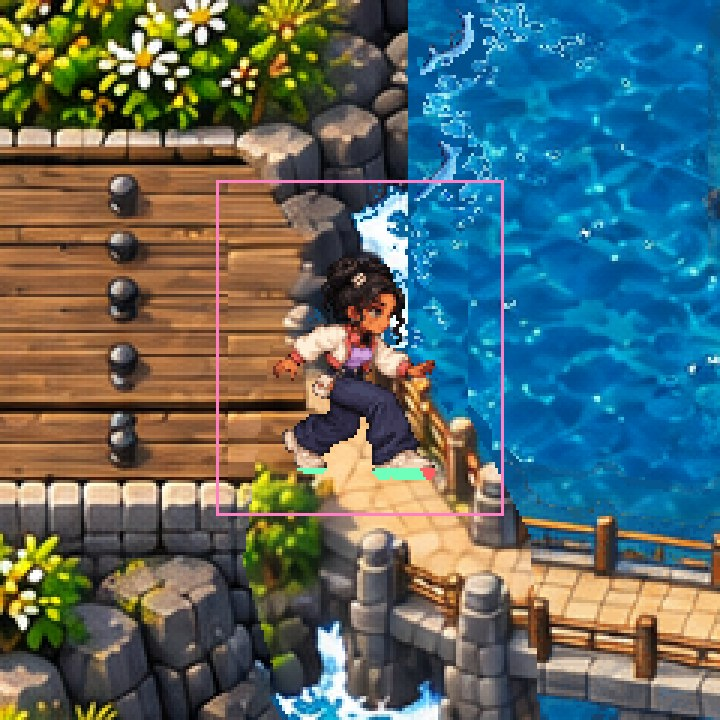

[Clean native1x](pose-06-complete-bridge-to-jeju-stop-native-crop-1x.png) · [Native contact overlay](pose-06-complete-bridge-to-jeju-stop-native-contact-crop-1x.png)

**pose-07-complete-jeju-to-mainland-turn-native /turn-1 /NO_FAILURE_IN_CAPTURED_POSE_ONLY**

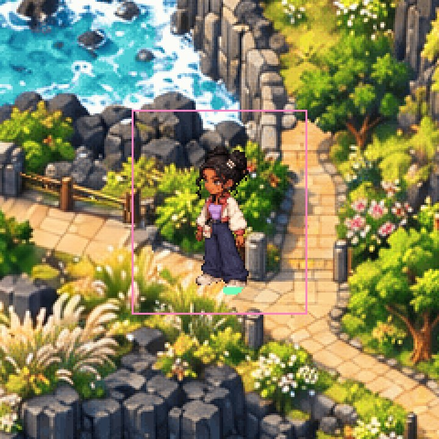

[Clean native1x](pose-07-complete-jeju-to-mainland-turn-native-crop-1x.png) · [Native contact overlay](pose-07-complete-jeju-to-mainland-turn-native-contact-crop-1x.png)

**pose-08-complete-jeju-to-mainland-stop-native /stop-left-0 /FAIL**

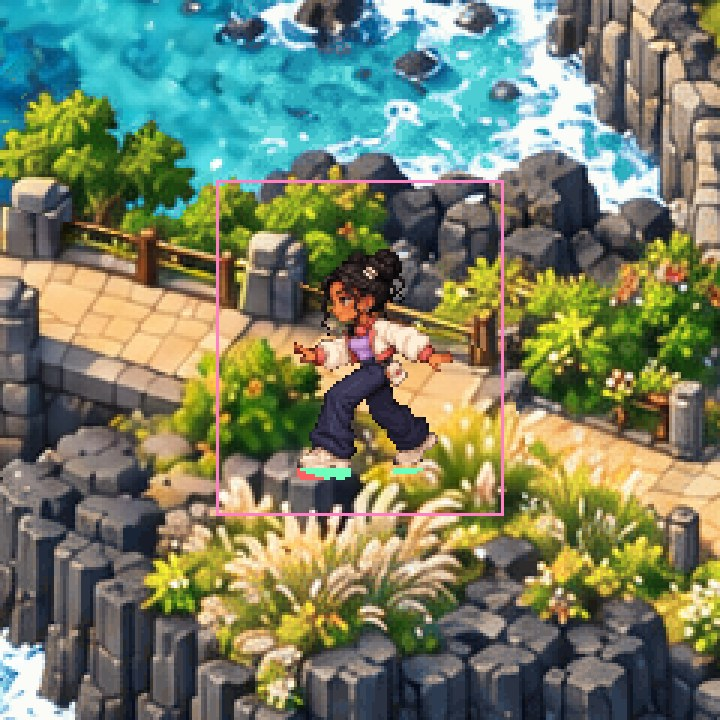

[Clean native1x](pose-08-complete-jeju-to-mainland-stop-native-crop-1x.png) · [Native contact overlay](pose-08-complete-jeju-to-mainland-stop-native-contact-crop-1x.png)

**pose-09-complete-jeju-to-mainland-turn-native /turn-3 /NO_FAILURE_IN_CAPTURED_POSE_ONLY**

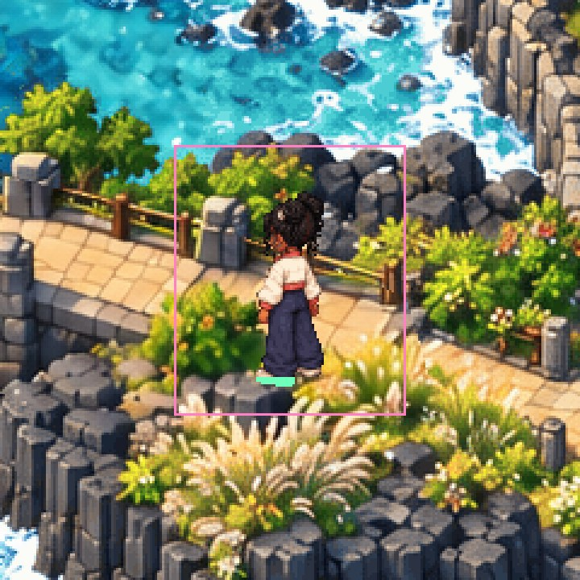

[Clean native1x](pose-09-complete-jeju-to-mainland-turn-native-crop-1x.png) · [Native contact overlay](pose-09-complete-jeju-to-mainland-turn-native-contact-crop-1x.png)

**pose-10-complete-jeju-to-mainland-stop-native /stop-back-0 /NO_FAILURE_IN_CAPTURED_POSE_ONLY**

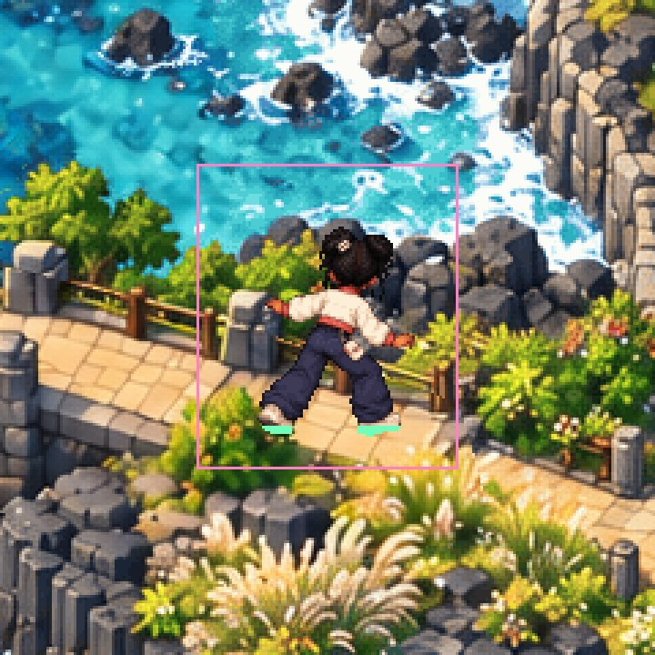

[Clean native1x](pose-10-complete-jeju-to-mainland-stop-native-crop-1x.png) · [Native contact overlay](pose-10-complete-jeju-to-mainland-stop-native-contact-crop-1x.png)

**pose-11-complete-jeju-to-mainland-turn-native /turn-3 /NO_FAILURE_IN_CAPTURED_POSE_ONLY**

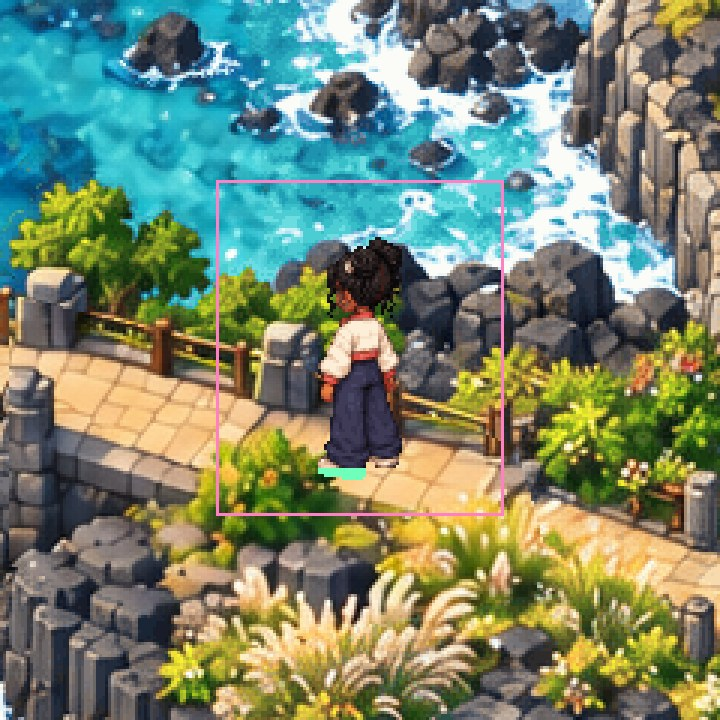

[Clean native1x](pose-11-complete-jeju-to-mainland-turn-native-crop-1x.png) · [Native contact overlay](pose-11-complete-jeju-to-mainland-turn-native-contact-crop-1x.png)

**pose-12-complete-jeju-to-mainland-stop-native /stop-left-0 /FAIL**

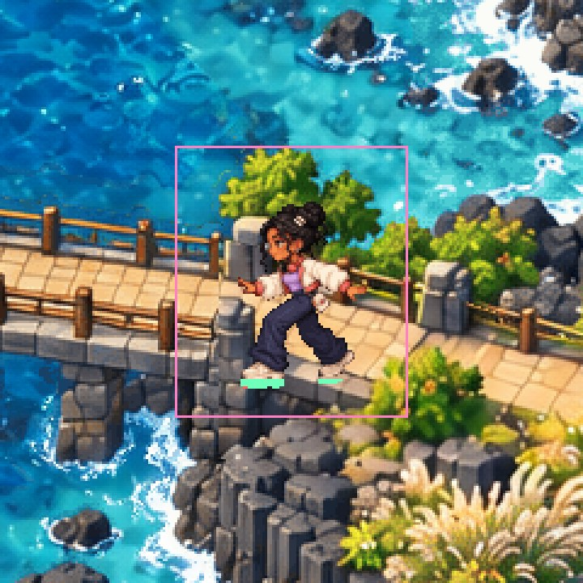

[Clean native1x](pose-12-complete-jeju-to-mainland-stop-native-crop-1x.png) · [Native contact overlay](pose-12-complete-jeju-to-mainland-stop-native-contact-crop-1x.png)

## Unadopted25px shoulder /4866px² proposal on current native bridge

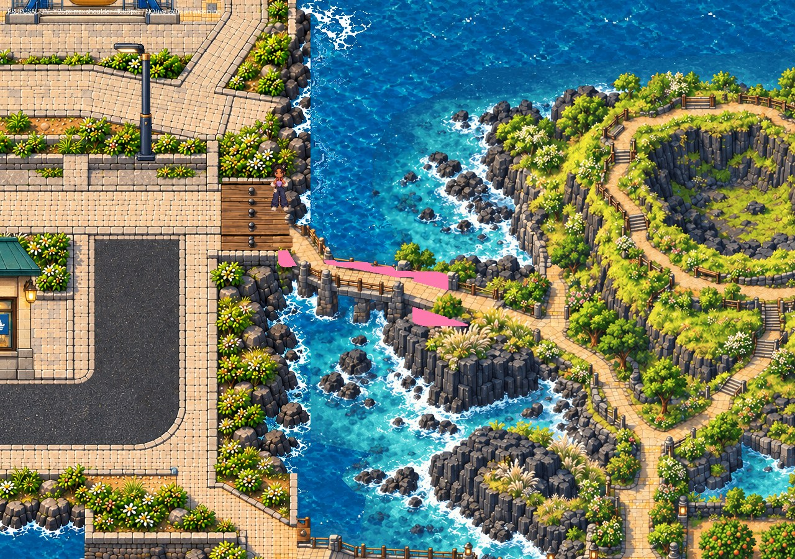

[Original native](bridge-support-proposal-native-overlay.png)

## Actual8px station transfer block

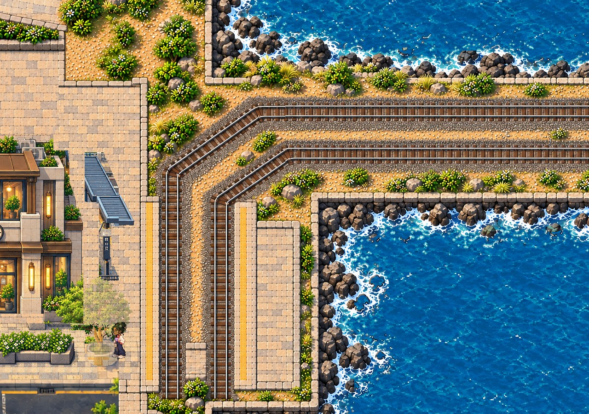

[Original native](station-platform-strip-blocked-native.png)
