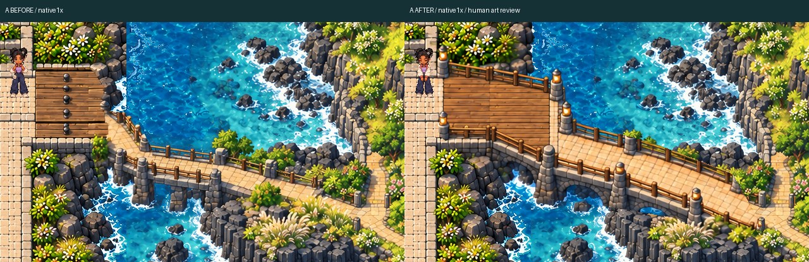
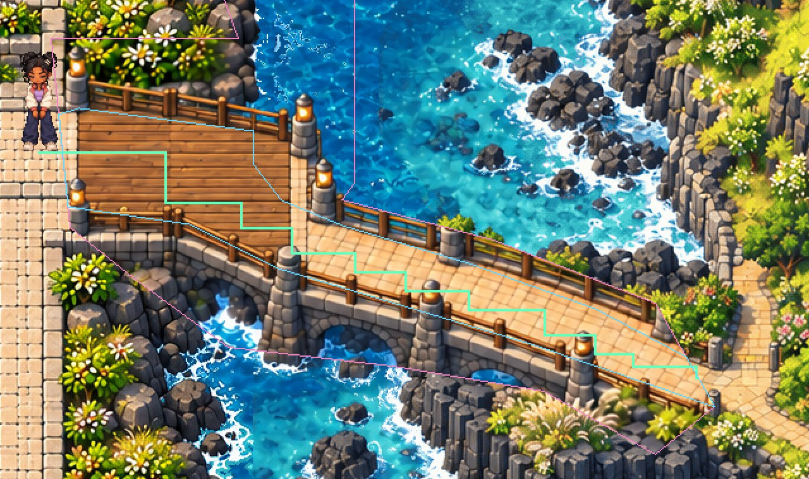
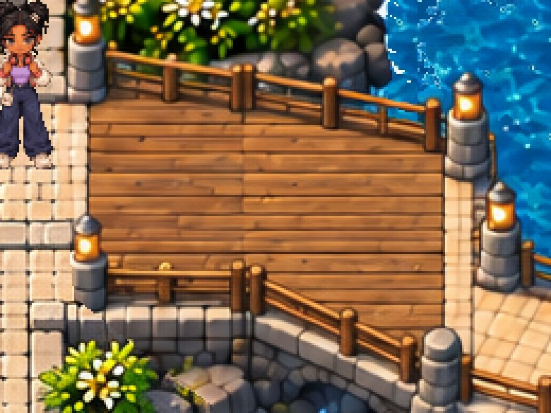
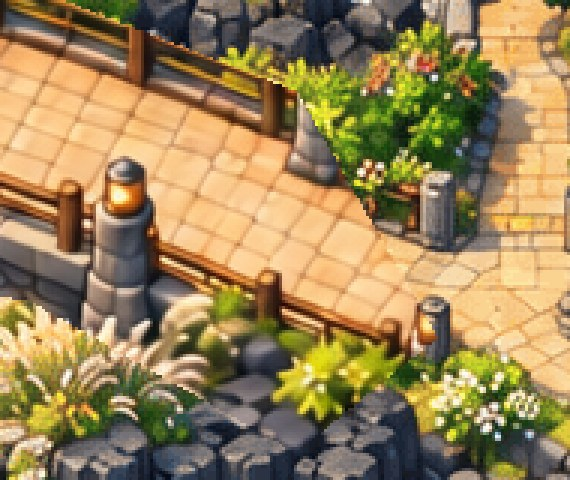
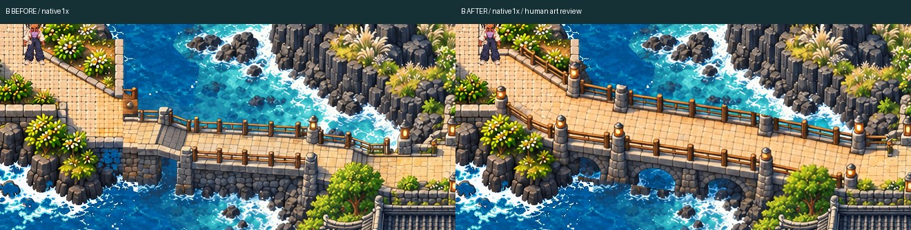
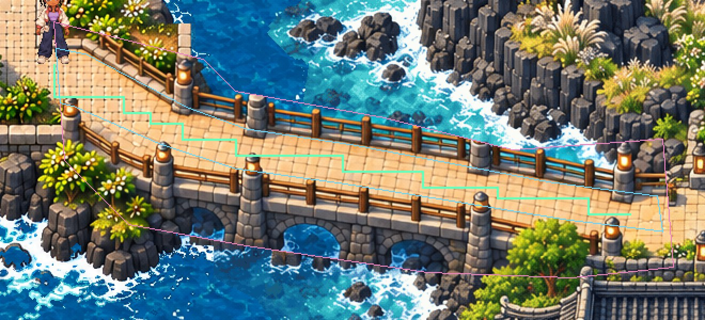
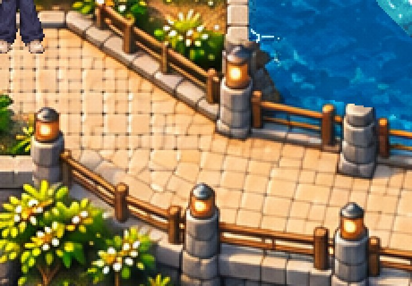
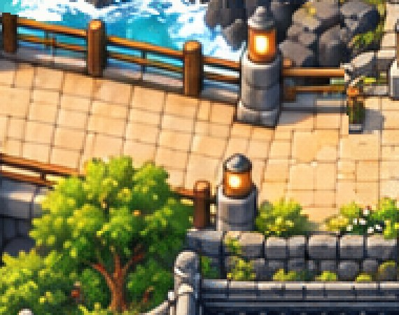

# TWO separate Jeju crossings — native Phaser review

Hanbit Station is HUMAN APPROVED AND LOCKED. Bridge artistic acceptance remains pending. All unannotated native PNGs are actual Phaser readbacks; only review JPEGs are resized.

[Playable ZIP](JEJU_TWO_BRIDGES_REVIEW.zip) · [QA](QA.md) · [Gameplay video](world-traversal-review.mp4) · [Physical device checklist](DEVICE_REVIEW.md)

## Bridge A — upper / northern

[BEFORE native1x](bridge-a-before-crop-1x.png) · [AFTER native1x](bridge-a-after-crop-1x.png) · [Full native frame](bridge-a-full-after-native.png)

[Native geometry overlay](bridge-a-alignment-overlay-native.png) — cyan: actual top plane; green: selected safe corridor; pink: maximum edit boundary. Gameplay validation is separate.

### mainland landing

[BEFORE native1x](bridge-a-mainland-before-detail-1x.png) · [AFTER native1x](bridge-a-mainland-after-detail-1x.png)

### island landing

[BEFORE native1x](bridge-a-island-before-detail-1x.png) · [AFTER native1x](bridge-a-island-after-detail-1x.png)

## Bridge B — lower / southern

[BEFORE native1x](bridge-b-before-crop-1x.png) · [AFTER native1x](bridge-b-after-crop-1x.png) · [Full native frame](bridge-b-full-after-native.png)

[Native geometry overlay](bridge-b-alignment-overlay-native.png) — cyan: actual top plane; green: selected safe corridor; pink: maximum edit boundary. Gameplay validation is separate.

### mainland landing

[BEFORE native1x](bridge-b-mainland-before-detail-1x.png) · [AFTER native1x](bridge-b-mainland-after-detail-1x.png)

### island landing

[BEFORE native1x](bridge-b-island-before-detail-1x.png) · [AFTER native1x](bridge-b-island-after-detail-1x.png)

## Actual gameplay

[Continuous video](world-traversal-review.mp4) · [Original-size video](world-traversal-native.mp4) · [Actual original-control records](movement-report.json) · [Native contacts and occlusion](body-clearance.json)

## Approved station

[Native Hanbit preservation proof](approved-hanbit-preserved-native.png) · [Protected assets](protected-hashes.json)
