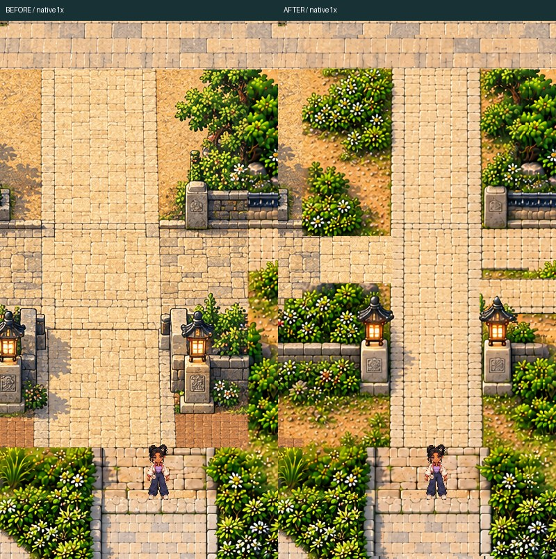
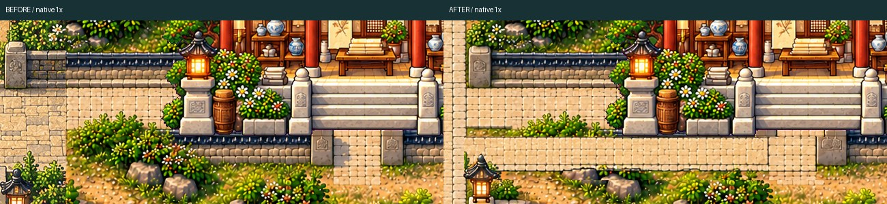
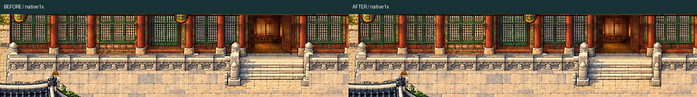
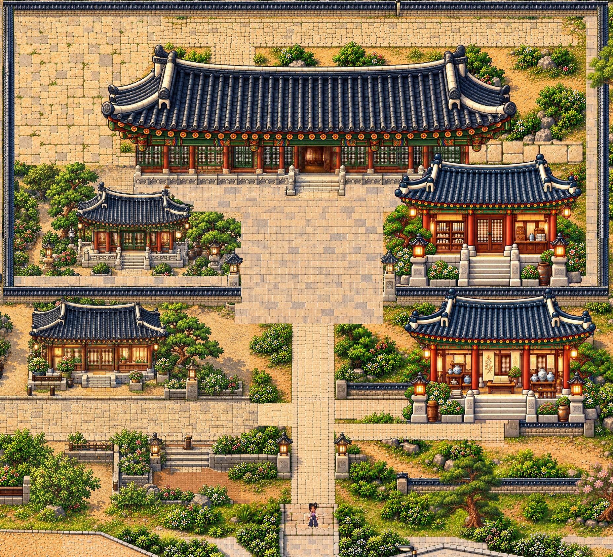

# Final local palace cleanup

Human artistic approval PENDING. Hanbit, BOTH Jeju bridges and western hanok remain locked. These PNGs are actual native1:1 Phaser readbacks, not authoring images. JPEGs are labelled review derivatives.

[Playable ZIP](PALACE_CLEANUP_REVIEW.zip) · [QA](QA.md) · [Actual gameplay](world-traversal-review.mp4)

## axis

[BEFORE native1x](axis-before-native-1x.png) · [AFTER native1x](axis-after-native-1x.png) · [Native comparison board](axis-before-after-native-board.png)

## right-access

[BEFORE native1x](right-access-before-native-1x.png) · [AFTER native1x](right-access-after-native-1x.png) · [Native comparison board](right-access-before-after-native-board.png)

## facade

[BEFORE native1x](facade-before-native-1x.png) · [AFTER native1x](facade-after-native-1x.png) · [Native comparison board](facade-before-after-native-board.png)

## Combined palace zone

[Full combined native1x](combined-palace-after-native-1x.png). Two actual Phaser readbacks joined at integer worldy1040, without resizing or blending. Full untouched source frames retained.
