# G3-D consolidated visual review

**Final artistic/spatial acceptance is pending.** The shared direction is conditionally approved; Bakery, tower/road projection, station strip, inherited routes and hardware/device requirements remain open. [QA / remaining decisions](README.md) · [Coverage](COVERAGE.md) · [Technical report](technical-qa.json) · [Physical-device handoff](DEVICE_REVIEW.md).

The playable ZIP includes the whole review world, ten untouched native PNGs and lightweight actual gameplay. The HTML gallery is available inside the ZIP; this Markdown gallery is directly viewable on GitHub without deploying a website.

## Updated Phaser overview

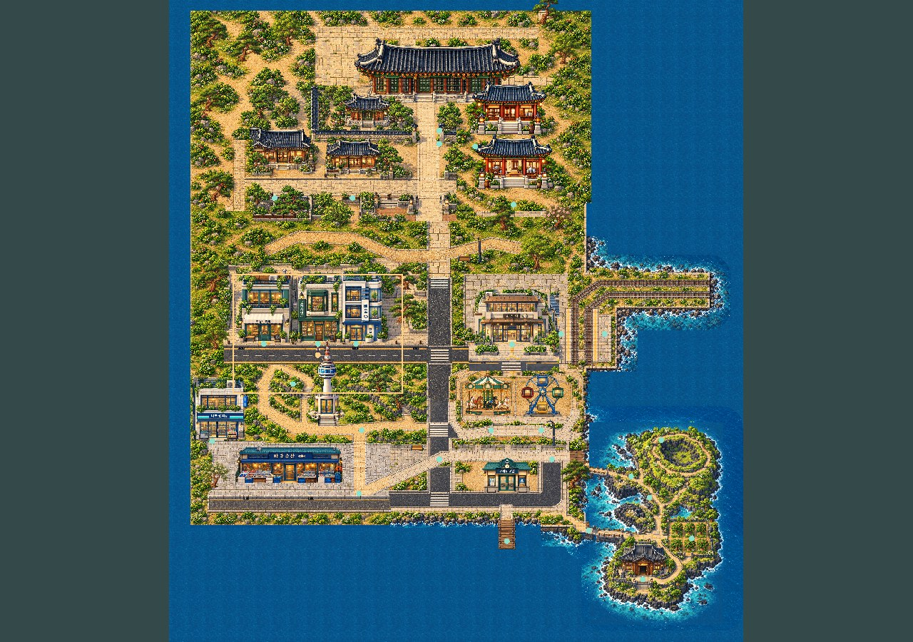

Overview is a scaled proxy rendered by actual Phaser, with built-in wayfinding overlays; it is not native-pixel evidence.

## Native Muneum comparison

[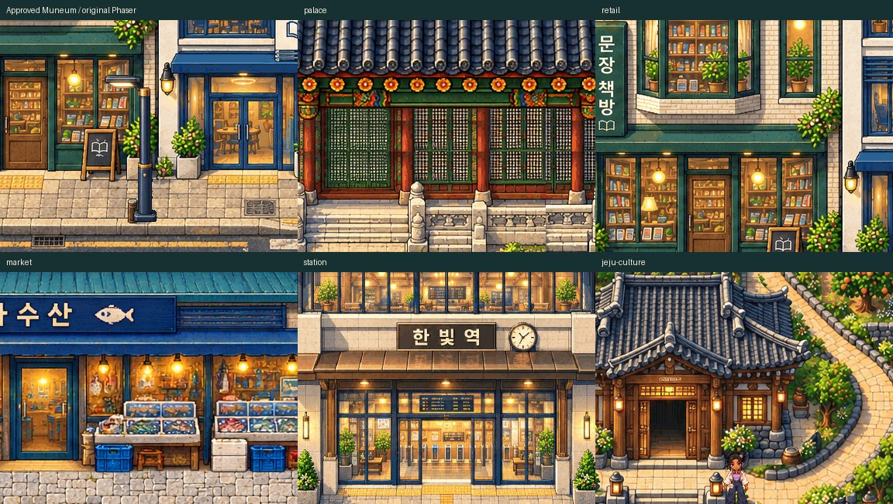](muneum-native-benchmark-board.png)

Each art cell is an unscaled384×300 crop. Original Muneum screenshot and crop coordinates are recorded in [derivative provenance](review-derivatives.json). No board or metric grants artistic approval.

## Ten-region before / after

JPEG previews are under1MB each. BEFORE is the preserved three-pilot world context. Click native PNG/crop links for original1:1 pixels; previews and compressed video do not establish pixel fidelity.

### 01 Palace

| Before | After |
|---|---|
| 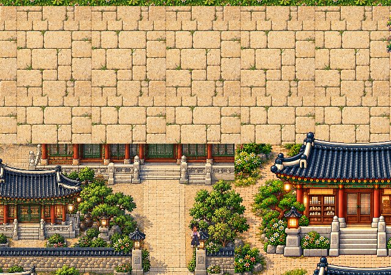 | 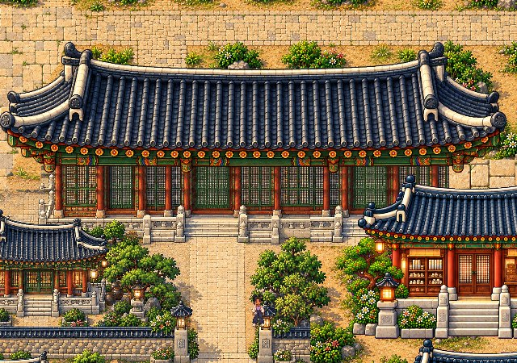 |

[Before native PNG](palace-before-native.png) · [After native PNG](palace-after-native.png) · [Before unscaled crop](palace-before-crop-1x.png) · [After unscaled crop](palace-after-crop-1x.png)

### 02 Academy

| Before | After |
|---|---|
| 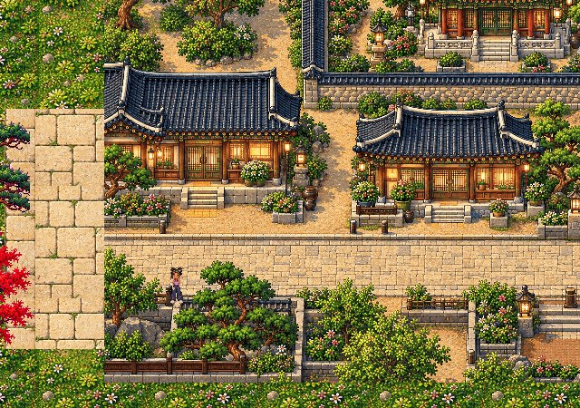 |  |

[Before native PNG](academy-before-native.png) · [After native PNG](academy-after-native.png) · [Before unscaled crop](academy-before-crop-1x.png) · [After unscaled crop](academy-after-crop-1x.png)

### 03 Cultural courtyard

| Before | After |
|---|---|
| 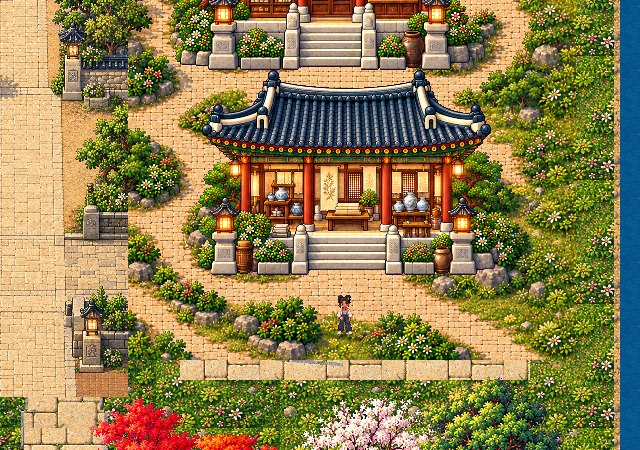 | 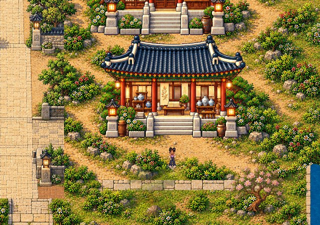 |

[Before native PNG](culture-before-native.png) · [After native PNG](culture-after-native.png) · [Before unscaled crop](culture-before-crop-1x.png) · [After unscaled crop](culture-after-crop-1x.png)

### 04 Heritage threshold

| Before | After |
|---|---|
| 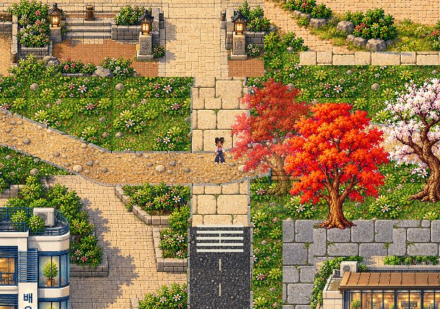 | 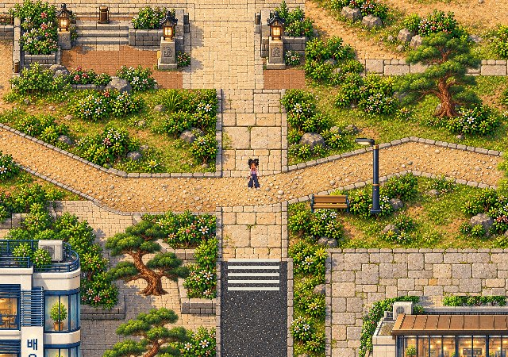 |

[Before native PNG](transition-before-native.png) · [After native PNG](transition-after-native.png) · [Before unscaled crop](transition-before-crop-1x.png) · [After unscaled crop](transition-after-crop-1x.png)

### 05 Modern retail

| Before | After |
|---|---|
| 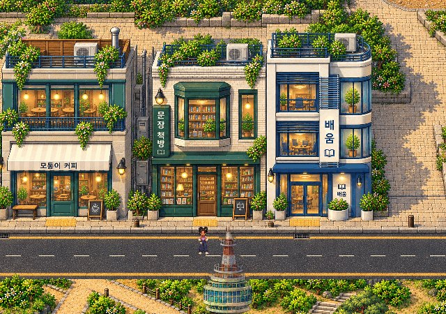 | 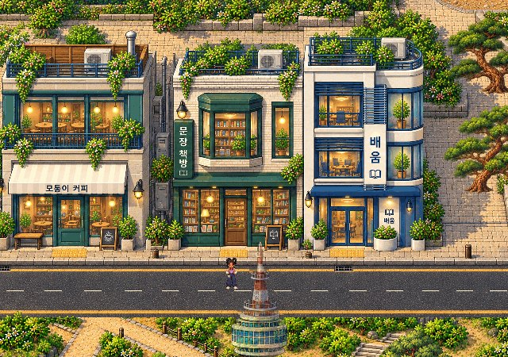 |

[Before native PNG](retail-before-native.png) · [After native PNG](retail-after-native.png) · [Before unscaled crop](retail-before-crop-1x.png) · [After unscaled crop](retail-after-crop-1x.png)

### 06 Railway

| Before | After |
|---|---|
| 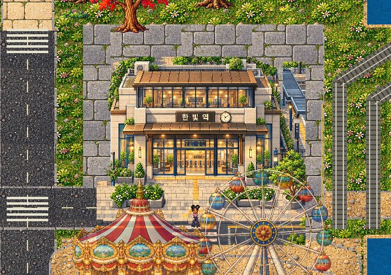 | 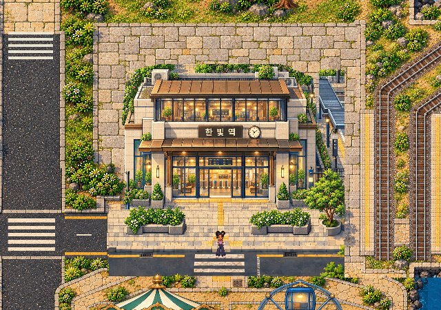 |

[Before native PNG](station-before-native.png) · [After native PNG](station-after-native.png) · [Before unscaled crop](station-before-crop-1x.png) · [After unscaled crop](station-after-crop-1x.png)

### 07 Namsan

| Before | After |
|---|---|
| 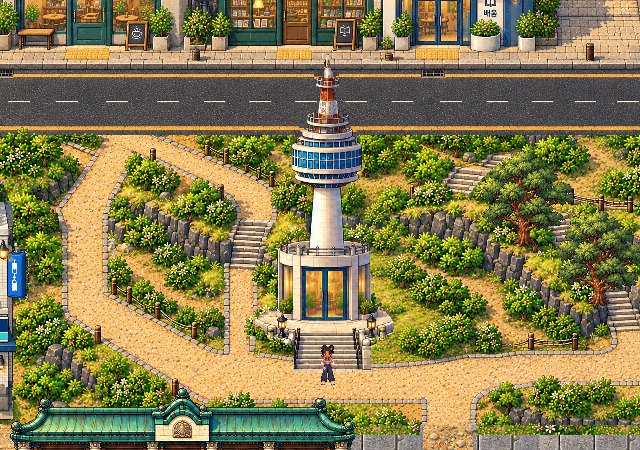 | 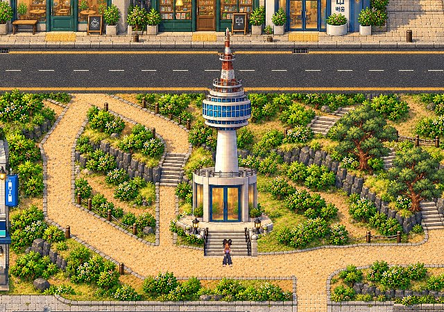 |

[Before native PNG](namsan-before-native.png) · [After native PNG](namsan-after-native.png) · [Before unscaled crop](namsan-before-crop-1x.png) · [After unscaled crop](namsan-after-crop-1x.png)

### 08 Amusement

| Before | After |
|---|---|
| 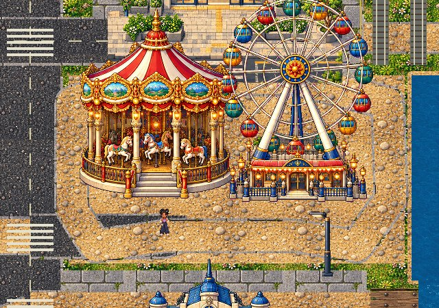 | 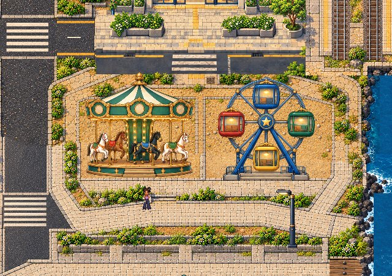 |

[Before native PNG](amusement-before-native.png) · [After native PNG](amusement-after-native.png) · [Before unscaled crop](amusement-before-crop-1x.png) · [After unscaled crop](amusement-after-crop-1x.png)

### 09 Harbor

| Before | After |
|---|---|
| 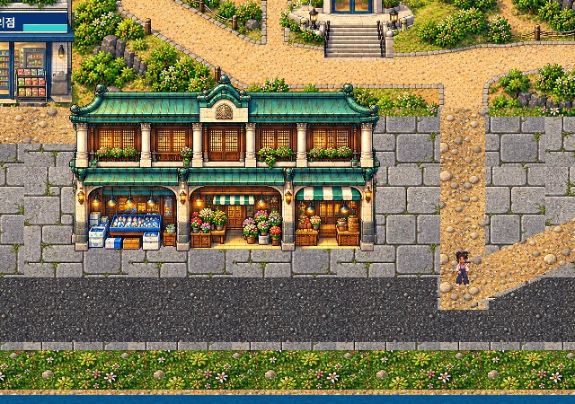 | 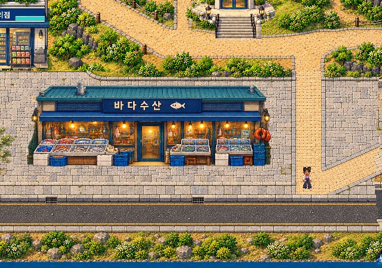 |

[Before native PNG](market-before-native.png) · [After native PNG](market-after-native.png) · [Before unscaled crop](market-before-crop-1x.png) · [After unscaled crop](market-after-crop-1x.png)

### 10 Jeju

| Before | After |
|---|---|
| 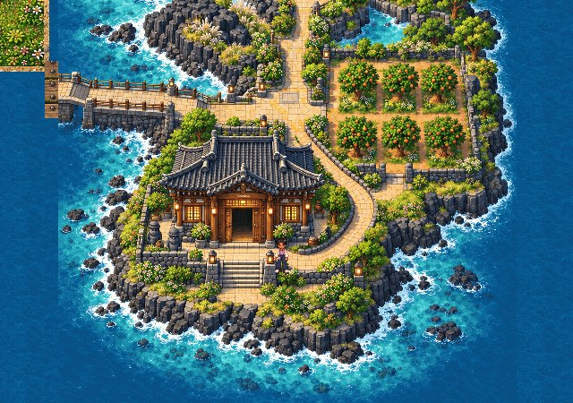 | 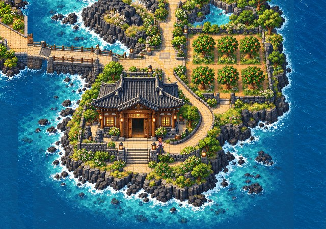 |

[Before native PNG](jeju-culture-before-native.png) · [After native PNG](jeju-culture-after-native.png) · [Before unscaled crop](jeju-culture-before-crop-1x.png) · [After unscaled crop](jeju-culture-after-crop-1x.png)

## Actual movement and supporting native evidence

[Lightweight actual17-leg gameplay](world-traversal-review.mp4) · [Native-resolution1280×1000 viewing encode](world-traversal-native-resolution.mp4) · [Movement data](movement-report.json).

[Juni visible behind bookshop](bookshop-occlusion-after-native.png) · [Protected Maru](maru-after-native.png) · [Original canopy/platform surroundings](platform-after-native.png) · [Closed8px strip overlay](station-collision-overlay-native.png) · [Native compact ferry hall](ferry-after-native.png) · [Jeju arrival](jeju-arrival-after-native.png) · [Original oreum](jeju-oreum-after-native.png).

[Exact projection findings](projection-report.json) distinguish the cleared station façade from95 remaining carousel pixels over its lower-road edge and the new road-apron projections. [Navigation](navigation-report.json) retains six planned-line failures and the body-clearance limits. Source hashes, historical tags, forecourt and original Juni remain protected. No complete-world acceptance, main merge, public deployment or physical-device PASS is claimed.
