# Hanbit — full clean rebuild review

**The active world uses ONLY the fresh station.** Old facade/roof/sign/canopy/planters/tree/owned ground/shadows are purged, not patched or retained. Archived BEFORE images are evidence only. Human artistic approval remains pending.

[Playable ZIP](HANBIT_CLEAN_REBUILD_REVIEW.zip) · [QA](QA.md) · [Purge/scope](purge-and-scope.json) · [Actual continuous controls](world-traversal-review.mp4)

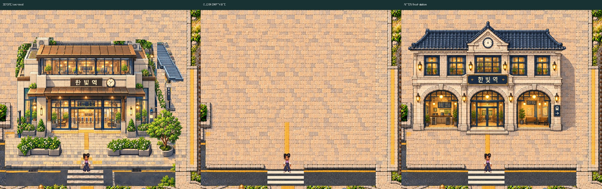

[Original native triptych](before-clean-after-native-triptych.png)

## station-all

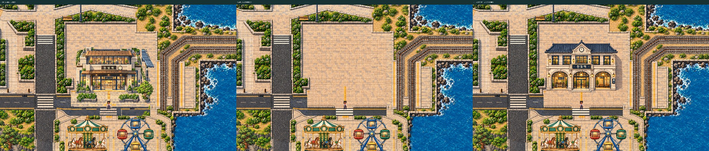

[station-all-before-native.png](station-all-before-native.png) · [station-all-clean-native.png](station-all-clean-native.png) · [station-all-after-native.png](station-all-after-native.png)

## station-facade

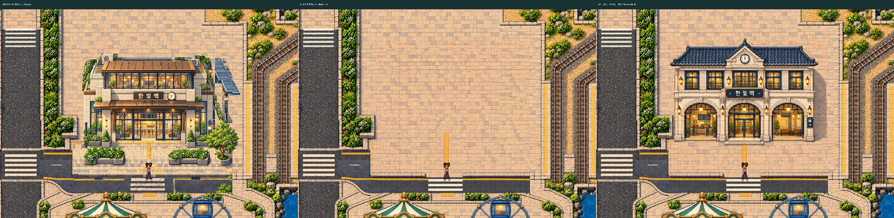

[station-facade-before-native.png](station-facade-before-native.png) · [station-facade-clean-native.png](station-facade-clean-native.png) · [station-facade-after-native.png](station-facade-after-native.png)

## station-top

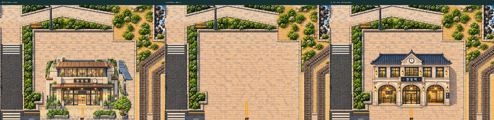

[station-top-before-native.png](station-top-before-native.png) · [station-top-clean-native.png](station-top-clean-native.png) · [station-top-after-native.png](station-top-after-native.png)

## station-east

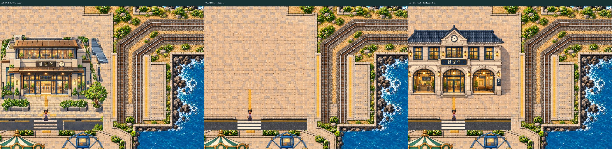

[station-east-before-native.png](station-east-before-native.png) · [station-east-clean-native.png](station-east-clean-native.png) · [station-east-after-native.png](station-east-after-native.png)

## station-base

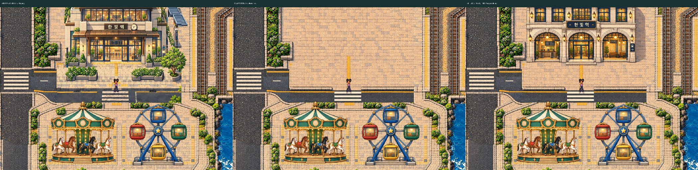

[station-base-before-native.png](station-base-before-native.png) · [station-base-clean-native.png](station-base-clean-native.png) · [station-base-after-native.png](station-base-after-native.png)

## Front facade / original pixel scale

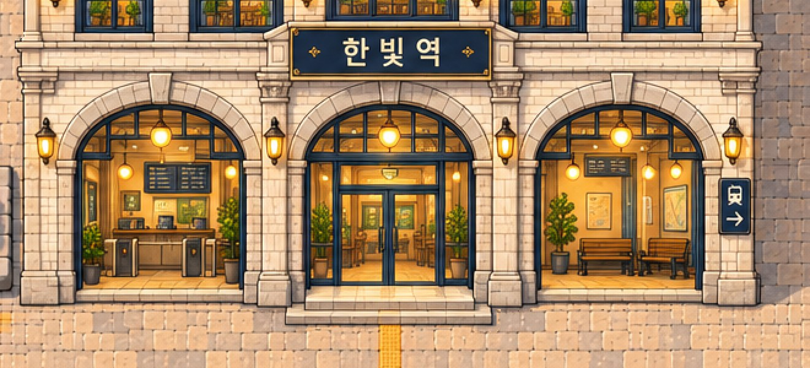

[Original native1x crop](station-facade-after-crop-1x.png)

## Complete NEW roof / clock / upper floor

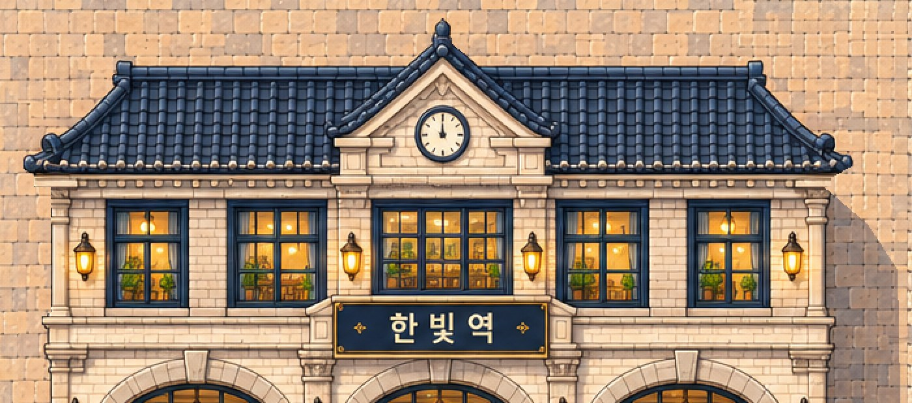

[Original native1x crop](station-top-after-crop-1x.png)

## Open-air platform-side approach / no old canopy

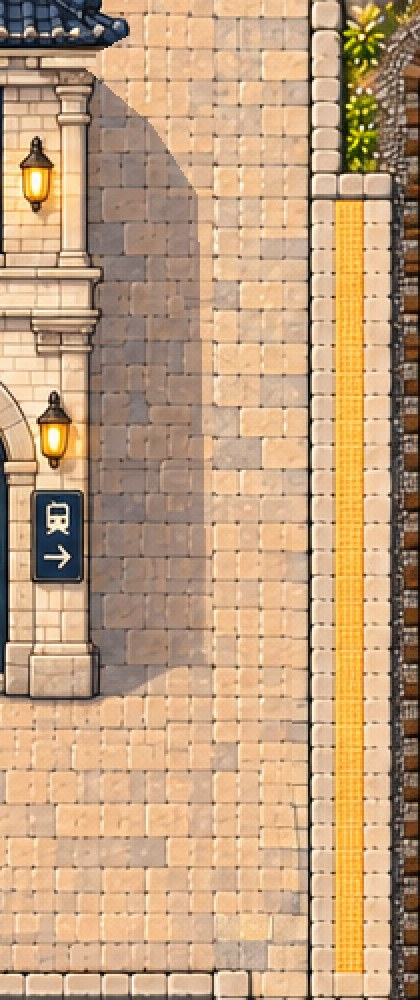

[Original native1x crop](station-east-after-crop-1x.png)

## Fresh forecourt / step / road edge

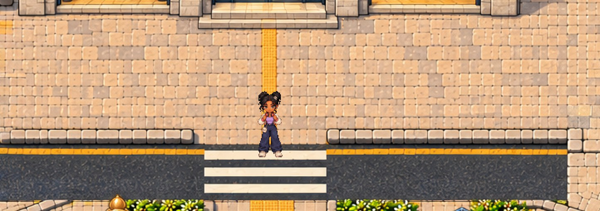

[Original native1x crop](station-base-after-crop-1x.png)

## Juni reaches the NEW station entrance — real controls

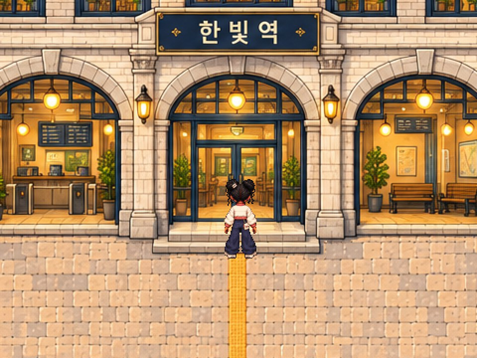

[Native original](juni-at-new-entrance-native-crop.png)

## Actual declared platform1 arrival2970,2530 / original E target confirmed

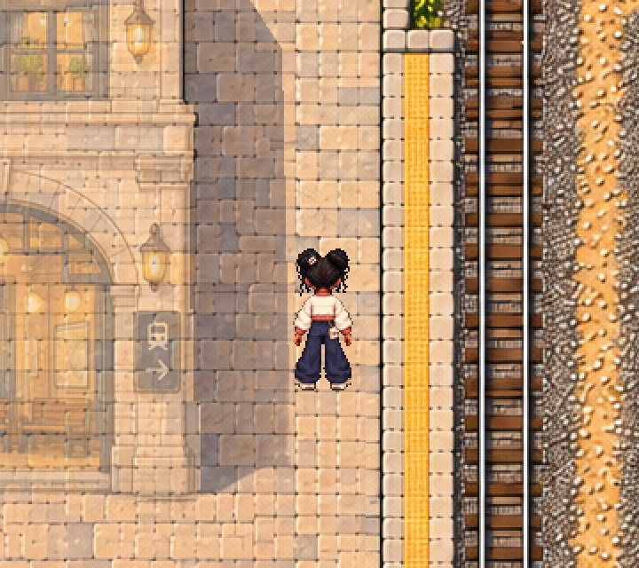

[Native original](juni-at-platform1-native-crop.png)

## Approved craftsmanship — same pixel scale

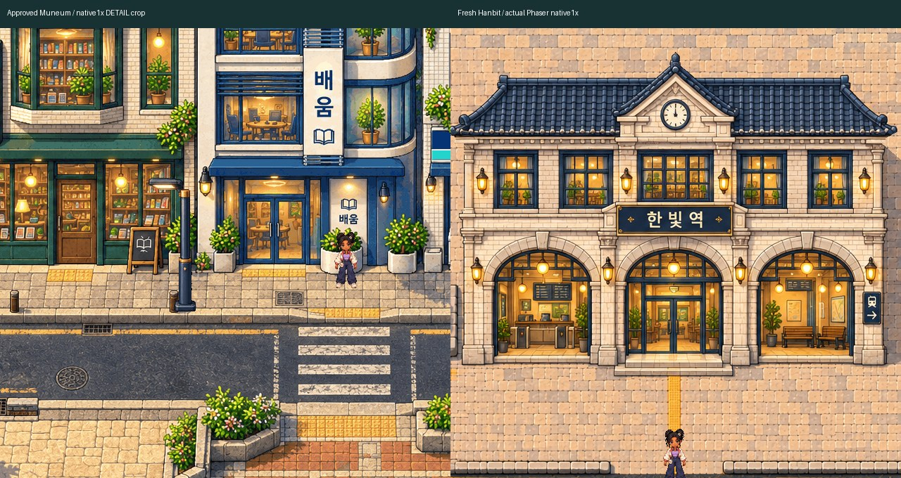

[Native original](muneum-fresh-station-native-board.png)

## SOURCE ownership — not gameplay / all parts from one fresh painting

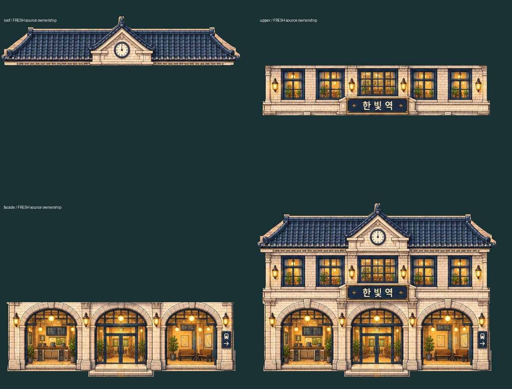

[Native original](fresh-source-layer-board-native.png)
