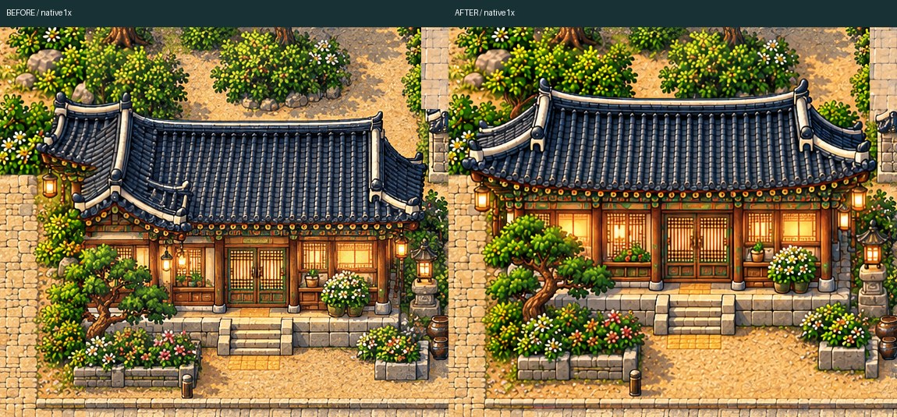
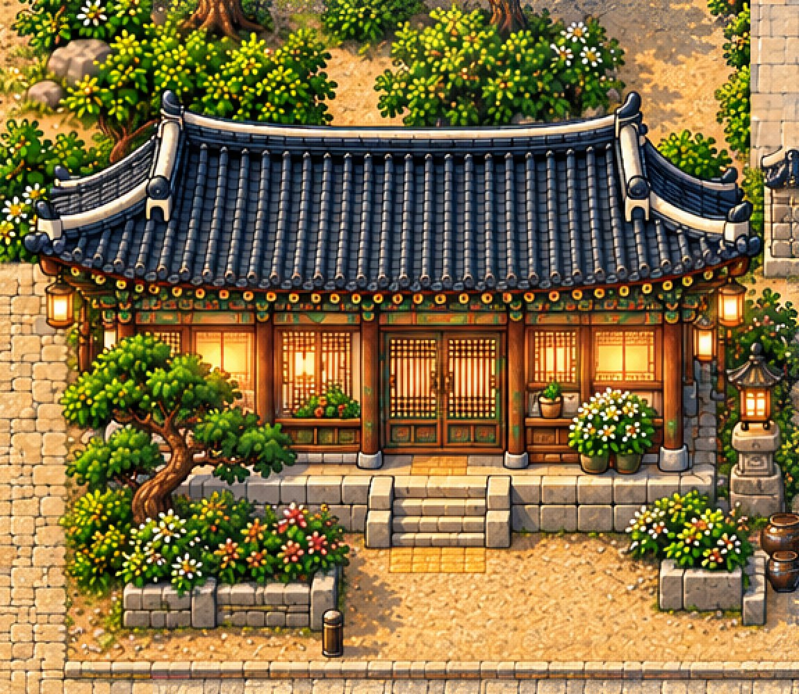
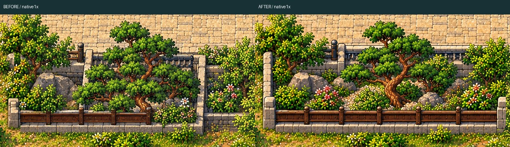
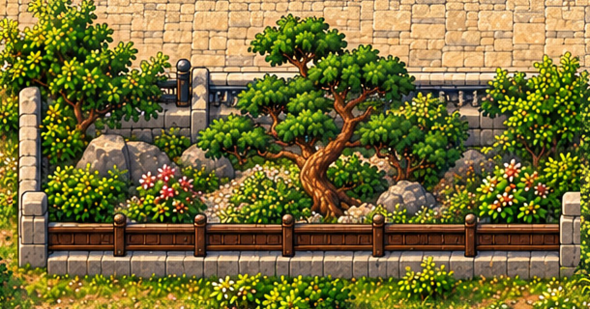
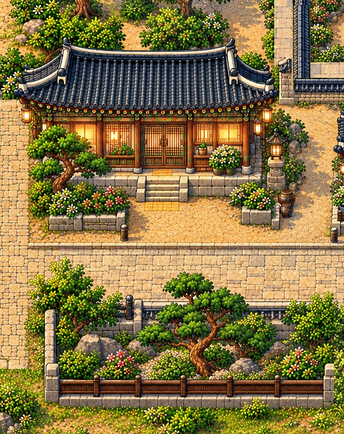

# Western hanok +lower courtyard — native Phaser review

Hanbit Station and BOTH Jeju bridge visuals are HUMAN APPROVED AND LOCKED. These2 local repairs await human review. Collision is EXACT unchanged.

[Playable ZIP](WEST_HANOK_COURTYARD_REVIEW.zip) · [QA](QA.md) · [Actual public-route controls](world-traversal-review.mp4)

## house

[BEFORE native1x](house-before-native-1x.png) · [AFTER native1x](house-after-native-1x.png) · [Native comparison board](house-before-after-native-board.png)

## courtyard

[BEFORE native1x](courtyard-before-native-1x.png) · [AFTER native1x](courtyard-after-native-1x.png) · [Native comparison board](courtyard-before-after-native-board.png)

## Combined local area

[Unannotated native1x local screenshot](combined-local-after-native-1x.png) · [Full original native Phaser frame](west-both-local-after-native.png)

## Scope / gameplay

[Native pixel audit](scope-and-collision.json) · [Protected hashes](protected-hashes.json) · [Movement QA](body-clearance.json) · [Gameplay video](world-traversal-review.mp4)
