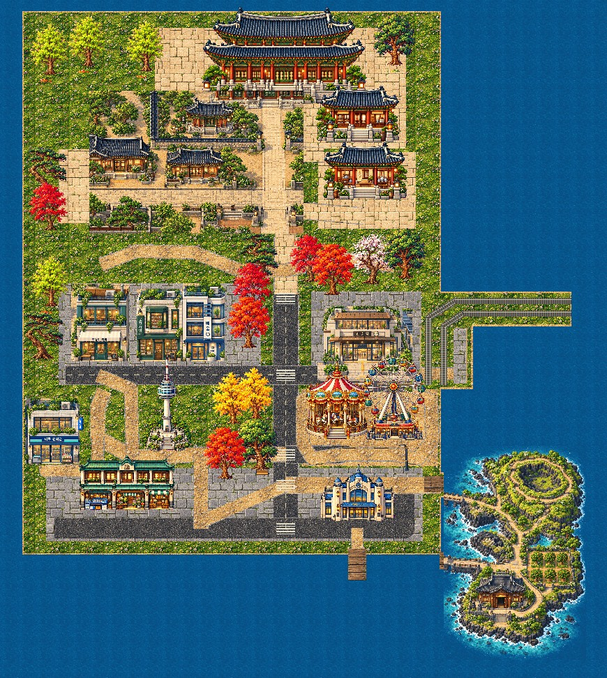

# Direct visual review links

Every original is an actual1280×900 native Phaser capture, zoom1, DPR1. JPEG copies are under1MB viewing aids. No artistic acceptance is implied.

| Region | Lightweight preview | Original native1:1 |
|---|---|---|
| palace | [Preview](palace-native-review.jpg) | [Native PNG](palace-native.png) |
| academy | [Preview](academy-native-review.jpg) | [Native PNG](academy-native.png) |
| archive | [Preview](archive-native-review.jpg) | [Native PNG](archive-native.png) |
| culture | [Preview](culture-native-review.jpg) | [Native PNG](culture-native.png) |
| transition | [Preview](transition-native-review.jpg) | [Native PNG](transition-native.png) |
| retail | [Preview](retail-native-review.jpg) | [Native PNG](retail-native.png) |
| station | [Preview](station-native-review.jpg) | [Native PNG](station-native.png) |
| platform | [Preview](platform-native-review.jpg) | [Native PNG](platform-native.png) |
| namsan | [Preview](namsan-native-review.jpg) | [Native PNG](namsan-native.png) |
| maru | [Preview](maru-native-review.jpg) | [Native PNG](maru-native.png) |
| amusement | [Preview](amusement-native-review.jpg) | [Native PNG](amusement-native.png) |
| market | [Preview](market-native-review.jpg) | [Native PNG](market-native.png) |
| waterfront | [Preview](waterfront-native-review.jpg) | [Native PNG](waterfront-native.png) |
| ferry | [Preview](ferry-native-review.jpg) | [Native PNG](ferry-native.png) |
| jeju | [Preview](jeju-native-review.jpg) | [Native PNG](jeju-native.png) |
| oreum | [Preview](oreum-native-review.jpg) | [Native PNG](oreum-native.png) |
| house | [Preview](house-native-review.jpg) | [Native PNG](house-native.png) |

[Actual scaled Phaser overview](world-overview-phaser.png) · [Actual gameplay review video](world-traversal-review.mp4) · [Full native gameplay recording](world-traversal.mp4)
