# G3-D coordinated urban / landscape correction

**Human artistic acceptance is pending.** [Playable ZIP](G3D_ZONED_WORLD_REVIEW.zip) · [QA/decisions](README.md) · [Landscape masterplan](LANDSCAPE_MASTERPLAN.md) · [Coverage](COVERAGE.md) · [Native capture registry](native-captures.json).

Six marked reviewer screenshots were not attached or found. Exact marked-region acceptance is **NOT TESTED**. Z01–Z08 map the textual defects to real native evidence, not invented screenshot markings.

## Identical-framing actual Phaser overviews

| Before | After |
|---|---|
| 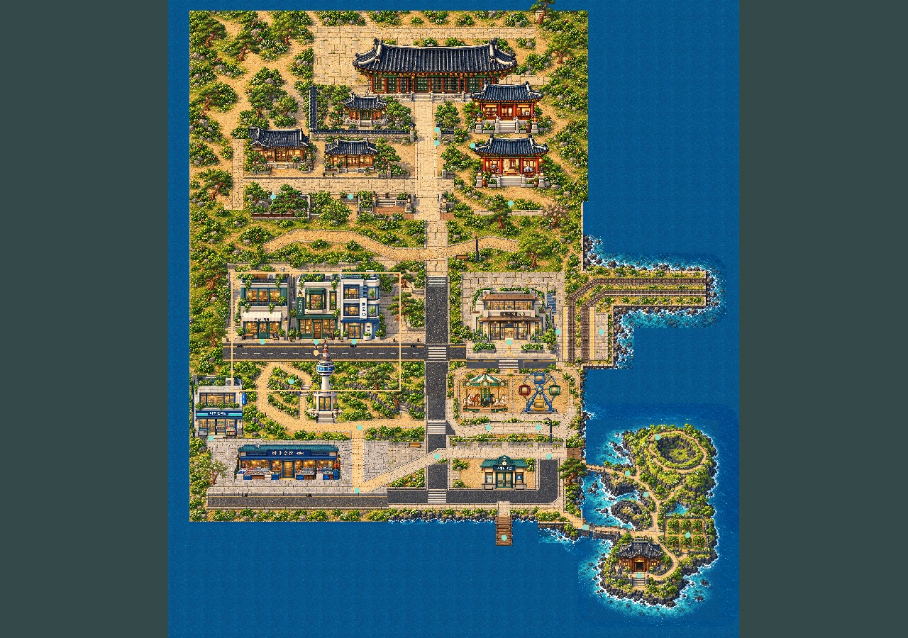 | 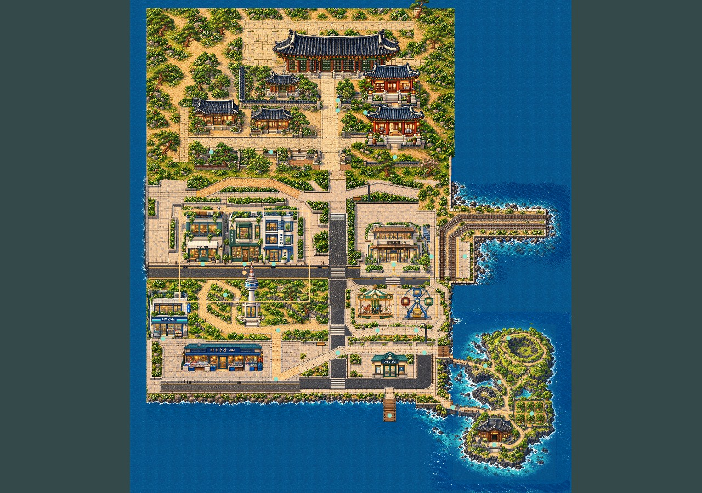 |

[Before original overview](world-before-overview-phaser.png) · [After original overview](world-after-overview-phaser.png). These are actual Phaser scaled proxies with existing wayfinding overlays; they do not prove pixel quality.

## All ten regions — actual native Phaser

Click the untouched1280×900 original PNGs for1:1 inspection. JPEGs are lightweight nearest-neighbor review copies under1MB.

### palace — 01 Historic palace

| Before | After |
|---|---|
| 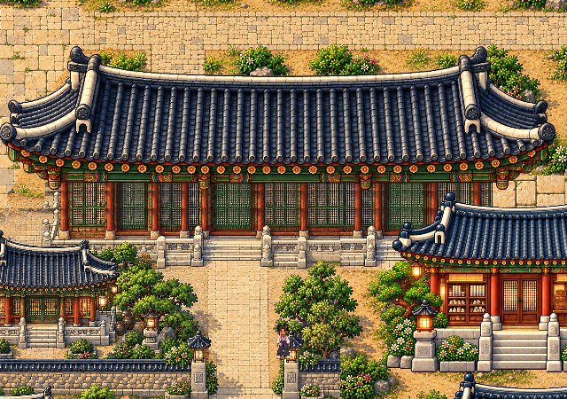 | 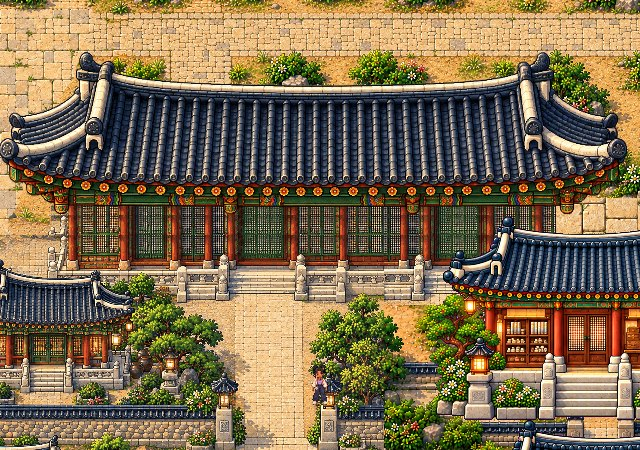 |

[Before1:1](palace-before-native.png) · [After1:1](palace-after-native.png)

### academy — 02 Academy/hanok

| Before | After |
|---|---|
| 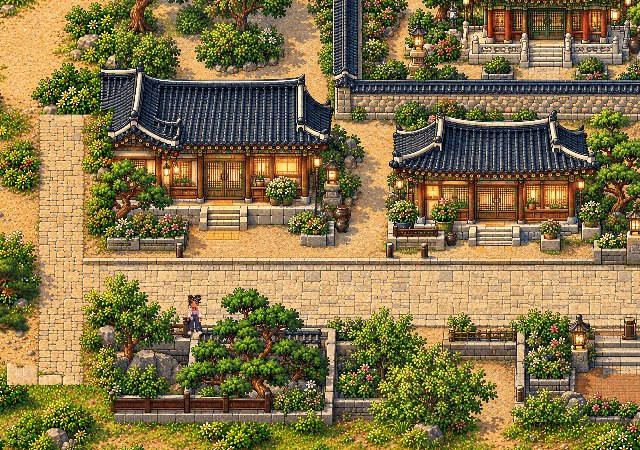 |  |

[Before1:1](academy-before-native.png) · [After1:1](academy-after-native.png)

### culture — 03 Cultural compound

| Before | After |
|---|---|
| 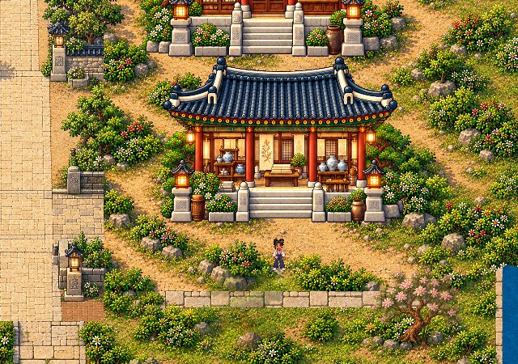 | 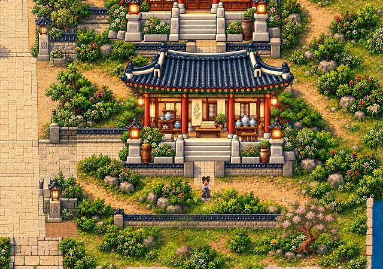 |

[Before1:1](culture-before-native.png) · [After1:1](culture-after-native.png)

### transition — 04 Historic/modern threshold

| Before | After |
|---|---|
|  | 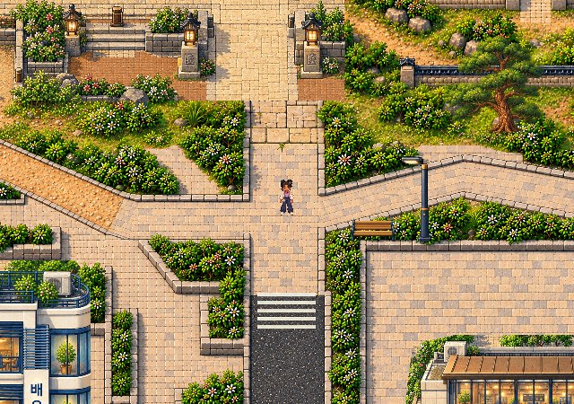 |

[Before1:1](transition-before-native.png) · [After1:1](transition-after-native.png)

### retail — 05 Modern commercial

| Before | After |
|---|---|
|  | 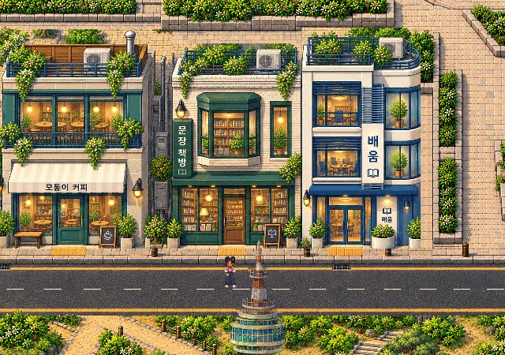 |

[Before1:1](retail-before-native.png) · [After1:1](retail-after-native.png)

### station — 06 Hanbit railway

| Before | After |
|---|---|
|  | 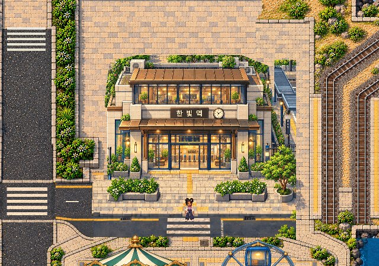 |

[Before1:1](station-before-native.png) · [After1:1](station-after-native.png)

### namsan — 07 Namsan/Maru

| Before | After |
|---|---|
|  | 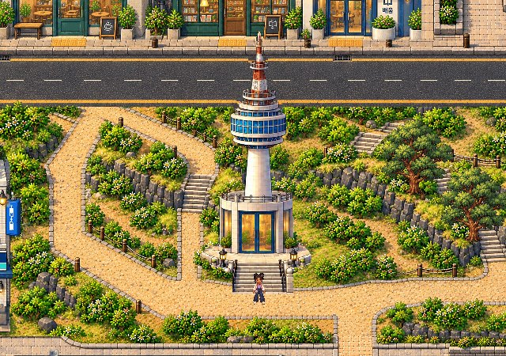 |

[Before1:1](namsan-before-native.png) · [After1:1](namsan-after-native.png)

### amusement — 08 Amusement

| Before | After |
|---|---|
|  | 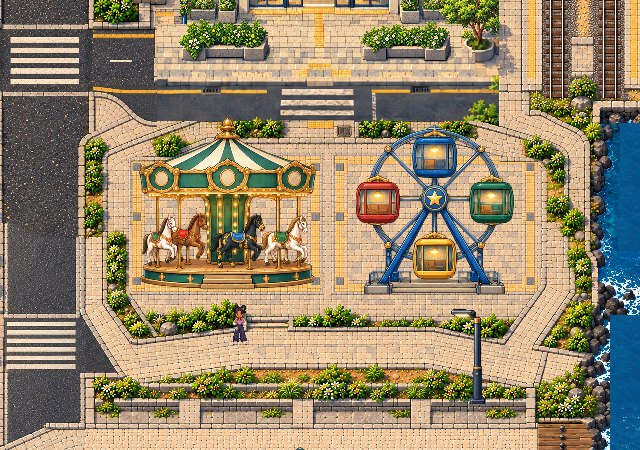 |

[Before1:1](amusement-before-native.png) · [After1:1](amusement-after-native.png)

### market — 09 Harbor/market

| Before | After |
|---|---|
|  | 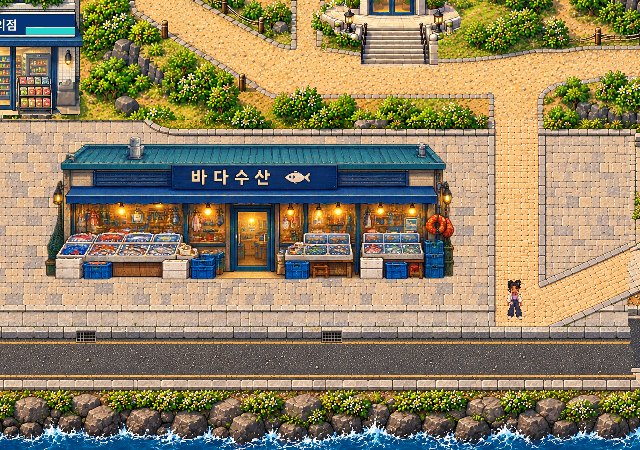 |

[Before1:1](market-before-native.png) · [After1:1](market-after-native.png)

### jeju-culture — 10 Canonical Jeju

| Before | After |
|---|---|
|  | 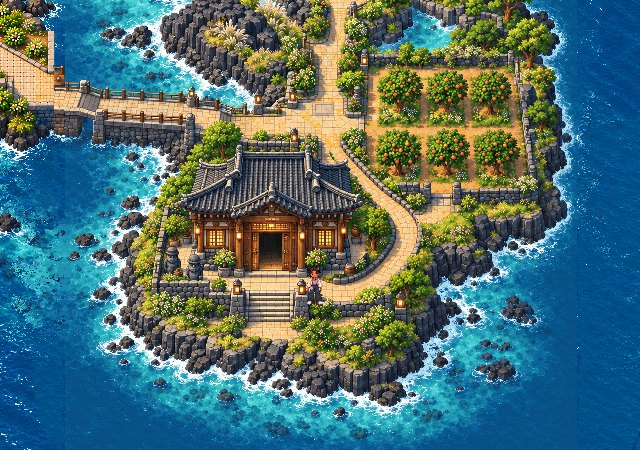 |

[Before1:1](jeju-culture-before-native.png) · [After1:1](jeju-culture-after-native.png)

### Z01 — Commercial service/public space

| Before | After |
|---|---|
| 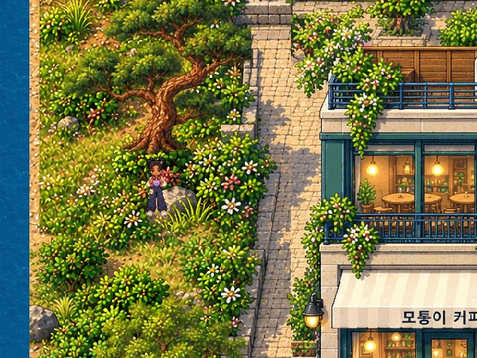 | 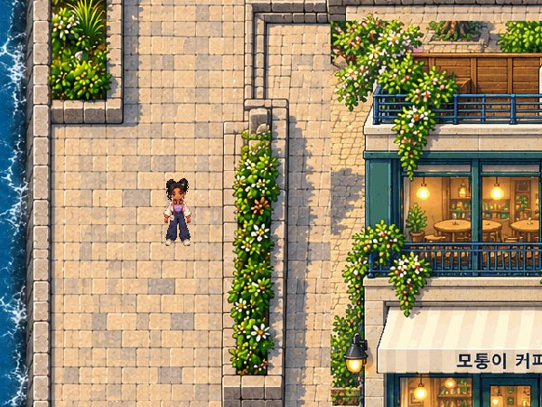 |

[Before1:1](Z01-before-crop-1x.png) · [After1:1](Z01-after-crop-1x.png)

### Z02 — Station paving/rail landscape

| Before | After |
|---|---|
| 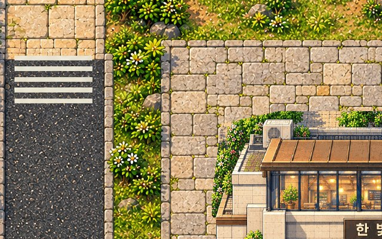 | 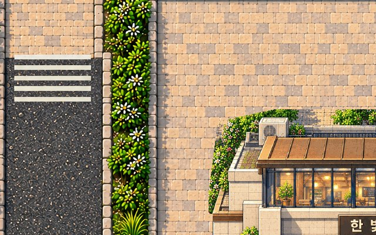 |

[Before1:1](Z02-before-crop-1x.png) · [After1:1](Z02-after-crop-1x.png)

### Z03 — Station/amusement arrival

| Before | After |
|---|---|
| 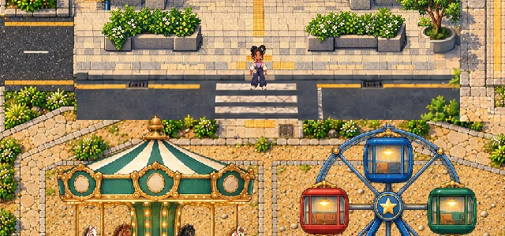 | 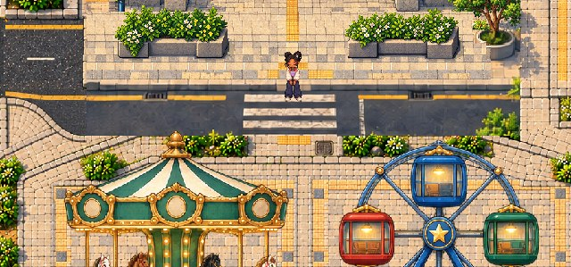 |

[Before1:1](Z03-before-crop-1x.png) · [After1:1](Z03-after-crop-1x.png)

### Z04 — Historic boundaries

| Before | After |
|---|---|
| 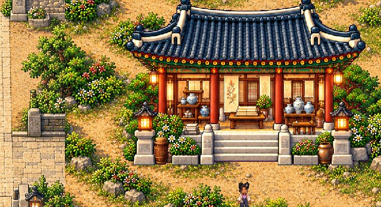 | 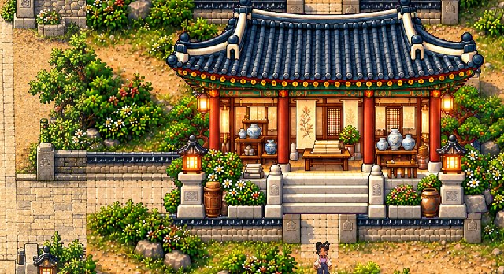 |

[Before1:1](Z04-before-crop-1x.png) · [After1:1](Z04-after-crop-1x.png)

### Z05 — City/Namsan threshold

| Before | After |
|---|---|
| 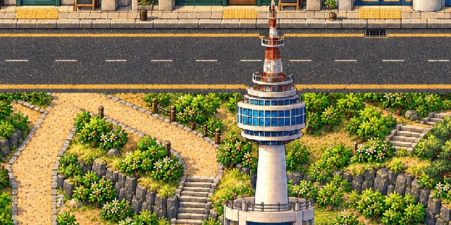 | 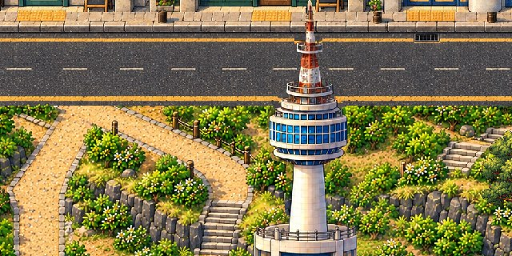 |

[Before1:1](Z05-before-crop-1x.png) · [After1:1](Z05-after-crop-1x.png)

### Z06 — Harbor promenade

| Before | After |
|---|---|
| 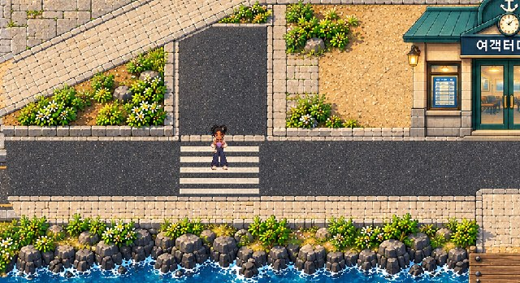 | 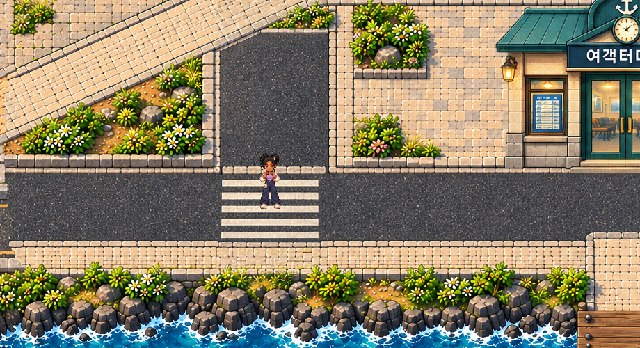 |

[Before1:1](Z06-before-crop-1x.png) · [After1:1](Z06-after-crop-1x.png)

### Z07 — Western Jeju bridge/ocean

| Before | After |
|---|---|
| 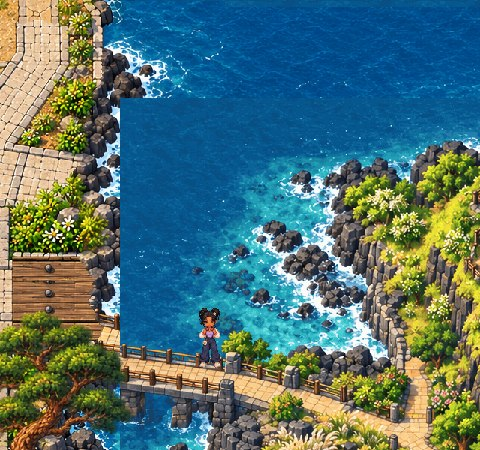 | 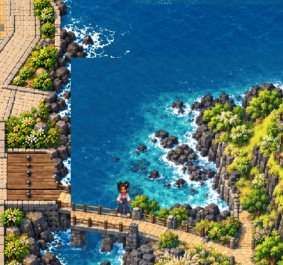 |

[Before1:1](Z07-before-crop-1x.png) · [After1:1](Z07-after-crop-1x.png)

### Z08 — External Jeju southern water

| Before | After |
|---|---|
| 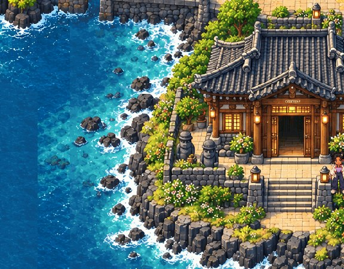 | 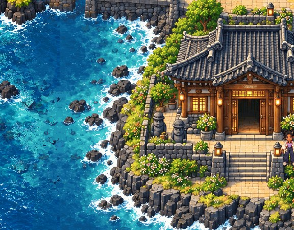 |

[Before1:1](Z08-before-crop-1x.png) · [After1:1](Z08-after-crop-1x.png)

### urban-service-west — Modern density / western service space

| Before | After |
|---|---|
| 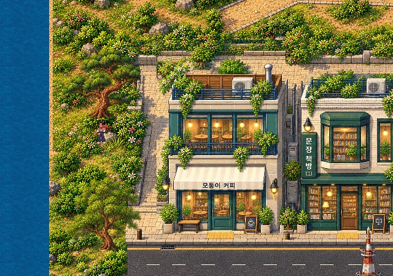 | 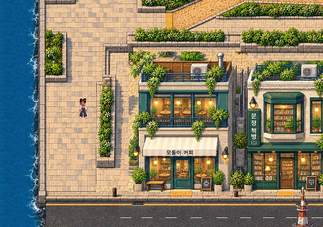 |

[Before1:1](urban-service-west-before-native.png) · [After1:1](urban-service-west-after-native.png)

### urban-service-east — Modern density / eastern service space

| Before | After |
|---|---|
| 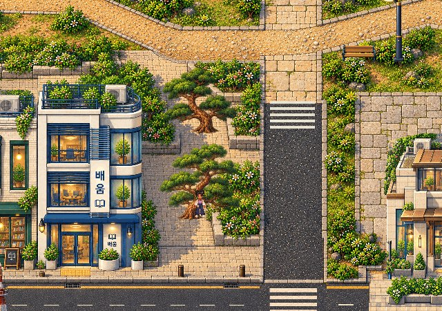 | 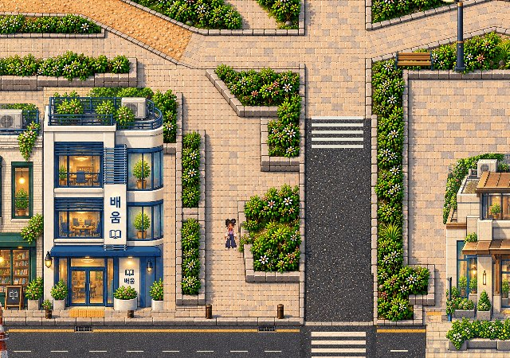 |

[Before1:1](urban-service-east-before-native.png) · [After1:1](urban-service-east-after-native.png)

### urban-density — Historic-to-commercial planting boundary

| Before | After |
|---|---|
| 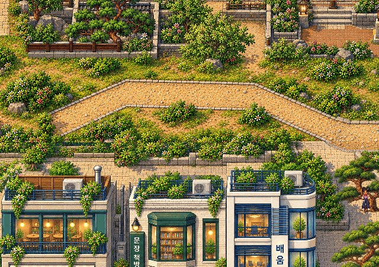 | 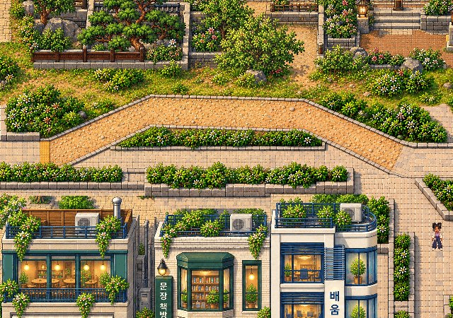 |

[Before1:1](urban-density-before-native.png) · [After1:1](urban-density-after-native.png)

## Native Muneum craftsmanship benchmark

[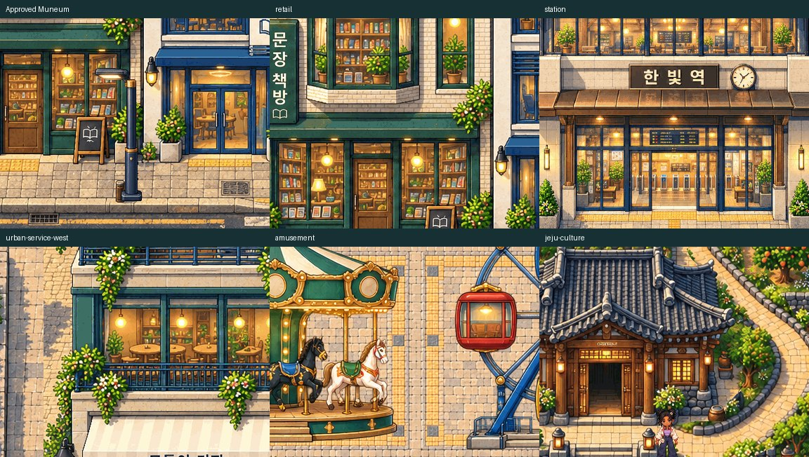](native-benchmark-board.png)

Six384×300 cells preserve source pixels at1:1. Protected facades are reused, not newly generated buildings.

## Landscape density and navigation

Density was decided by public-space function and available land, not an arbitrary vegetation percentage. Seven noncanonical urban/harbor trees were removed and four visible low-bed bases received explicit contacts; protected garden/park trees remain. [Native ownership registry](../../assets-src/gate3/zoned-world-v1/integration-provenance.json).

[Actual continuous gameplay](world-traversal-review.mp4) · [Native-resolution viewing encode](world-traversal-native-resolution.mp4) · [Movement report](movement-report.json) · [Station/amusement native](station-amusement-after-native.png) · [Bridge native](jeju-bridge-after-native.png) · [Rail/coast native](rail-coast-after-native.png) · [Bookshop visibility](bookshop-occlusion-after-native.png).

The station8px strip, tower/retail and ride/road projection, inherited routes/body clearance, required Bakery and real hardware/device requirements remain explicit. No main merge, deployment or physical-device PASS.
