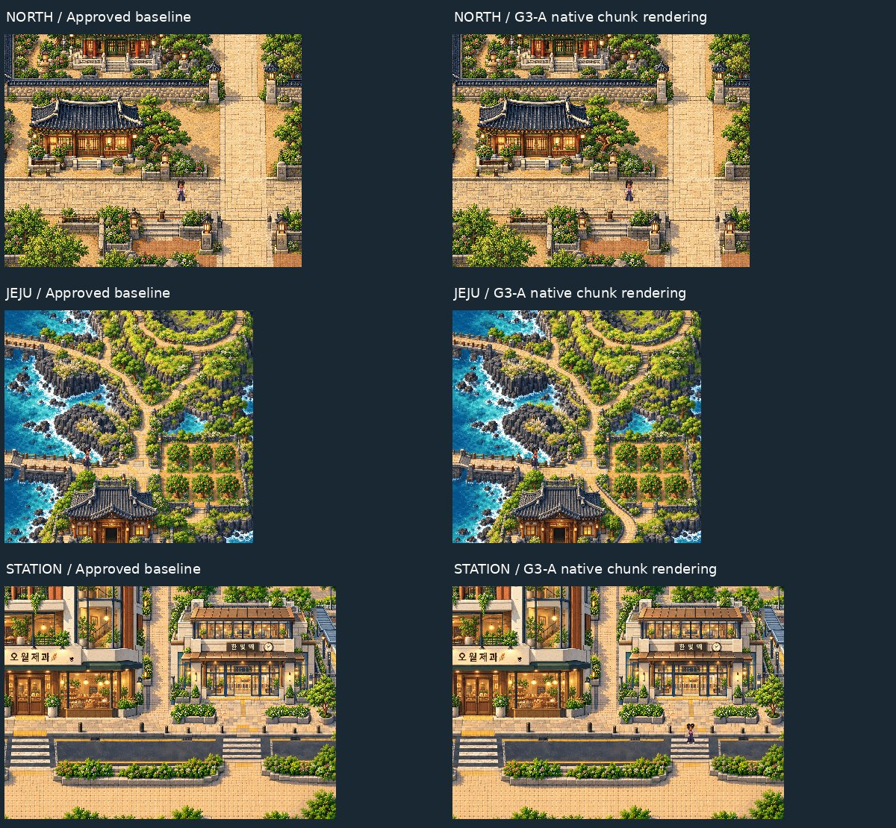

# G3-A — first foundation review

Gate3 is authorized. The corrected Gate2.5 baseline is protected at`01f4f95` by`checkpoint/gate25-final-approved-20261022`; working branch`art-gate/gate3-full-world`.

**[Download playable ZIP](G3A_FOUNDATION_REVIEW.zip)** · [Technical PASS/FAIL/NOT TESTED report](REPORT.md) · [Source/provenance](PROVENANCE.md) · [Physical-device handoff](DEVICE_CHECKLIST.md)

This is the4352×4864 engine foundation, with approved northern/Jeju art and unfinished engineering terrain. The corrected district is a separate native cache laboratory. **World registration needs a decision:** anchoring its station to the approved world origin places its west edge225.5px outside the canvas and exposes a0.5px pixel-phase issue. No protected coordinate, facade or source has moved. [Spatial evidence and proposed next review](REPORT.md#unresolved-registration-decision--do-not-silently-move-assets).

## Quick visual review

These small previews are review derivatives. Original1:1 captures below remain unchanged. Overview is explicitly a low-resolution planning proxy, not native world artwork.

[Full-world Phaser planning overview](world-overview.png) · [Light overview](world-overview-preview.jpg) · [Registration conflict diagram](registration-conflict.png)

| Environment | Native Phaser screenshot | Native pixel crop | Lightweight preview |
| --- | --- | --- | --- |
| Historical North | [1:1](north-native.png) | [Original pixels](north-native-pixels-1x.png) | [266KB](north-native-preview.jpg) |
| Jeju | [1:1](jeju-native.png) | [Original pixels](jeju-native-pixels-1x.png) | [243KB](jeju-native-preview.jpg) |
| Station / corrected district with Juni | [1:1](station-native.png) | [Original pixels](station-native-pixels-1x.png) | [253KB](station-native-preview.jpg) |
| Both corrected planters | [Left native](left-planter-native.png) | [Right native](right-planter-native.png) | [Exact native readback proof](preservation-and-native-proof.json) |
| Mobile emulation / Tour | [Tour](mobile-tour.png) | [Overview](mobile-overview.png) | [106KB](mobile-tour-preview.jpg) |

## Actual gameplay and camera evidence

- [District traversal through both art joins and native chunk boundaries](DISTRICT_TRAVERSAL.mp4).
- [Historical artwork to world-planning spine traversal](NORTH_TO_PLANNING_SPINE.mp4).
- [Mobile-emulated Jeju Tour, overview and Return cycles](CAMERA_TOUR_EMULATED.mp4). Juni position preserved. This is not physical-device evidence.

## Engineering evidence

- [Input/camera/session report](gameplay-report.json), [five-route collision/pacing audit](route-audit.json), [actual route points](route-points.json).
- [24MiB eviction, injected collision-failure recovery and Canvas fallback](resilience-report.json).
- [Touch joystick, reduced-motion tour, control restoration and export checks](controls-report.json); [example exported browser report](emulated-export-example.json).
- [Isolated WebGL/Canvas samples](renderer-bench.json). SwiftShader/recording has frame spikes; production performance is not approved.
- [Chunk generation proof](chunk-generation-proof.json), [1,341 protected SHA256 entries](protected-assets.json), [preservation/native check](preservation-and-native-proof.json), [package integrity](package-proof.json).
- [Versioned production plan](../../assets-src/gate3/production-plan-v1.json), [official authorization](../current/GATE3_AUTHORIZATION.md).

Physical Android Chrome and iPhone Safari: **NOT TESTED**. No main merge or public deployment. Original approved package is unchanged inside the new ZIP under`approved-prototype/GATE25_APPROVED.zip`.

**Please review G3-A and the registration conflict before pipeline expansion into G3-B**, as required by the official authorization's final checkpoint. This delivery does not grant itself artistic or architectural approval.
