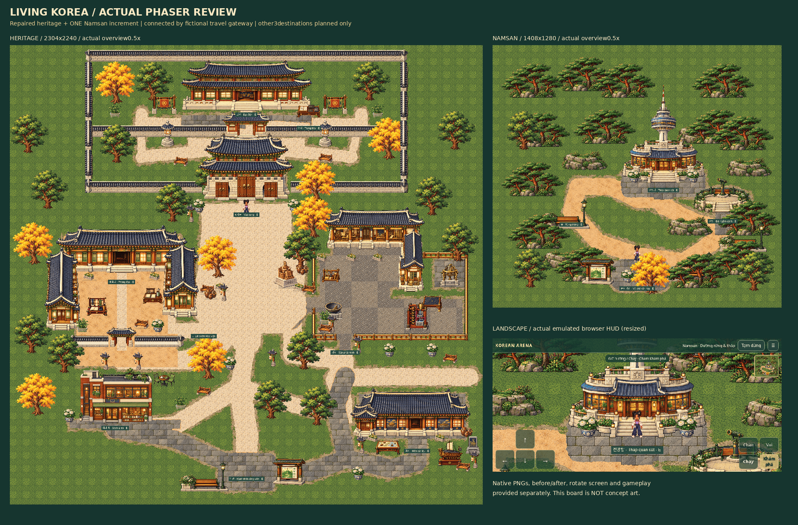

# Living Korea — repaired north + first Namsan review increment

Stage A northern repair and Stage B editable four-destination masterplan are complete. The FIRST Stage C playable increment is Namsan only, with landscape mobile integration. Entertainment, Busan coast and Jeju are PLANNED, not produced. Stop for visual/gameplay approval before mass southern production, further NPCs, cleanup, main merge or publication.

## View and play

Download [playable-review.zip](playable-review.zip). Extract the ENTIRE `Korean-Arena-Living-Korea-Review` folder, run `python3 start.py` (Windows `py start.py`) and open the printed HTTP URL ending `/3D-pharse5-/living-korea-review.html`. Python3 required; no Node/account/API needed to VIEW. Never open file:// or HTML source viewer. Ctrl+C stops your local server. Cloud loopback is not a public preview link; this candidate is not on Pages.

For a software-GPU machine run `python3 start.py --canvas`. Optional same-network phone review uses `--lan` and the computer LAN IP. Portrait pauses and asks you to rotate; browser fullscreen/orientation requests require a gesture and may be unsupported, especially iOS/LAN HTTP. Manual rotation remains available. See [mobile notes](MOBILE.md).

WASD/arrows walk, Shift runs, E explores; mobile D-pad and hold-run work simultaneously. Wave/celebrate/settings, evening, zoom, pause and OS reduced-motion remain. Open the palace main gate and visit inner hall/hanji; west Academy opens the preserved reading room and Hangul desk. Return through its south exit. Workshop service gap/front gate and museum cross-lane/frontage are accessible. Follow the southern cultural street to the modern travel garden, Explore and choose Namsan. Walk forest paths to tower and accessible terrace stairs/telescope; use the park entrance travel interaction to return. Return is reciprocal, with no forced gate bounce.

The original town and all prior review entries remain in the ZIP. No multiplayer, ads, paid services or new historical NPCs are implied.

## What changed

- Coherent palace side returns, actual main/inner gates, Academy low front walls and open shortcut. No decorative wall fragments through roofs. Workshop bare rails and23unique socket posts (minimum52pxspacing), genuine service/front entrances.
- Museum's entire11object functional cluster moved224pxsouth with its colliders/anchor, preserving exact approved PNGs/scale. Public cross-lane and purposeful frontage planting/seating separate workshop and museum.
- Northern2304x2240world:144props/150static rectangles. Original2304x1920review stays intact. First Namsan1408x1280world:35props/39rectangles, original tower silhouette/pavilion, layered forest, actual open terrace stair and retaining-face collision, learning interaction and reciprocal travel.
- Juni144frames, native80pxbody, walk60/run100 and original movement system unchanged.1123protected prior source/assets/lock files retain exact hashes. All approved source pixels and Blender/3D/history checkpoints retained.
- Fictional Korean travel geography is explicit. [Editable masterplan PNG](southern-masterplan.png), [SVG](southern-masterplan.svg) and [JSON](southern-masterplan.json) separate distant destinations through travel links. No claim they are adjacent in real Seoul.

## Actual visual evidence

[Before/after nine-position audit](quality/northern-repair-comparison.png), with complete native images in quality/. [Stage A table](STAGE_A.md) gives exact final camera poses. The user's annotated blue-circle image was not attached: this is an independent defect audit, not proof of exact correspondence to unseen annotations.

[Full northern overview](quality/north-overview-half-scale.png) and [Namsan overview](quality/namsan-overview-half-scale.png) are actual Phaser camera renders at0.5x. Landmark PNGs are native1x; pixel-detail crops are nearest-neighbor2x/3x, not regenerated artwork. QA placements are used for matched stills, never represented as locomotion. [Traditional→modern transition](quality/traditional-modern-transition-native.png), [mobile landscape](quality/mobile-landscape-interface.png), [mobile panorama](quality/mobile-panorama-interface.png), [portrait rotate screen](quality/portrait-rotate-interface.png), [Hangul dialogue](quality/mobile-hangul-dialogue.png) and [socket detail](quality/workshop-sockets-detail-2x.png) are provided. Screenshots demonstrate a candidate for user review, not user aesthetic approval.

[Decoded gameplay contact sheet](quality/gameplay-decoded-contact-sheet.png), [real mobile walkthrough](quality/gameplay-landscape-walkthrough.mp4) and [original simultaneous native VP9 capture](quality/native-gameplay-original.webm) follow palace→Academy lesson→workshop→museum→travel garden→Namsan forest/tower/terrace→return. Ordinary public entry, real multi-pointer touch/tap/run, no QA hook/placement/injected frames. Source frame hashes and timestamps are permanent in quality/capture.json; large raw JPEGs remain only in ignored execution cache. Encoding preserves every actual CDP frame and its capture time, sorting12out-of-order delivery events by their original timestamps. No interpolation, duplication, speed-up or promised constant60fps. Timestamp quantization and exact decoded frame count are checked in video-verification.json; browser playback separately in video-playback.json. Runtime and capture FPS are separate; see [performance](PERFORMANCE.md).

## Actual production pipeline and validation

See [FORGE.md](FORGE.md), source commands.json and original raw images/prompts. Four actual native host image calls, zero paid provider routes; host model/pricing is unexposed and is not claimed free. Pinned Agent Sprite Forge extraction, measured ownership boxes, area finish, edge hygiene, shared192color palette, map bundle/hash/nav/Tiled/layered composition and official HTTP marker verification actually executed. No generic code-drawn replacement art.15finished components include a retained earlier terrace candidate; targeted source edit opens real south stairs.

36north/11park marker routes and52/13assets loaded without errors; three linked maps and2952public-path clearance samples pass. Actor checks skipped on actorless boards and inherited small side-idle/wave warnings remain explicitly documented. Terrain is not certified seamless/Wang. [Reference record](HISTORICAL_REFERENCES.md) distinguishes successful official pages from failed guesses; fictional landmarks are not historical reconstructions.

Final source/build/test/HTTP-package facts are in verification.json, package.json and the immutable `checkpoint/living-korea-first-increment-verified-20261018` annotation AFTER independent observation. Source checkpoint, cloud-environment activation and public website release are separate. Main and Pages are not changed by this review.

## Verified local release checks

Full root setup12unit +26browser PASS,0skipped/unexpected/flaky; source/assets/type/lint/format/build pass. Exact ZIP:20,698,371bytes,291static files, SHA256`3db8f47d5e723598444d6bb6c8aee36b3e785cce66ccae03f7008a3c4604ee48`. HTTP pixel equality and travel/lesson/oldtown checks pass. MP4:9282frames/155.311s, averageVFR59.76FPS; maximum relative timestamp error0.500ms. Original native stream8888frames is independently retained. Both videos actually play and seek in Chromium, decoded pixels change. Final remote CI and independent checkout are observed and recorded in the immutable verified tag; local report is not a substitute for those observations.
