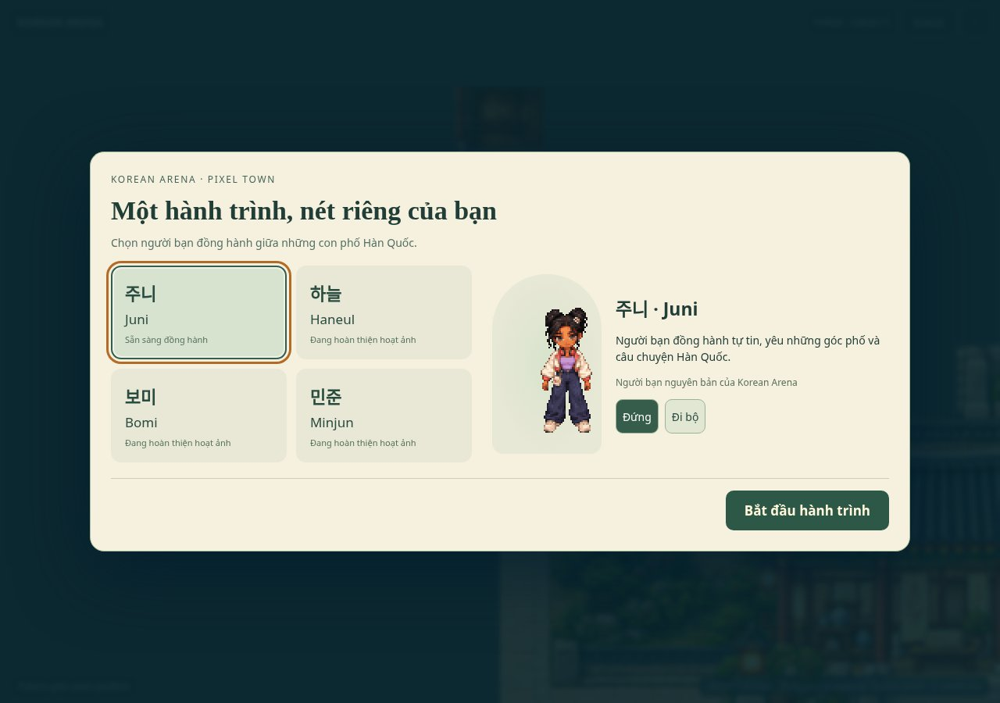
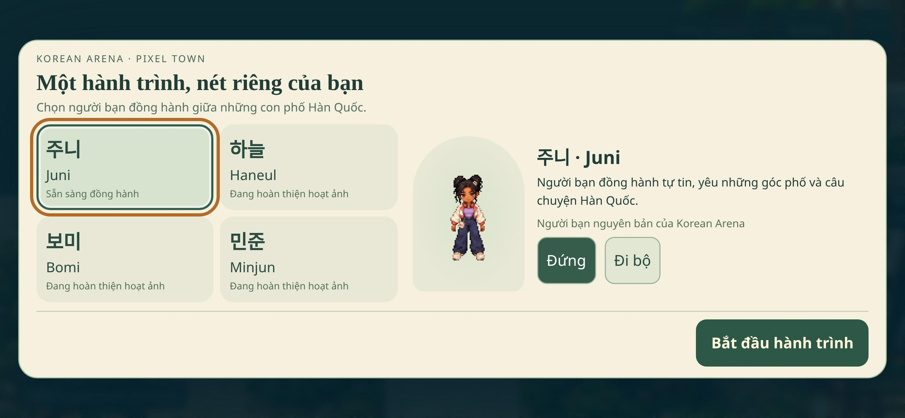
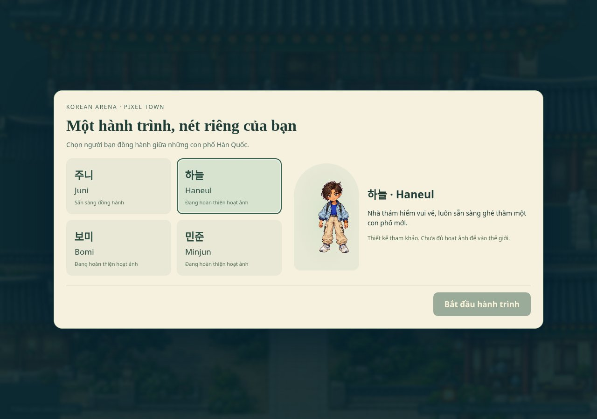
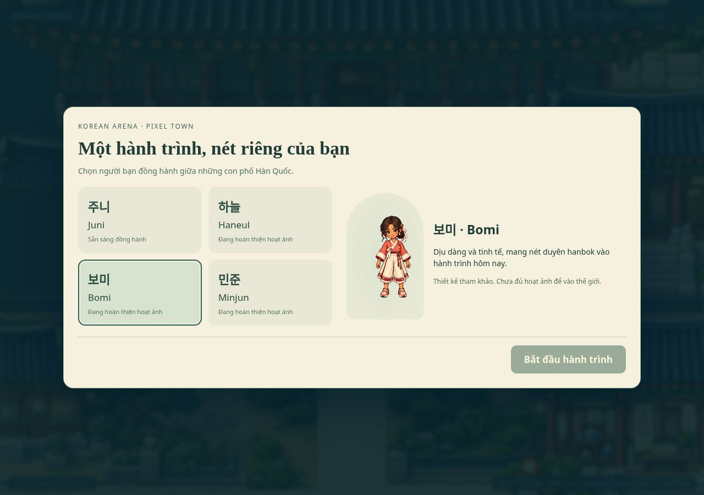
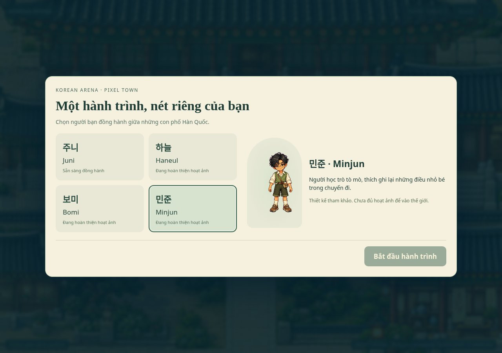
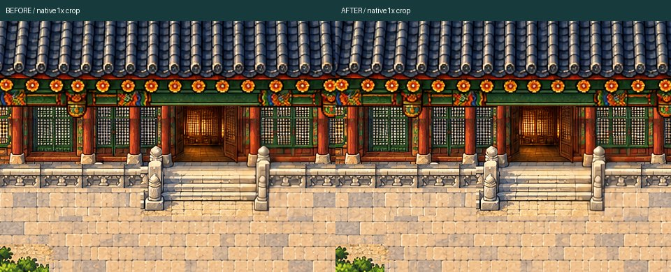
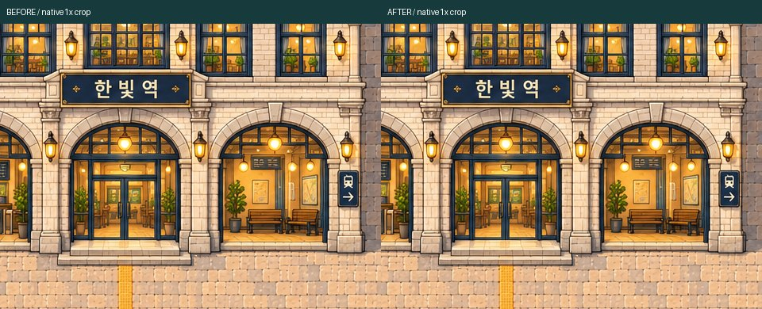
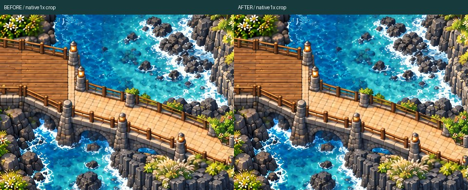

# Phase1 review — technical foundation / roster INCOMPLETE

**Only Juni is playable. Haneul/Bomi/Minjun are design references, not completed native sprites. Four-character acceptance is NOT achieved.**

[Playable ZIP](PHASE1_FOUNDATION_REVIEW.zip) · [QA](QA.md) · [Character art status](character-art-status.json) · [Selection + Juni gameplay](selection-juni-gameplay-review.mp4)

## Actual selection UI

## haneul — INCOMPLETE

## bomi — INCOMPLETE

## minjun — INCOMPLETE

## Genuine native Phaser world preservation

Six identical-camera pairs, Canvas/WebGL. Originals are1:1 canvas readbacks; only Juni animation-time rectangles excluded from pixel comparison. Camera/nearest/world assets unchanged.

### palace-front-local

[BEFORE1x](palace-front-local-webgl-before-native-1x.png) · [AFTER1x](palace-front-local-webgl-after-native-1x.png) · [Native crop board](palace-front-local-native-comparison.png)

### station-all

[BEFORE1x](station-all-webgl-before-native-1x.png) · [AFTER1x](station-all-webgl-after-native-1x.png) · [Native crop board](station-all-native-comparison.png)

### bridge-a-full

[BEFORE1x](bridge-a-full-webgl-before-native-1x.png) · [AFTER1x](bridge-a-full-webgl-after-native-1x.png) · [Native crop board](bridge-a-full-native-comparison.png)

## Juni native movement and scale

Original96×112cell,48/100foot origin, native scale1. Actual original WASD/Shift/Space/C. New character native motion/scale comparison is NOT AVAILABLE; no synthetic four-character in-world collage is provided.

[walk-back original native frame](walk-back-native-1x.png) · [1x context crop](walk-back-native-crop.png)

[walk-left original native frame](walk-left-native-1x.png) · [1x context crop](walk-left-native-crop.png)

[walk-front original native frame](walk-front-native-1x.png) · [1x context crop](walk-front-native-crop.png)

[walk-right original native frame](walk-right-native-1x.png) · [1x context crop](walk-right-native-crop.png)

[run-back original native frame](run-back-native-1x.png) · [1x context crop](run-back-native-crop.png)

[run-left original native frame](run-left-native-1x.png) · [1x context crop](run-left-native-crop.png)

[run-front original native frame](run-front-native-1x.png) · [1x context crop](run-front-native-crop.png)

[run-right original native frame](run-right-native-1x.png) · [1x context crop](run-right-native-crop.png)

[wave original native frame](wave-native-1x.png) · [1x context crop](wave-native-crop.png)

[celebrate original native frame](celebrate-native-1x.png) · [1x context crop](celebrate-native-crop.png)

## Actual gameplay

[Selection/Juni video](selection-juni-gameplay-review.mp4) · [Both crossings: A walk/B run out+return](bridge-regression/world-traversal-review.mp4)

[Preservation QA](preservation-qa.json) · [Body/native foot regression](bridge-regression/body-clearance.json) · [Physical-device checklist / NOT TESTED](DEVICE_REVIEW.md)
