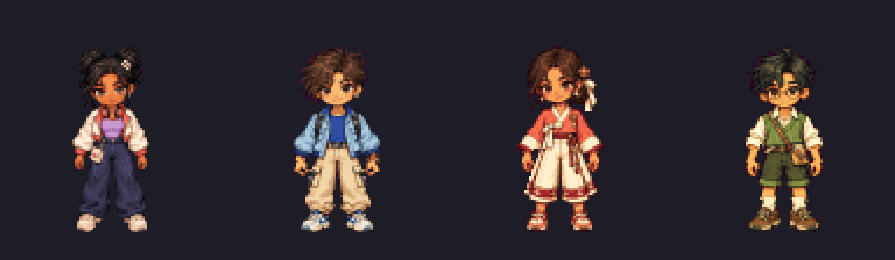
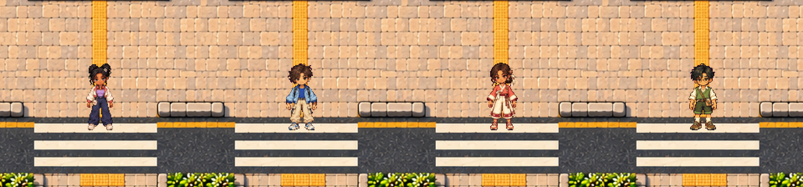

# Phase1B — four-character playable review

Juni, Haneul (하늘), Bomi (보미) and Minjun (민준) are now genuinely selectable and playable in the frozen canonical world. Three new native packs extend the accepted foundation. **Human artistic approval is pending. Phase2 remains locked.**

- [Download playable ZIP](PHASE1B_FOUR_CHARACTER_REVIEW.zip) — extract, run `python3 start_review.py`, open `REVIEW.html` / the local game.
- [Visual evidence](VISUAL_REVIEW.md) · [Offline review gallery](VISUAL_REVIEW.html) · [QA and all remaining warnings](QA.md).
- [Source/provenance](SOURCE_PROVENANCE.md) · [Technical changes and reload continuity](TECHNICAL_CHANGES.md) · [Physical-device checklist](DEVICE_REVIEW.md).

The second comparison contains crops from four separate actual native Phaser station screenshots. It is not a fabricated four-player scene. [Original1:1 comparison](four-native-gameplay-crops.png).

Required checks pass, and protected world/Juni sources remain unchanged. The actual extracted ZIP also passed four-avatar switching, nonempty visited-marker/position reload, mobile touch and native sprite/world readback checks; see [package validation](package-pixel-qa.json). Physical devices, sustained hardware WebGL performance and unsupported canonical interiors remain NOT TESTED. Final auto-luminance motion diagnostics retain11 WARNs at overlapping/crossing-foot poses; inspect the complete values in QA.md and judge actual-speed movement. This is not automatic artistic approval.

No new world art, repeated cleanup, new character engine, Phase2 services, main merge or public deployment was performed. Earlier Phase1 reports, sources and checkpoints remain recoverable. Stop here for human review.
