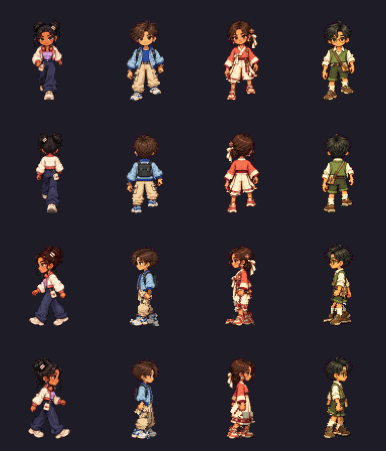
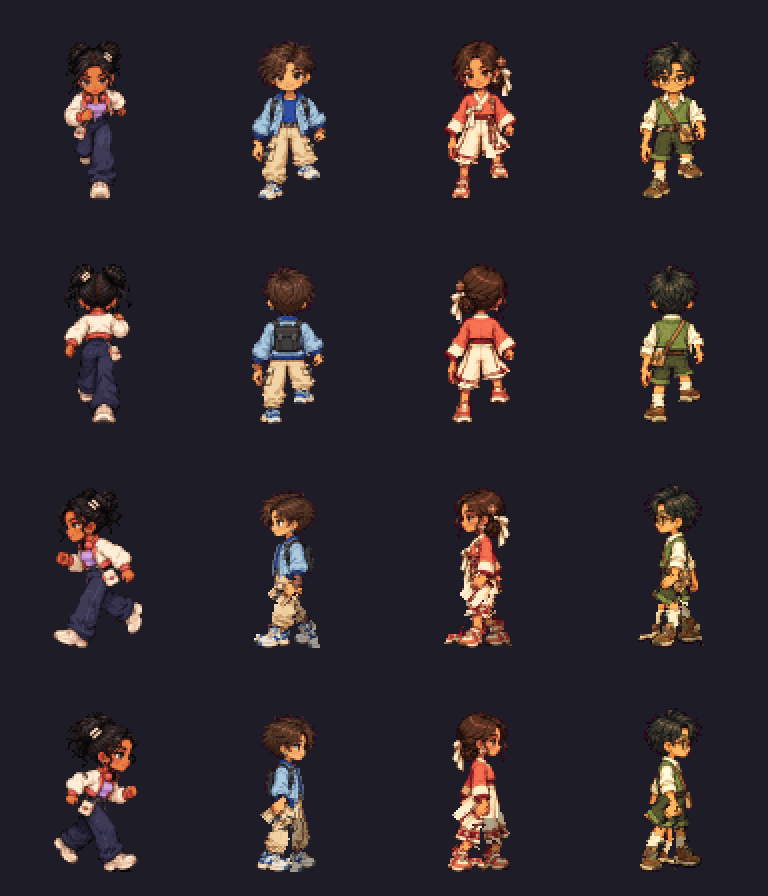
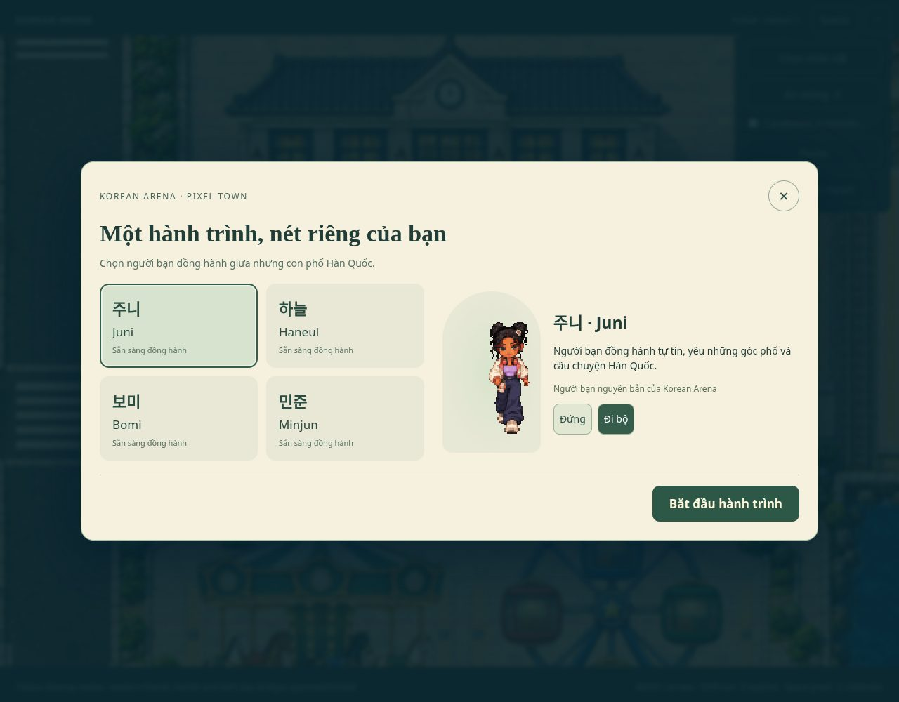
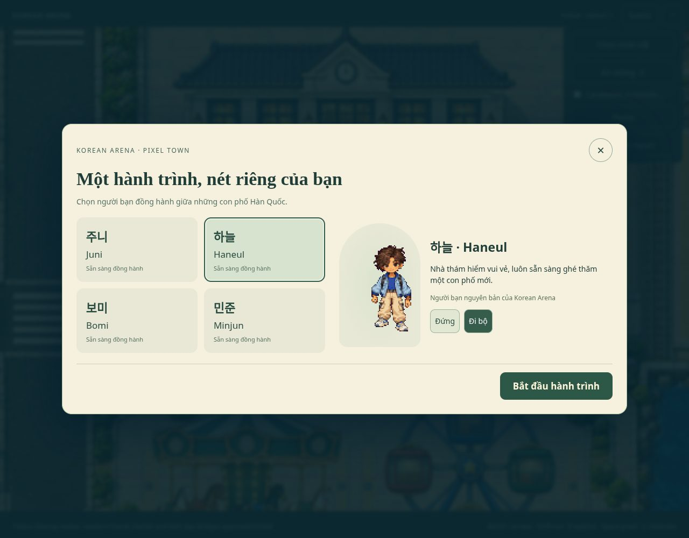
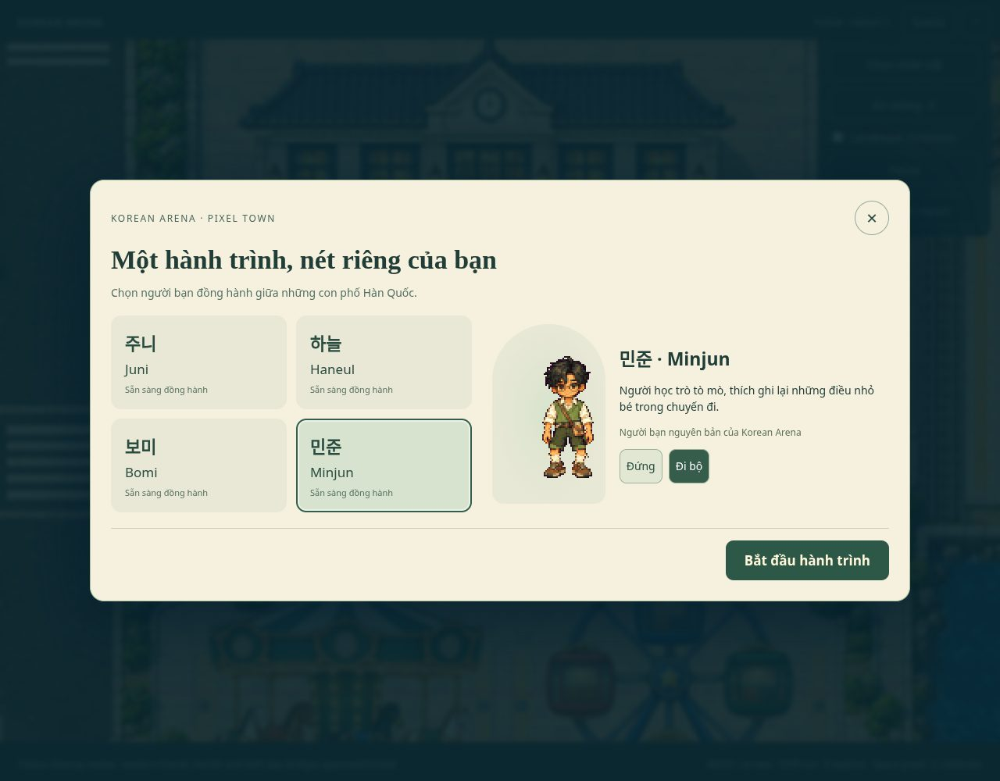

# Native visual review

Order throughout: **Juni · Haneul · Bomi · Minjun**. Native PNGs are unscaled Phaser backing images; review enlargements use integer nearest sampling. Source sheets are labelled separately from gameplay. Videos are actual browser recordings; H264 review copies are lossy and do not substitute for native pixel evidence.

**Lossless atlas animations, source review only (not gameplay).** Columns: Juni/Haneul/Bomi/Minjun. Rows: front/back/left/right. The images animate in compatible browsers; [native walk](walk-four-directions-native-preview.png) and [native run](run-four-directions-native-preview.png) remain1×. [Pose-key provenance](motion-preview-provenance.json) explains the intended contact/crossing phases and retains all Forge warnings.

[Native source lineup1×](lineup-native-1x.png) · [Actual Phaser body readback lineup1×](actual-phaser-body-lineup-native.png) · [Actual scene crops1×](four-native-gameplay-crops.png)

[Native-pixel gameplay focus crop, all four characters / walk / run / emotes](four-character-gameplay-native-crop-review.mp4) · [Uncropped UI review video](four-character-gameplay-review.mp4) · [Full recording](four-character-gameplay.mp4)

[Actual nonempty visited marker, four character switches and refresh — lightweight video](progress-switch-refresh-review.mp4) · [Full recording](progress-switch-refresh.mp4)

## Juni

[Complete station frontage, native1:1](juni-complete-station-frontage-native-1x.png) · [Native scene crop](juni-station-native-crop.png) · [Both bridges, actual out/return gameplay](bridges-juni-review.mp4) · [Full bridge recording](bridges-juni.mp4)

## Haneul

[Complete station frontage, native1:1](haneul-complete-station-frontage-native-1x.png) · [Native scene crop](haneul-station-native-crop.png) · [Both bridges, actual out/return gameplay](bridges-haneul-review.mp4) · [Full bridge recording](bridges-haneul.mp4)

[Native atlas](../../public/assets/characters/haneul/atlas.png) · [Phaser JSON](../../public/assets/characters/haneul/atlas.json) · [Sources / masks / joints / provenance](../../assets-src/characters/phase1b/haneul/provenance.json)

- [walk front: eight native source frames](haneul-walk-front-sheet-native.png) · [2× review](haneul-walk-front-sheet-2x.png) · [Actual Phaser1× pose](haneul-walk-front-native-1x.png)
- [walk back: eight native source frames](haneul-walk-back-sheet-native.png) · [2× review](haneul-walk-back-sheet-2x.png) · [Actual Phaser1× pose](haneul-walk-back-native-1x.png)
- [walk left: eight native source frames](haneul-walk-left-sheet-native.png) · [2× review](haneul-walk-left-sheet-2x.png) · [Actual Phaser1× pose](haneul-walk-left-native-1x.png)
- [walk right: eight native source frames](haneul-walk-right-sheet-native.png) · [2× review](haneul-walk-right-sheet-2x.png) · [Actual Phaser1× pose](haneul-walk-right-native-1x.png)
- [run front: eight native source frames](haneul-run-front-sheet-native.png) · [2× review](haneul-run-front-sheet-2x.png) · [Actual Phaser1× pose](haneul-run-front-native-1x.png)
- [run back: eight native source frames](haneul-run-back-sheet-native.png) · [2× review](haneul-run-back-sheet-2x.png) · [Actual Phaser1× pose](haneul-run-back-native-1x.png)
- [run left: eight native source frames](haneul-run-left-sheet-native.png) · [2× review](haneul-run-left-sheet-2x.png) · [Actual Phaser1× pose](haneul-run-left-native-1x.png)
- [run right: eight native source frames](haneul-run-right-sheet-native.png) · [2× review](haneul-run-right-sheet-2x.png) · [Actual Phaser1× pose](haneul-run-right-native-1x.png)

[Wave native sheet](haneul-wave-sheet-native.png) · [Celebrate native sheet](haneul-celebrate-sheet-native.png) · [Wave actual Phaser](haneul-wave-native-1x.png) · [Celebrate actual Phaser](haneul-celebrate-native-1x.png)

## Bomi

[Complete station frontage, native1:1](bomi-complete-station-frontage-native-1x.png) · [Native scene crop](bomi-station-native-crop.png) · [Both bridges, actual out/return gameplay](bridges-bomi-review.mp4) · [Full bridge recording](bridges-bomi.mp4)

[Native atlas](../../public/assets/characters/bomi/atlas.png) · [Phaser JSON](../../public/assets/characters/bomi/atlas.json) · [Sources / masks / joints / provenance](../../assets-src/characters/phase1b/bomi/provenance.json)

- [walk front: eight native source frames](bomi-walk-front-sheet-native.png) · [2× review](bomi-walk-front-sheet-2x.png) · [Actual Phaser1× pose](bomi-walk-front-native-1x.png)
- [walk back: eight native source frames](bomi-walk-back-sheet-native.png) · [2× review](bomi-walk-back-sheet-2x.png) · [Actual Phaser1× pose](bomi-walk-back-native-1x.png)
- [walk left: eight native source frames](bomi-walk-left-sheet-native.png) · [2× review](bomi-walk-left-sheet-2x.png) · [Actual Phaser1× pose](bomi-walk-left-native-1x.png)
- [walk right: eight native source frames](bomi-walk-right-sheet-native.png) · [2× review](bomi-walk-right-sheet-2x.png) · [Actual Phaser1× pose](bomi-walk-right-native-1x.png)
- [run front: eight native source frames](bomi-run-front-sheet-native.png) · [2× review](bomi-run-front-sheet-2x.png) · [Actual Phaser1× pose](bomi-run-front-native-1x.png)
- [run back: eight native source frames](bomi-run-back-sheet-native.png) · [2× review](bomi-run-back-sheet-2x.png) · [Actual Phaser1× pose](bomi-run-back-native-1x.png)
- [run left: eight native source frames](bomi-run-left-sheet-native.png) · [2× review](bomi-run-left-sheet-2x.png) · [Actual Phaser1× pose](bomi-run-left-native-1x.png)
- [run right: eight native source frames](bomi-run-right-sheet-native.png) · [2× review](bomi-run-right-sheet-2x.png) · [Actual Phaser1× pose](bomi-run-right-native-1x.png)

[Wave native sheet](bomi-wave-sheet-native.png) · [Celebrate native sheet](bomi-celebrate-sheet-native.png) · [Wave actual Phaser](bomi-wave-native-1x.png) · [Celebrate actual Phaser](bomi-celebrate-native-1x.png)

## Minjun

[Complete station frontage, native1:1](minjun-complete-station-frontage-native-1x.png) · [Native scene crop](minjun-station-native-crop.png) · [Both bridges, actual out/return gameplay](bridges-minjun-review.mp4) · [Full bridge recording](bridges-minjun.mp4)

[Native atlas](../../public/assets/characters/minjun/atlas.png) · [Phaser JSON](../../public/assets/characters/minjun/atlas.json) · [Sources / masks / joints / provenance](../../assets-src/characters/phase1b/minjun/provenance.json)

- [walk front: eight native source frames](minjun-walk-front-sheet-native.png) · [2× review](minjun-walk-front-sheet-2x.png) · [Actual Phaser1× pose](minjun-walk-front-native-1x.png)
- [walk back: eight native source frames](minjun-walk-back-sheet-native.png) · [2× review](minjun-walk-back-sheet-2x.png) · [Actual Phaser1× pose](minjun-walk-back-native-1x.png)
- [walk left: eight native source frames](minjun-walk-left-sheet-native.png) · [2× review](minjun-walk-left-sheet-2x.png) · [Actual Phaser1× pose](minjun-walk-left-native-1x.png)
- [walk right: eight native source frames](minjun-walk-right-sheet-native.png) · [2× review](minjun-walk-right-sheet-2x.png) · [Actual Phaser1× pose](minjun-walk-right-native-1x.png)
- [run front: eight native source frames](minjun-run-front-sheet-native.png) · [2× review](minjun-run-front-sheet-2x.png) · [Actual Phaser1× pose](minjun-run-front-native-1x.png)
- [run back: eight native source frames](minjun-run-back-sheet-native.png) · [2× review](minjun-run-back-sheet-2x.png) · [Actual Phaser1× pose](minjun-run-back-native-1x.png)
- [run left: eight native source frames](minjun-run-left-sheet-native.png) · [2× review](minjun-run-left-sheet-2x.png) · [Actual Phaser1× pose](minjun-run-left-native-1x.png)
- [run right: eight native source frames](minjun-run-right-sheet-native.png) · [2× review](minjun-run-right-sheet-2x.png) · [Actual Phaser1× pose](minjun-run-right-native-1x.png)

[Wave native sheet](minjun-wave-sheet-native.png) · [Celebrate native sheet](minjun-celebrate-sheet-native.png) · [Wave actual Phaser](minjun-wave-native-1x.png) · [Celebrate actual Phaser](minjun-celebrate-native-1x.png)

## Preserved world

[Native Canvas/WebGL comparison report](native-pixel-qa.json). Current palace, station and bridge reference entries match accepted Phase1 world pixels exactly under the same camera/browser configuration; original comparison images remain unchanged in docs/phase1.

[QA / exact warning values](QA.md) · [Physical-device review](DEVICE_REVIEW.md).
