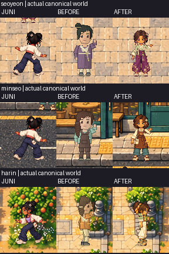
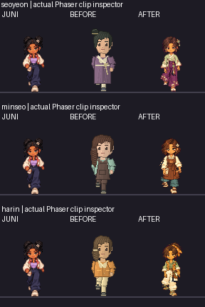

# Juni versus BEFORE versus AFTER

All columns use native96×112cells and scale1;the new figures were not enlarged to manufacture detail. Review enlargements use integer nearest-neighbor only. Juni and the12approved playable actors remain byte-identical.

## Canonical-world native evidence

[Readable3×copy](juni-before-after-world-review-3x.png). Crops contain genuine ground/lighting and may include nearby actors at the edge;full screenshots remain linked below. BEFORE is an actual Phaser replay of the exact rejected checkpoint PNG at its original texture URL,using the unchanged engine/data/world. AFTER uses only the3newatlas replacements. No rendered pose,position,physics,camera or clock was forced.

## Same-phase native Phaser clip inspection

[Readable3×copy](juni-before-after-inspector-review-3x.png). These are actual Phaser-rendered sprites at the same normalized animation phase/scale,with approved Juni alongside old/new NPC cells. Neutral QA backdrop;this is SUPPLEMENTAL clip inspection,not world-navigation proof. [36pixel-exact sprite readbacks](inspector-native-qa.json).

Assess faces/eyelids/brows,hair volume and highlights,collars/cuffs/folds,footwear,silhouette,palette,source identity and animation continuity. We consider the illustrated source substantially closer to the approved family;human review must decide whether it meets Juni's craftsmanship. No PASS based solely on104cells or technical checks.
