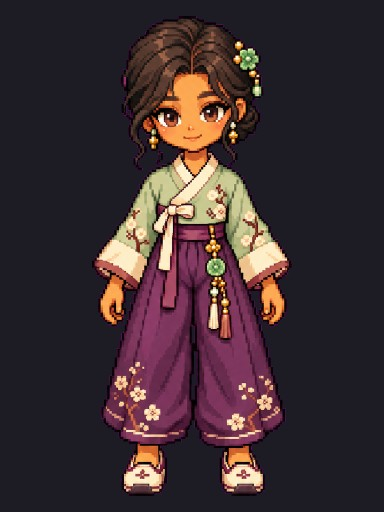
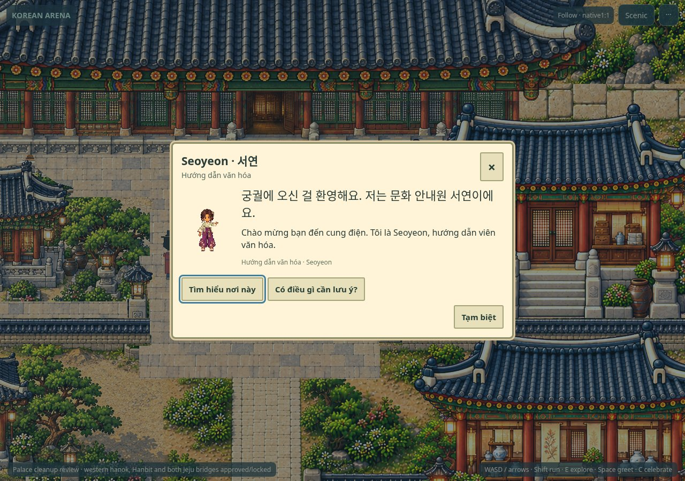
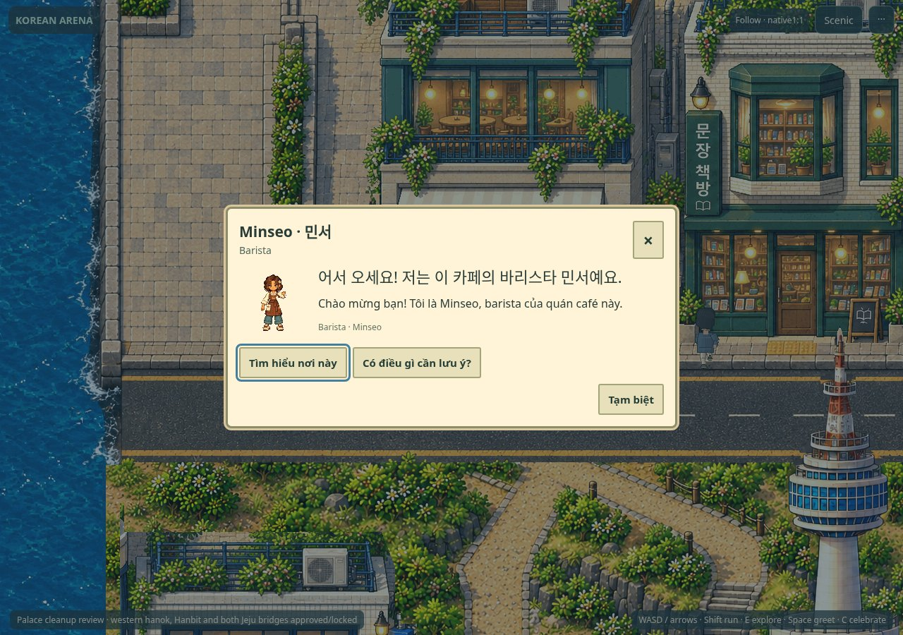
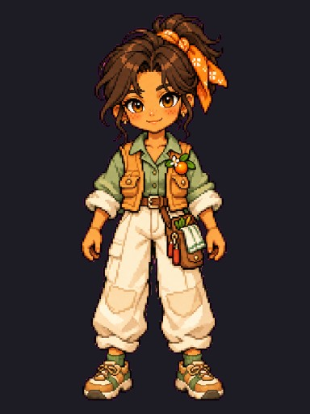
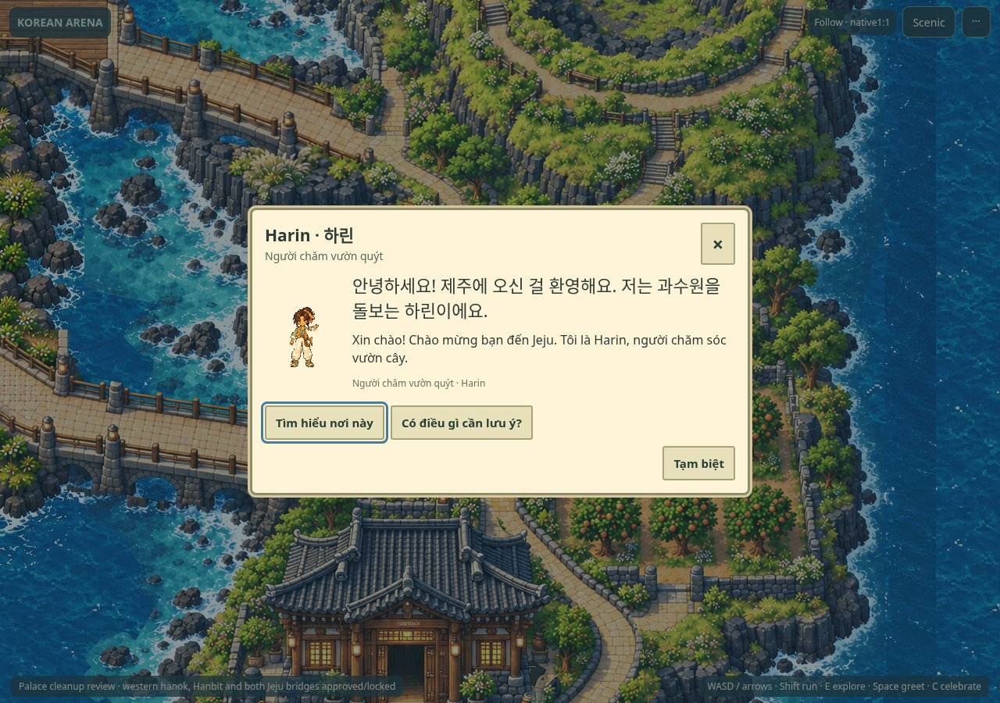

# Three-pilot artistic review

**Human ARTISTIC APPROVAL PENDING. Elevenremaining NPC rebuilds andPhase3B LOCKED.**

[Play ZIP](PHASE3A_ILLUSTRATED_PILOTS_REVIEW.zip) · [Juni native comparisons](JUNI_STYLE_COMPARISON.md) · [QA](QA.md) · [pipeline/source provenance](ART_PIPELINE.md).

## Seoyeon · 서연 — Palace cultural guide

[Original master](../../assets-src/npcs/phase3a-art-rebuild/seoyeon/master-source.png) · [Original four-view source](../../assets-src/npcs/phase3a-art-rebuild/seoyeon/turnaround-source.png) · [Native turnaround](seoyeon-native-turnaround.png) · [Readable3×turnaround](seoyeon-native-turnaround-review-3x.png) · [Complete104cell atlas](../../public/assets/npcs/phase3a/npc-seoyeon/atlas.png) · [Frame registrations](../../public/assets/npcs/phase3a/npc-seoyeon/atlas.json) · [Own masks/joints](../../assets-src/npcs/phase3a-art-rebuild/seoyeon/rig.json).

[AFTER full native world screenshot with Juni](gameplay/after-seoyeon-with-juni-phaser-native.png) · [BEFORE full native](gameplay/before-seoyeon-with-juni-phaser-native.png) · [Actual AFTER gameplay video](gameplay/after-seoyeon-actual.mp4) · [Actual BEFORE replay](gameplay/before-seoyeon-actual.mp4).

[Front8phase source motion](seoyeon-walk-front-source-motion.webp) · [Back](seoyeon-walk-back-source-motion.webp) · [Right](seoyeon-walk-right-source-motion.webp) · [Left](seoyeon-walk-left-source-motion.webp). These animated source previews are labelled SOURCE,not gameplay. Full normalized3loop/direction actual Phaser atlas playback is [separately recorded](supplemental-clip-inspector-actual.mp4). Canonical world recordings show original patrols,real approach/dialogue/return.

## Minseo · 민서 — Café barista

[Original master](../../assets-src/npcs/phase3a-art-rebuild/minseo/master-source.png) · [Original four-view source](../../assets-src/npcs/phase3a-art-rebuild/minseo/turnaround-source.png) · [Native turnaround](minseo-native-turnaround.png) · [Readable3×turnaround](minseo-native-turnaround-review-3x.png) · [Complete104cell atlas](../../public/assets/npcs/phase3a/npc-minseo/atlas.png) · [Frame registrations](../../public/assets/npcs/phase3a/npc-minseo/atlas.json) · [Own masks/joints](../../assets-src/npcs/phase3a-art-rebuild/minseo/rig.json).

[AFTER full native world screenshot with Juni](gameplay/after-minseo-with-juni-phaser-native.png) · [BEFORE full native](gameplay/before-minseo-with-juni-phaser-native.png) · [Actual AFTER gameplay video](gameplay/after-minseo-actual.mp4) · [Actual BEFORE replay](gameplay/before-minseo-actual.mp4).

[Front8phase source motion](minseo-walk-front-source-motion.webp) · [Back](minseo-walk-back-source-motion.webp) · [Right](minseo-walk-right-source-motion.webp) · [Left](minseo-walk-left-source-motion.webp). These animated source previews are labelled SOURCE,not gameplay. Full normalized3loop/direction actual Phaser atlas playback is [separately recorded](supplemental-clip-inspector-actual.mp4). Canonical world recordings show original patrols,real approach/dialogue/return.

## Harin · 하린 — Jeju orchard keeper

[Original master](../../assets-src/npcs/phase3a-art-rebuild/harin/master-source.png) · [Original four-view source](../../assets-src/npcs/phase3a-art-rebuild/harin/turnaround-source.png) · [Native turnaround](harin-native-turnaround.png) · [Readable3×turnaround](harin-native-turnaround-review-3x.png) · [Complete104cell atlas](../../public/assets/npcs/phase3a/npc-harin/atlas.png) · [Frame registrations](../../public/assets/npcs/phase3a/npc-harin/atlas.json) · [Own masks/joints](../../assets-src/npcs/phase3a-art-rebuild/harin/rig.json).

[AFTER full native world screenshot with Juni](gameplay/after-harin-with-juni-phaser-native.png) · [BEFORE full native](gameplay/before-harin-with-juni-phaser-native.png) · [Actual AFTER gameplay video](gameplay/after-harin-actual.mp4) · [Actual BEFORE replay](gameplay/before-harin-actual.mp4).

[Front8phase source motion](harin-walk-front-source-motion.webp) · [Back](harin-walk-back-source-motion.webp) · [Right](harin-walk-right-source-motion.webp) · [Left](harin-walk-left-source-motion.webp). These animated source previews are labelled SOURCE,not gameplay. Full normalized3loop/direction actual Phaser atlas playback is [separately recorded](supplemental-clip-inspector-actual.mp4). Canonical world recordings show original patrols,real approach/dialogue/return.

## Review limits

146actual canonical before/after captures;0unexplained source/render mismatch. One Harinwalk-left0 has6shoe-edge pixels covered by the unchanged `c/tangerine-3`ground-containing foreground plate atworldx3787,y4075–4080. Exact matching source/depth ownership is in [native QA](native-render-qa.json);[close inspection](tooling/harin-native-occlusion-investigation.png). This P2existing ownership edge is not fixed by shrinking art,moving NPCs or repainting protected Jeju.

Harin frozen patrol has12pxvertical legs and88pxtotal length,while its accepted animation stride is44px. Some heading/frame combinations never occur on this short route. All32walk cells are source-validated;full8phase/direction playback is in the clearly labelled Phaser inspector. Actual canonical movement remains separately recorded;no route was extended for evidence.

Automated Forge FAIL/WARNs and square-cell tool limitations are retained. Human must judge source quality,face identity,anatomy,garments,foot contact,occlusion and perceived gait. Physical devices/hardware performance NOT TESTED. STOP before remaining11.
