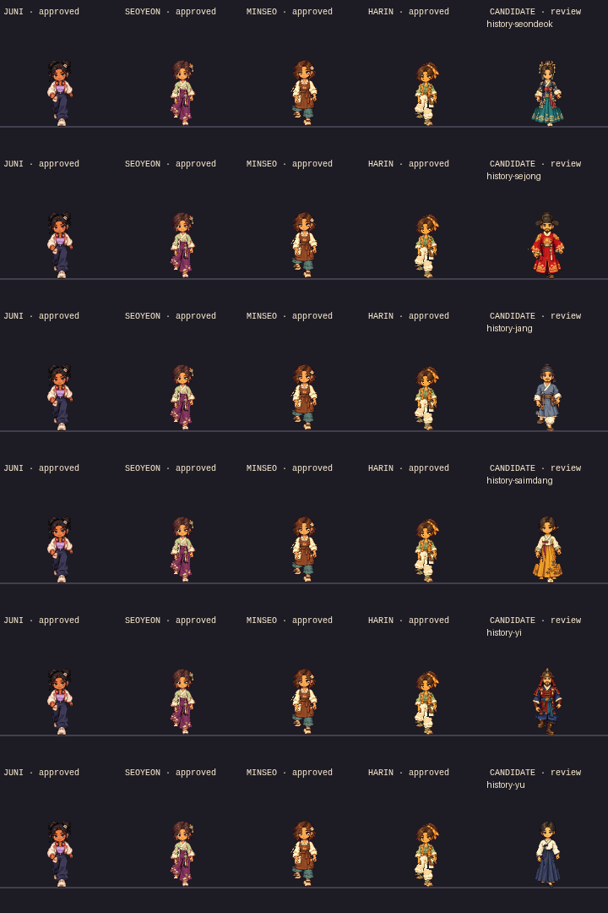

# Consolidated six-history ART REVIEW

[Native actual Phaser comparison](six-actual-phaser-comparison-native.png) · [2×nearest copy](six-actual-phaser-comparison-2x.png) · [26-identity source roster](roster26-art-candidates-native.png) · [interactive gallery](REVIEW.html).

The five columns are genuine Phaser atlas rendering:Juni,approvedSeoyeon/Minseo/Harin,newcandidate. This supplemental inspector is not world navigation; full canonical PNGs/videos below show real Juni approach and actual NPCs. Original native PNGs are preserved unmodified. Review JPEGs are lightweight convenience copies,not fidelity evidence. Before means the accepted20-resident context with no historical actor; there was no rejected historical artwork to fabricate a before comparison from.

## Nữ vương Seondeok · 선덕여왕

[Native world with Juni](gameplay/npc-history-seondeok-with-juni-native.png) · [Native context crop](gameplay/npc-history-seondeok-context-native.png) · [Actual gameplay](gameplay/npc-history-seondeok-actual.mp4) · [Neutral KO/VI notice](gameplay/npc-history-seondeok-notice.jpg) · [Own master](../../assets-src/npcs/phase3a-final-six/history-seondeok/master-source.png) · [Four views](../../assets-src/npcs/phase3a-final-six/history-seondeok/turnaround-source.png) · [104cell native atlas](../../public/assets/npcs/phase3a/npc-history-seondeok/atlas.png).

Costume is speculative,not independently authenticated. Human art/perceived-gait review pending.

## Vua Sejong · 세종대왕

[Native world with Juni](gameplay/npc-history-sejong-with-juni-native.png) · [Native context crop](gameplay/npc-history-sejong-context-native.png) · [Actual gameplay](gameplay/npc-history-sejong-actual.mp4) · [Neutral KO/VI notice](gameplay/npc-history-sejong-notice.jpg) · [Own master](../../assets-src/npcs/phase3a-final-six/history-sejong/master-source.png) · [Four views](../../assets-src/npcs/phase3a-final-six/history-sejong/turnaround-source.png) · [104cell native atlas](../../public/assets/npcs/phase3a/npc-history-sejong/atlas.png).

Costume is speculative,not independently authenticated. Human art/perceived-gait review pending.

## Jang Yeong-sil · 장영실

[Native world with Juni](gameplay/npc-history-jang-with-juni-native.png) · [Native context crop](gameplay/npc-history-jang-context-native.png) · [Actual gameplay](gameplay/npc-history-jang-actual.mp4) · [Neutral KO/VI notice](gameplay/npc-history-jang-notice.jpg) · [Own master](../../assets-src/npcs/phase3a-final-six/history-jang/master-source.png) · [Four views](../../assets-src/npcs/phase3a-final-six/history-jang/turnaround-source.png) · [104cell native atlas](../../public/assets/npcs/phase3a/npc-history-jang/atlas.png).

Costume is speculative,not independently authenticated. Human art/perceived-gait review pending.

## Shin Saimdang · 신사임당

[Native world with Juni](gameplay/npc-history-saimdang-with-juni-native.png) · [Native context crop](gameplay/npc-history-saimdang-context-native.png) · [Actual gameplay](gameplay/npc-history-saimdang-actual.mp4) · [Neutral KO/VI notice](gameplay/npc-history-saimdang-notice.jpg) · [Own master](../../assets-src/npcs/phase3a-final-six/history-saimdang/master-source.png) · [Four views](../../assets-src/npcs/phase3a-final-six/history-saimdang/turnaround-source.png) · [104cell native atlas](../../public/assets/npcs/phase3a/npc-history-saimdang/atlas.png).

Costume is speculative,not independently authenticated. Human art/perceived-gait review pending.

## Đô đốc Yi Sun-sin · 이순신

[Native world with Juni](gameplay/npc-history-yi-with-juni-native.png) · [Native context crop](gameplay/npc-history-yi-context-native.png) · [Actual gameplay](gameplay/npc-history-yi-actual.mp4) · [Neutral KO/VI notice](gameplay/npc-history-yi-notice.jpg) · [Own master](../../assets-src/npcs/phase3a-final-six/history-yi/master-source.png) · [Four views](../../assets-src/npcs/phase3a-final-six/history-yi/turnaround-source.png) · [104cell native atlas](../../public/assets/npcs/phase3a/npc-history-yi/atlas.png).

Costume is speculative,not independently authenticated. Human art/perceived-gait review pending.

## Yu Gwan-sun · 유관순

[Native world with Juni](gameplay/npc-history-yu-with-juni-native.png) · [Native context crop](gameplay/npc-history-yu-context-native.png) · [Actual gameplay](gameplay/npc-history-yu-actual.mp4) · [Neutral KO/VI notice](gameplay/npc-history-yu-notice.jpg) · [Own master](../../assets-src/npcs/phase3a-final-six/history-yu/master-source.png) · [Four views](../../assets-src/npcs/phase3a-final-six/history-yu/turnaround-source.png) · [104cell native atlas](../../public/assets/npcs/phase3a/npc-history-yu/atlas.png).

Costume is speculative,not independently authenticated. Human art/perceived-gait review pending.
