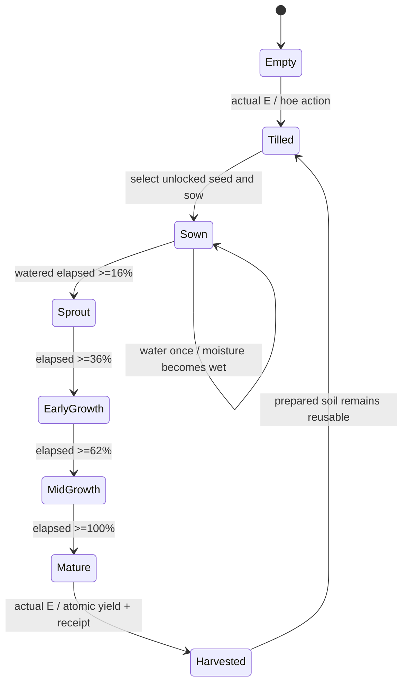

# Independent farm state and native ownership

Six existing beds × six cells =36states. Legacy six IDs/positions remain stable. Base16×16material components and one40×44nativecrop Sprite per cell; root(20,40), scale1/nearest. Original source ground/map/trees/fences are never replaced or re-exported. Ground component coverage is opaque over the existing cultivated interiors, with independently owned till/wet layers.

Progression stages are derived from saved timestamps and crop duration; moisture does not erase the crop stage. Unwatered seeds stay sown. Normal durations45–300seconds; first valid quest crop has a one-cycle6/10/12second intro only. Reload/tab switching uses the original saved times and never awards a second harvest. Review videos use real elapsed time, not test-speed or state injection.

Radish/scallion available initially. Completing first seed quest unlocks carrot/cabbage; completing market quest unlocks remaining8species. Both purchase and sow enforce the same predicate. See ECONOMY_TABLE.json for exact12species, prices/yields/durations/unlock/source. All12mature frame hashes are distinct; all12have5nonempty registered phases; original12radish/scallionframes remain byte-exact. New art is PENDING_HUMAN_REVIEW.

Old stock/saves migrate additively; no refill of exhausted stock. First upgrade write preserves the old snapshot. Corrupt save export and validated backup restore are available. Transactions/rewards are idempotent locally; local clocks/storage are not real server authority. Town Coins/gameXP are independent from any website mastery/FSRS or formal scores.

Persisted harvest result is `stage: empty` plus `lastHarvestedAt`; the reused native soil presentation may look prepared. A following plant can till implicitly when the player uses the seed tool. The diagram describes visual progression, not an additional serialized Harvested enum.
