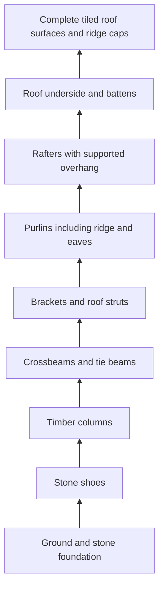

# REFORGE-005 — Hanok structure and playable slice plan

**Planning document, not a built or visually verified v0.5 environment.** Gate A requires a user character choice before final character production. Gate B will validate the graybox before decorative work. Current public v0.4 remains unchanged.

## Design and scope

Build one compact, straight-line scholarly Hanok and its courtyard: an inhabited house with a central wooden maru, two side rooms, a sheltered front veranda, complete rear/side walls and working front sliding doors. Use the original ink/celadon/ivory/coral/brass identity with stronger wood/stone/fabric response. Retain the old Ceramic Seed Spirit as an optional legacy companion, loaded separately rather than stacked with both humanoid and all old world layers by default.

The official [Seoul Hanok structure reference](https://hanok.seoul.go.kr/front/eng/info/infoHanok.do?tab=2) informs columns/crossbeams/purlins/rafters and regional layout variation. This is an original stylized fantasy scholarly house, not a royal palace, copied landmark or certified historical reconstruction. No reference image/texture redistribution is planned.

## Coordinate and scale contract

Blender authoring is Z-up; glTF/runtime is Y-up. **1 unit =1m.** All coordinates below are runtime X/Y/Z, with the front facing +Z. Convert explicitly during export and validate bounding boxes; do not silently shrink a person to fit a miniature building.

| Element | Provisional dimension / placement |
|---|---|
| Walkable courtyard | 12m ×10m, X[-6,6], Z[-5.7,4.3], ground Y0 |
| Main enclosed building | Width6.4m, depth3.8m; X[-3.2,3.2], Z[-4.4,-0.6] |
| Structural bays | X columns at -3.2,-1.1,1.1,3.2; depth supports at Z-4.4,-2.5,-0.6 |
| Front veranda | Z[-0.6,0.25], same raised floor; openings coherent with interior |
| Stone foundation / finished floor | Floor Y0.45m; individual stone shoes below grounded posts |
| Stair / threshold | Three0.15m risers,0.32m treads,1.2m clear width; extends from veranda front toward Z1.21 |
| Timber frame | Post tops nearY2.80m, actual joined beams about0.22m deep; dimensions finalized from load-path graybox |
| Roof | Complete two-slope matbae-inspired gabled roof, gently upturned eave edges; eave aboutY3.10m, ridge aboutY4.20m; enclosed gables at both ends |
| Roof plan overhang | X±3.85m, Z approximately[-4.95,0.80]; support framing continues beneath, no floating edge strips |
| Front doorway | Clear width≥1.10m, clear height≥2.00m above finished floor; sliding panels open out of the collision aperture |
| Side/rear inspection routes | Side clear width≥1.2m and rear ground route≥1.0m; no skyline screen masking the rear envelope |
| Character / collision | Provisional1.45m height, radius0.24m capsule; doorway and stairs tested at this scale |

These dimensions are targets for Gate B, not values already implemented. The rear ground path is independent of the roof projection; verify headroom under eaves in the actual graybox.

## Floor plan

```text
                         REAR / -Z
              inspectable rear wall and windows
       X -3.2        -1.1          +1.1        +3.2
        ┌──────────────┬──────────────┬──────────────┐ Z -4.4
        │ study / desk │ central maru│ quiet room   │
        │ rear window  │ rear window │ rear window  │
        │ side window  │ open passage│ side window  │
        ├──door────────┤              ├────door──────┤
        │              │ sliding main│              │
        └──────────────┴────doors─────┴──────────────┘ Z -0.6
        ═════════════ raised front veranda ══════════ Z +0.25
                            stairs
                  open courtyard / +Z
           plum planting                lantern entry
```

Side rooms have real walls and doors to the central hall; rear remains closed except framed windows. No blanket deletion of the rear wall to make an attractive front camera. A modest desk, books, floor cushion, low chest and folded paper are visible through the front door; expensive room clutter is deferred until proportions and movement pass.

## Continuous support chain



Author named structural modules before merging render geometry: Foundation,Column,Beam,Bracket,Purlin,Rafter,Eave,Gable,Wall,Floor,Door. Each member records its support anchors in a structure manifest. Use these anchors and actual bounding geometry to check connection distance (initial tolerance0.02m); proximity alone is insufficient, so inspect rendered connections and intersections too. A beam must meet a post/support, rafters must meet purlins, and roof sheets must meet the underside. Unsupported ornaments must have visible mounting geometry.

Use genuine solid wall/roof thickness and correctly wound exterior/interior surfaces, not DoubleSide as a substitute for a complete building. Keep doors as named independent sliding nodes with matching moving colliders. Protect previously approved source files by writing `Studio/modeling/hanok-v05.py`, `assets/v0.5/source-blend/hanok-reforge.blend` and `exports/v0.5/models/hanok-reforge.glb`. These paths are planned, not present deliverables.

## Gate B — structural proof before detailed materials

1. Build a neutral-material full envelope and supporting frame with all four facades, floor, thresholds and stairs. Central open veranda is deliberate; side/rear rooms remain enclosed.
2. Place a1.45m human scale capsule, confirm entrance/headroom and a continuous traversable route from courtyard to central hall and around all four sides.
3. Inspect front/rear/left/right, roof perspective, roof-to-column connection and interior at normal and close view. Produce a real 360° orbit capture; never use the concept board as render evidence.
4. Check support anchors, wall openings, normals, collision footprints, floor continuity and bounds. Correct structural gaps/intersections before tiling, grain or props.
5. Save source/GLB/structure manifest, run Validator and production/browser checks appropriate to the graybox, inspect actual renders, update four records and remotely verify a checkpoint. Gate B remains TODO until this exists.

## Character and Gate C implementation contract

After explicit A/B/C approval, author the selected humanoid with a real armature and skinned, continuous deforming body. Use separate overlapping clothing only where natural, with controlled joint deformation beneath; no disconnected floating limb substitutes. Establish deform loops at shoulder, elbow, hip, knee and ankle; normalized maximum4 weights per vertex, no unweighted vertices, no negative object scales. Check raised-arm, elbow fold, crouch and stride poses from front/side/rear before animation polish. Use IK during authoring and bake only needed deform joints into GLB; retain the editable rig and weights in `.blend`.

Start around28–34 deform bones for A; revise honestly if B/C needs more cloth controls. Use controlled accessory joints and facial morph targets/bones rather than runtime cloth simulation. Eyelids, brows, gaze and mouth must produce Neutral,Happy,Excited,Curious,Thinking,Confused,Sad,Surprised,Determined,Celebrating with readable static poses and coordinated body movement. Preserve constant reset tracks when semantically needed, based on the v0.4 export lesson.

Twenty named clips: Idle,Walk,Run,WalkStart,WalkStop,RunStart,RunStop,JumpStart,JumpAir,JumpLand,TurnLeft,TurnRight,Greeting,Happy,Thinking,Sad,Celebration,Surprised,Curious,InteractionReaction. Validate duration, actual bone channels, joint range, loop seam, foot contact, facial keys and side/rear deformation. Clip counts alone do not pass Gate C.

### Lightweight playable movement

- Reuse the current React/Vite/R3F stack; separate candidate scene/modes from the legacy viewer, with explicit model manifest and lazy legacy loading. Do not upgrade working packages or introduce a physics engine without concrete need.
- Focusable game stage: WASD/arrows move relative to the camera; Shift runs, Space jumps; inputs do not intercept typing/selects and clear on blur/visibility loss. Touch directional controls, run/jump and keyboard-operable DOM equivalents share the same input state.
- Kinematic capsule against explicit architecture colliders: swept horizontal movement, sliding response, bounded fixed physics steps, ground/step support and matching sliding-door collision. Do not use decorative visual meshes as an indiscriminate collision soup.
- Provisional walk1.2m/s, run2.6m/s; acceleration/deceleration and yaw smoothing remain responsive. Animation cadence follows actual displacement and authored stride length, not render FPS. In-place clips have no oscillating world-root displacement. Test planted feet against tracked contact points to find sliding.
- Jump uses JumpStart anticipation, upward physics, JumpAir and actual grounded JumpLand recovery. Provisional height0.5m/gravity11m/s², tune from real motion review. No jump animation claiming landing while capsule is airborne; stop wall penetration at low frame rates.
- States: Idle→WalkStart→Walk→WalkStop→Idle and Run equivalents; direction turns and airborne states have priority. Crossfades are short and do not erase anticipation/landing. One-shot emotions return to locomotion or Idle; a dedicated review panel exposes actual clips and expression presets.
- Doors provide visible slide/highlight and button interaction; do not close through a player in the aperture. Ground contact/shadow, sparse footstep/landing dust and capped celebration accents reinforce actual motion. Effects have Off/Reduced/Full controls.

## Gate D — materials, life and presentation

Use original small procedural baked wood-grain/roughness, stone variation and cloth/hanji maps, with source/provenance and color-space metadata. Start512px atlases, allow1024px only for a demonstrated close-up need. Reuse materials and instance tiles/lattice/plant clusters; roof supports still exist under those visual layers. Roof/wood/stone/fabric must differ in roughness and surface response; celadon accents remain glazed. No copied game assets, downloaded unverified material or paid service.

Wind drives bounded foliage/banner/lantern motion, warm flicker and sparse falling petals; animate water ripples only where water remains in the final composition. Keep ambient particles restrained and stop decorative loops offscreen/paused/reduced motion. Main light provides a character shadow in medium/high, low uses contact shadow/ground cue at bounded cost. Three lighting presets must reveal walls, roof depth and face at night; no bloom dependency.

Six presentation modes: environment hero, third-person gameplay, hero close-up, architecture inspection, animation review and day/evening/night presets. Keep orthographic hero/orbit inspection; gameplay uses a perspective follow camera with full-body framing, roof/wall obstruction tests and an accessible reset. Camera follow smoothing yields to intentional orbit; no auto cinematic movement or shake by default. Reduced motion removes decorative sway, camera bob/automatic paths and effects; necessary input-driven displacement remains controllable, with static expression review available. Respect the OS preference and never silently enable decorative animation.

## Provisional performance budgets — targets, not measured acceptance

| Asset/system | Initial target |
|---|---|
| Humanoid | A18–24k triangles,≤4 material primitives, target≤3.5MB with clips/maps; revise for approved B/C instead of claiming the same cost |
| New world | Target≤90k visible triangles on Low including character,≤100 draws without shadow pass; measure actual scene instances |
| Medium/High | Initial≤200 draws including shadows; bound shadow map1024/2048 and DPR1.25/1.75 |
| Low/mobile | DPR1, simplified foliage/tile instances, cheap contact cue, capped effects, no duplicate legacy world |
| Textures | Shared512px default,≤1024px justified maximum; compressed textures only with tested browser support/fallback |
| Particles | Bounded shared/instanced pool; target≤24 ambient visible plus a short≤12 landing/celebration burst, fewer/off in reduced modes |

Record real calls/triangles/bytes/frame timings and target-device availability. Cloud SwiftShader proves functionality, not ordinary-desktop or physical-phone FPS. No stable30/60FPS acceptance claim without measured target hardware. Do not remove necessary face reset channels to meet byte goals.

## Gate E — actual evidence and release hold

Save front/rear/left/right/roof/connection/interior structure captures; character front/side/rear, ten expressions and readable walk/run/jump/celebration/reaction; day/evening/night, ambient, phone and reduced-motion/fallback captures. Include genuine real-time five-second walking and five-second running, jump/landing/greeting/facial changes and a route entering or circling the Hanok when capture tools permit. Preserve raw frames/timestamps and limitations. Make a before/after comparison against the real v0.4 renders.

Run Validator on new GLBs, inspect skin/weight/clip/export parity, production/typecheck and actual browser input/collision/door/camera/OS preference/quality/mobile/fallback checks. Check console/resources, source provenance and static privacy/subpath loading. Publish only after user review and explicit v0.5 publication approval, using a separately pinned candidate artifact. Keep all v0.4 deployment inputs unchanged until that release gate.

Gate A stops at a concrete choice request; B–E are planned and unimplemented here. No Hangul Garden, other learning district, backend, paid audio or public v0.5 deployment is included.
