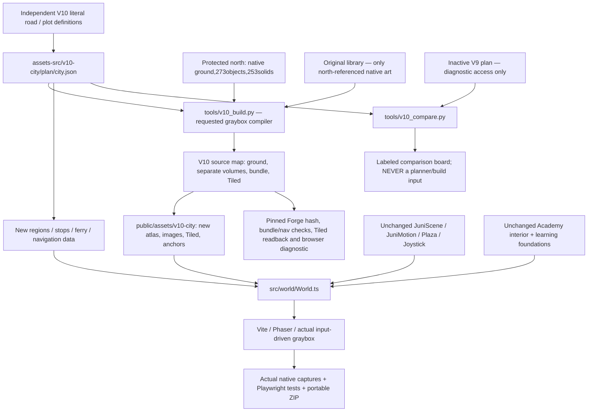

# V10 source dependency graph

## Runtime binding

World.ts imports only assets-src/v10-city/{map/world.json,map/bundle.json,water.json,stops.json,travel.json,regions.json} for the outdoor world, and public/assets/v10-city/anchors.json. Its assetRoot is assets/v10-city/. Academy retains its independent existing interior and assets/academy. Juni and shared original assets remain in their approved paths. The shared Plaza default fallback path is preserved as original code but is overridden by FullWorld; request capture proves it is not used.

New tile atlas is a lossless deduplication of the protected NORTH native ground plus newly authored geometric SOUTH placeholders. Buildings/volumes are separate images and instances, never baked screenshots. No V9 ground/atlas is reused. Existing historical north art in this atlas is intentional protected foundation, not southern reuse.

## Planning and comparison integrity

The independent plan was committed as eea64e4 before diagnostic V9 geometry reading. Two later path corrections avoid new tower/village placeholder masses. v10_compare.py reads old centerlines/bounds AFTER planning, renders in the SAME absolute coordinate system and writes only review diagnostics. No plan/compiler/runtime module imports it. Old curves are approximated by their stored control polygons for the comparison raster; final V10 curves use their actual sampled data. Both limitations and overlap metrics are explicit in geometry-comparison.json.

## Editable sources and verification

- Plan: assets-src/v10-city/plan/city.json; road hierarchy, loops, coherent lots, door approaches, regions, rail, sea/travel.
- Native data: assets-src/v10-city/map/*.png, world.json, bundle.json, bundle-hashed.json, plaza.tmj. All southern images labeled code/requested graybox; no final art generation.
- Runtime: public/assets/v10-city; exact source/runtime checks in tools/v10_validate.py, called by npm run assets:check.
- Forge diagnostics: assets-src/v10-city/qa; tool pin5324342fdfab72430f4e9604f3fe427009f8596d. Browser verifier body unchanged; only HTTP/installed-Chromium launch resolution adapted.
- Setup validates STORED outputs, never needs Forge and never generates artwork.
- Mandatory gates: preserve north/Juni/shared hashes; exact ground Tiled readback/colliders; fresh nav proof; no legacy outdoor imports or network requests; real input routes/entrances/ferry; user visual approval still required.
