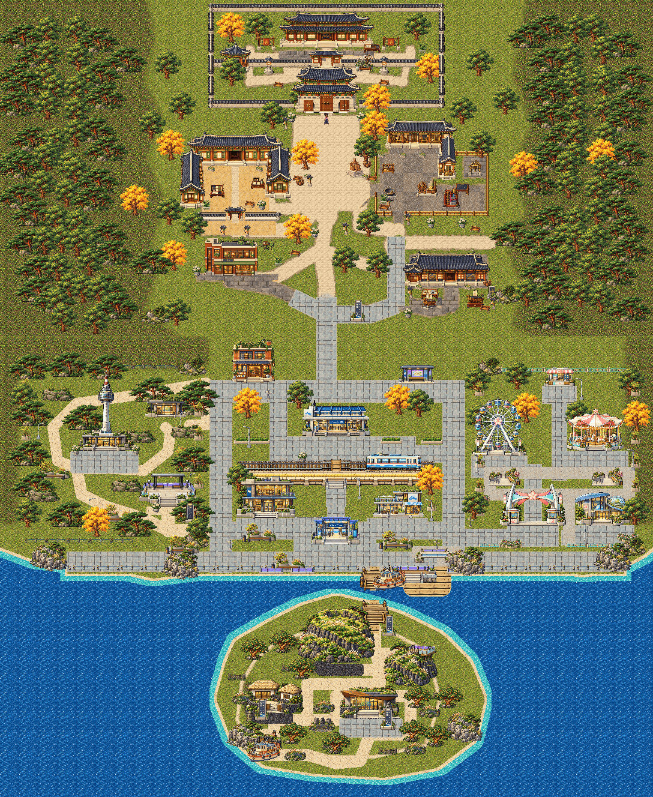

# V6 — sharpness and path repair review

This fixes the existing V6. Original architecture, Juni144frames,497placements,552colliders, world layout and previous reviews remain intact. No main merge or deployment. User visual approval is pending.

- [Full native4352×5312 overview](V6_FIXED_OVERVIEW.png)
- [Web overview2176×2656](V6_FIXED_OVERVIEW_WEB.png), integer-half-size nearest sampling.
- [Full-world path comparison](PATHS_FULL_BEFORE_AFTER.png)
- [Canvas sharpness comparison](SHARPNESS_CANVAS_COMPARISON.png) / [WebGL comparison](SHARPNESS_WEBGL_COMPARISON.png)
- Actual1:1gameplay PNGs: [civic join](quality/after/civic-join-native.png), [station](quality/after/station-joins-native.png), [hall passage](quality/after/park-hall-passage-native.png), [waterfront](quality/after/waterfront-access-native.png), [island](quality/after/island-garden-native.png), [mobile](quality/after/mobile-native.png).
- Larger native before/after boards: `PATHS_*_BEFORE_AFTER.png` in this folder.
- [Cause, repairs and validation report](REPORT.md), [blue-mark register](issue-register.json), editable route source `assets-src/v6-path-fix/path-network.json`.

View native PNGs at100%, or the game at1×. A whole-map image fitted into a narrow viewer necessarily loses detail. The controlled native V4/V6 comparison shows zero changed pixels in the unchanged heritage area for both Canvas and actual nonblank WebGL compositor captures; no V6-specific rendering blur was found. Original game rendering and movement code is unchanged.

## Play the actual fixed build

Download [playable-review.zip](playable-review.zip), extract the **entire** `Korean-Arena-V6-Reconstructed-World-Review` folder, and run `python3 start.py` (Windows: `py start.py`). Open the printed HTTP address ending `/3D-pharse5-/v6-world-review.html`. Python3is required; Node/account/API is not needed to play. Do not open the HTML in a source viewer or with file://.

Arrows/WASD move, Shift runs, E explores; mobile uses the existing analog stick and action buttons. Settings→1× is the native gameplay view. Existing Academy lesson and reciprocal ferry remain. Optional `--canvas` selects compatibility mode; `--lan` explicitly allows same-network phone access. Rotate landscape manually. Ctrl+C stops the local server.

Final exact source/CI/clean-clone facts belong in the **observed** `checkpoint/v6-path-sharpness-verified-20261019` annotation after verification. A planned tag name is not proof. Source checkpoint, environment activation and public website deployment are separate. Stop for user visual feedback after the verified handoff.
