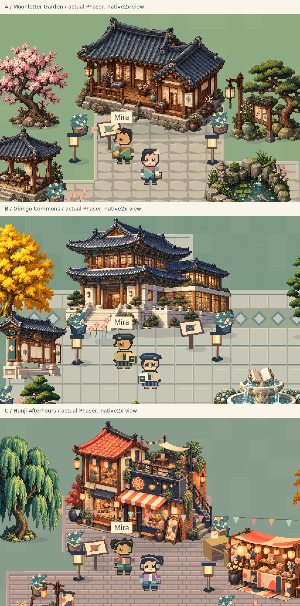

# Gate 2 — pixel art direction reset, review candidate

**READY_FOR_USER_VISUAL_REVIEW — NOT APPROVED.** Technical proof is verified; visual direction belongs to the user. Previous minimal A/B/C rejected and preserved at035d4cd. This is a new exploration, not a public release or full production milestone.

## Three genuinely separate studies

| Direction | Character fantasy / silhouette | Architecture and space | Foliage / social mood |
| --- | --- | --- | --- |
| A — Moonletter Garden / Thư quán ven hồ | Arin courier: long split celadon coat, scarf/hairpin/satchel; envelope-wave | Timber L-wing hanok, deep giwa eaves, porch/plinth, irregular stone path and koi pond | Plum/pine, tea pavilion; quiet garden correspondence |
| B — Ginkgo Commons / Quảng trường Ngân Hạnh | Seoha scholar: broad beret/glasses, ivory academic coat/pleats, book/backpack; raised book | Two-storey Korean seowon library, broad stair, formal slab courtyard with diamond/curb edges, book fountain/kiosk | Ginkgo/narrow pine, hydrangea seating; civic academy gathering |
| C — Hanji Afterhours / Phố xưởng Hanji | Jun performer: ponytail/headphones, cropped purple jacket, cyan trousers, camera pouch/lightsticks | Split-height workshop, terrace/exterior stair, shop awning, zigzag brick lane, stall/stage/lantern arch | Willow/orange tree, banners; creative festival street |

[Old vs new, native sizes](OLD_VS_NEW.png) · [actual idle/walk/emote character crops](ACTUAL_CHARACTER_READABILITY.png) · [source study board](NEW_DIRECTIONS_SOURCE.png).

Source vs actual engine: [A](SOURCE_VS_ENGINE_A.png), [B](SOURCE_VS_ENGINE_B.png), [C](SOURCE_VS_ENGINE_C.png). The board contains actual native gameplay captures, not screenshot-sized concept backgrounds. Individual object sprites are depth sorted and have collision; each direction has its own map.

Native gameplay evidence: final-render/{A,B,C}-hero-idle.png, -walk.png, -emote.png, -overview.png, -mobile.png and -mobile-overview.png. 1×overview shows the whole map; default2× shows player-scale detail. No board resampling is used to disguise the source scale. Old and new viewports/cameras differ and are labelled: old idle53/53/54px; new126/124/126CSSpx. Frame box48×64 is128CSSpx at2×; transparent padding explains the smaller visible height.

## Actual animation and browser inspection

[Final actual motion capture](premium-pixel-reset-motion.mp4):413 Chrome compositor frames over46.55s, original timestamps, no accelerated playback or injected poses. Includes all three idle sections, native four-direction walking and individual emotes. Raw JPEGs and metrics are in motion/capture.json. The assistant inspected final decoded motion stills and original frames115/250/252/388: envelope-wave, book lift and overhead lightsticks are visible. Selected decoded video-A/B/C-emote.png now show the actual gesture rather than a later return-to-idle frame.

Blink proof: blink/verification.json and A/B/C-natural-blink.png. The runtime naturally reached blink frame, then normal Pause UI retained it; Bimage eyes visibly closed. Final Phaser4 idle durations1800/120/350/1100ms use absolute frame overrides, correcting an earlier additive-duration assumption. Reduced motion preserves static idle; explicit movement/emote remain usable. First weak gestures and earlier timing attempts are retained in motion-attempt-1/2. VIDEO_IDLE_LIFE and VIDEO_BLINK_EVIDENCE boards are historical extraction attempts and do not prove the final120ms blink.

Actual rendered heroes, overview maps, expressive poses, phone framing, natural blink and decoded final video inspected. No console errors or missing assets in final-render reports, motion report or exact-package checks. This establishes rendered behavior and inspectable candidates; it does not establish aesthetic approval.

## Checks and limits

- Production build/typecheck/lint/formatter PASS; existing five unit tests PASS.
- Existing three native browser flows PASS on the final blink-duration runtime: keyboard/collision/NPC content route, phone/touch/DPR2, OS reduced motion/pause, loaded-session offline/state persistence, actual Canvas fallback without WebGL. Native final run45.04s, no failures/flaky cases.
- Legacy and new asset QA PASS:52runtime files/hashes,72frames/style, source/atlas equality, alpha/gutters/palette bounds, independent map layouts, colliders23/20/21 and NPC reachability.
- Current source f22a9d9: [remote CI success38677204356](https://github.com/Anapaulagatti/3D-pharse5-/actions/runs/38677204356). Read-only workflow; no deployment permissions/jobs.
-214protected old art/source/lock/package files and110old review files byte-matched baseline;3D archive untouched. Publicv0.5 HTML hash082c661b still matches, see public-preservation.json.
- Cloud SwiftShader, capture overhead and emulated phone are not physical-device FPS certification. No60FPS claim. Native GUI Tiled/LibreSprite absent; editablePNG/TiledJSON source pipeline works.
- Original object masters use native image generation, then annotated object crops, binary alpha, bounded palette and nearest-neighbour export. Characters/tiles/small props are code-raster-authored; not every master pixel is manually placed. Prompts, masters, source frames and corrected Korean Bsource are retained. Full production consistency/final refinement await selection.

## Play this exact candidate

Download [premium-pixel-reset-review.zip](../../downloads/pixel-reset-v2/premium-pixel-reset-review.zip), unzip, open a terminal inside Hangeul-Pixel-Reset-Gate2, run `python3 start.py` (Windows `py start.py`), then open its printed HTTP address. Do not open index.html in a source-text viewer. Python3 required; Node not required for viewing.

Use WASD/arrows, Shift run, Space or Biểu cảm for emote; E near Mira; phone direction pad/buttons. Choose A/B/C in Hướng hình ảnh;1×overview/2×gameplay/3×detail. Pause and OS reduced motion retained. This is a local art proof; no real online players or full learning quest.

ZIP size1,746,808bytes, SHA2567351fd54f57bec5a848400c11c07284a8a3e39f9e9bdd0cb85af6127987b7ed0. Build2,952,216bytes, JS1,485,905raw /385,856theoretical gzip (not measured transfer). Allowlisted dist-only; dependency licenses included; no source/private-key/provider-token markers/old3D shipped. Exact extracted HTTP package rendered in Chromium desktop/mobile atDPR1/2 with movement, pixelated1:1canvas, no missing resources/errors; package/exact-package-verification.json.

No public browser port is exposed in this environment. Existing Pages still serves oldv0.5, not this candidate. Git branch/tag is the recovery checkpoint, not public deployment. **Review these new A/B/C or request specific changes. STOP before asset mass production, gameplay expansion, districts or publishing.**
