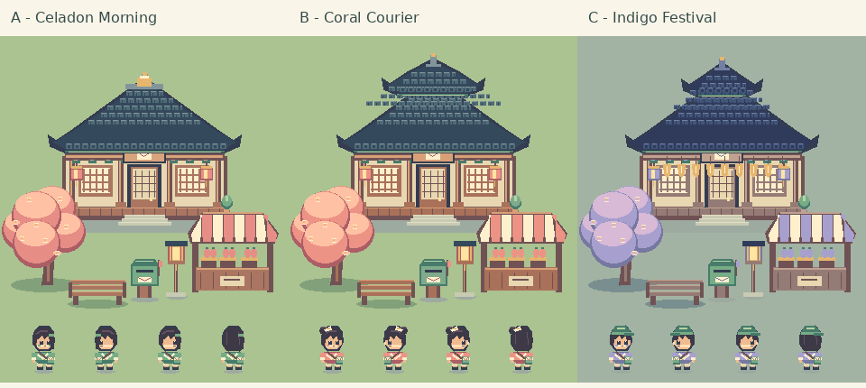
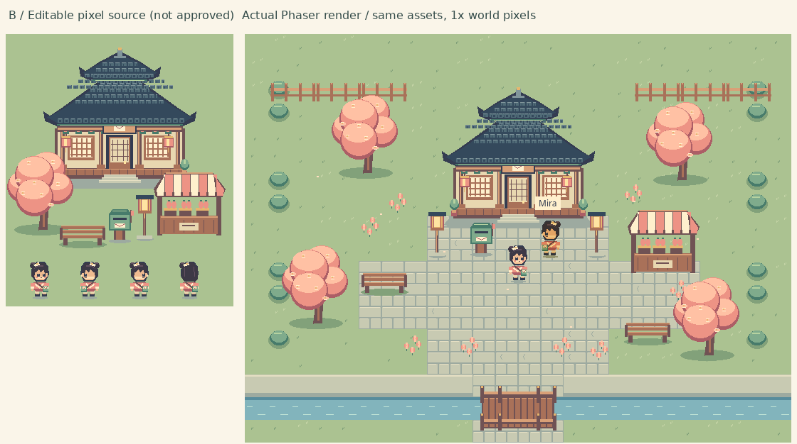

# Pixel v3.1 — Gate2 visual review

**Status: preview/evidence complete; final style NOT APPROVED.** Recommendation B Coral Courier: warm courier identity, raised roof, celadon envelope satchel. A: low hanok/jade student. C: indigo festival/capped maker/lantern banners. The scene is an intentionally small art/input proof, not the completed RPG or first12-minute quest.

## Source versus real game

Also inspect source-vs-engine-A.png and C.png. No approved sheet exists yet: left is the candidate source, right actual same-art production Phaser rendering. Source frame pixels are independently compared against atlas exports. No concept painting used as game proof.

Actual browser frames: engine-A/B/C.png (same daylight), desktop-B.png, package-mobile-canvas.png, mobile-dpr-1/2.png, pixel-zoom-1/2/3.png, dialogue-hangul.png, evening.png and canvas-fallback.png. Human review opened all three engine renders, source lineup, B comparison, phone opening, zoom3, evening and real Canvas fallback. Whole hanok/hero readable in phone opening; moving camera may crop peripheral world.

## Movement evidence

[pixel-town-art-preview.mp4](pixel-town-art-preview.mp4):6.55seconds/17actual compositor frames, native keyboard four directions/run/wave/return. Original wall-clock intervals retained, no retiming. video-decoded-review.png contains frames decoded from the encoded video and was inspected. capture.json stores action/frame/position and source JPEG hashes/timestamps. Sparse capture is motion evidence, not display-FPS measurement.

## Checks

5unit tests +3real production browser flows PASS; source/map/atlas/hash checks, typecheck/lint/formatter/build PASS; fresh remote clone npm ci+checks+build PASS at0dd7550; actual default dev scene PASS. Native touch via Chromium input, DPR1/2, pause, live OS-reduced motion/explicit input, collision, HTML Hangul dialogue, state reload and loaded-session offline all tested. WebGL made genuinely unavailable: actual Canvas fallback renders and moves. No critical console/missing resource errors. Final extracted ZIP independently hash-checked and tested in desktop/mobile; native canvas pixels equal CSS pixels even atDPR2.

Earlier failed favicon and stale-build attempts are preserved and explicitly not final PASS evidence. ESLint generated-cache discovery was corrected with a standard .cache exclusion; authored source/helpers remain linted.

## View locally

Download ../../downloads/pixel-v3.1/hangeul-pixel-town-gate2-review.zip from repository root (actual path downloads/pixel-v3.1). Unzip, run `python3 start.py` (Windows `py start.py`), open printed local HTTP address.480147bytes ZIP;1,625,075bytes full static build,1,476,212raw JS bytes. Computed gzip382597bytes is not measured server transfer. Hash manifest in downloads/pixel-v3.1/package-manifest.json. No npm required to view.

Public https://anapaulagatti.github.io/3D-pharse5-/ remains v0.5, independently matched082c661b. Pixel site is NOT published. Cloud UI has no supported public loopback preview.

## Limits and next approval

No physical-GPU/mobile FPS claim. Native desktop art GUIs absent; editable indexed PNG/TiledJSON pipeline works. Current shared-map art proof has no full learning quest, wardrobe, real players, backend, exams or ads; these remain later gates. Run currently reuses walk sprites with faster cadence. Educational/cultural review by a qualified human is pending.

User's authoritative request Gate2 says **“STOP FOR USER VISUAL APPROVAL before mass-producing sprites and whole town.”** Stop now for explicit A/B/C choice. New public replacement requires its own approval later. Original3D recovery branch/tag and proof in docs/migration/3d-archive-proof.md.
