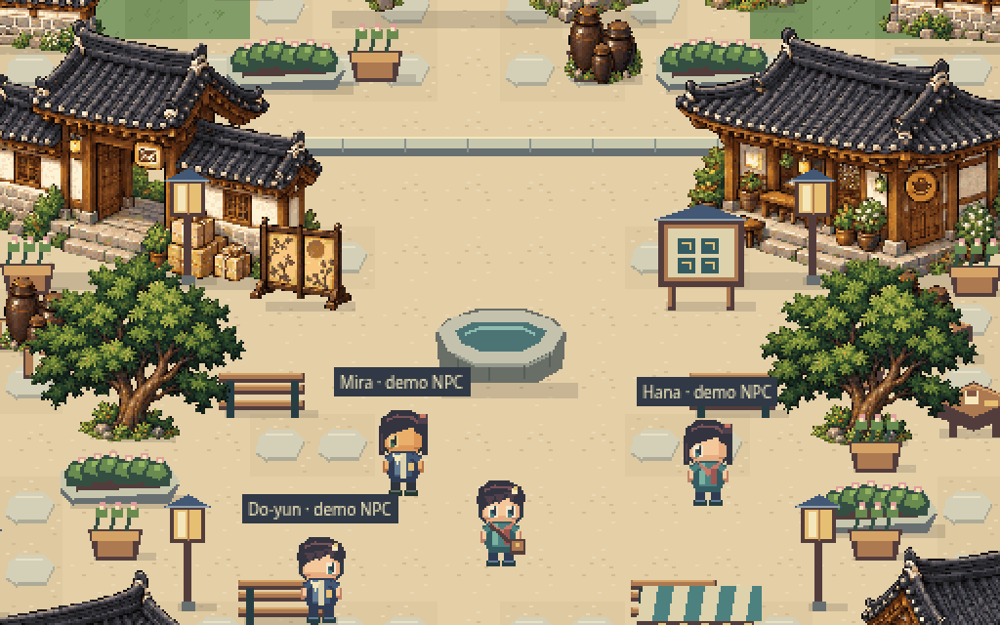

# Living Pixel Seoul — final Gate2 hanok-courtyard review

**READY FOR USER VISUAL REVIEW — NOT APPROVED.** Full V4 and latest rich hanok-courtyard image drive this ONE original town. All previous A/B/C and initial code-only candidate remain unapproved and recoverable. No public replacement or Gate3 gameplay expansion.

[Whole town1×](render/overview-1x.png) · [idle3×](render/idle-closeup.png) · [actual outfit examples](ACTUAL_OUTFIT_COMPARISON.png) · [old-vs-new](REJECTED_VS_UNIFIED.png) · [mobile](render/mobile.png).

Five original hanok/courier/café/culture buildings, rich curved charcoal giwa roofs/lattice doors/plinths, broad layered green/cream/gold trees, roofed walls/onggi/hanji screen, warm sand/stepping-stones and social court.76props/77colliders,11landmark approaches reachable. Buildings/trees are separate sorted objects on a genuine tilemap, not a whole painted scene. Source comprises one original native image_gen pixel-object atlas with disclosed crops/NEAREST/native128colour export plus code-raster layered chibi/ground/small props. No copied reference pixels/map/UI; not every source pixel manually placed. Source atlas/brief/provenance preserved.

Avatar32×48 with clear large eyes/face/hair/outfit/signaturepin,≈90CSSpx visible idle at2×. Common body/outfit/hair/accessory registration,2hair/2constructed outfits/satchel. Four-direction idle/blink/walk, separately authored run, wave/celebrate/social pose. Actual review caught enlarged head hiding raised arms: final arms extend outside silhouette; paused actual emotes and final decoded video inspected. Outfits reflect current selectors after an explicit render-frame wait. Three NPCs explicitly labelled demo, no real connected users claimed.

## Real movement and details

[Final actual gameplay movie25.45s](living-pixel-seoul-gameplay.mp4), 286CDPcompositor frames with original Chrome timestamps. Native keyboard/UI, no injected positions/poses or speed-up. Natural idle, three social gestures, hair/outfit change and four-way walk/run. Actual gait contact sheet and decoded wave/celebrate/pose/run inspected. Different reach/airborne/side-lean run silhouettes are visible; run never remaps walk frames at a higher rate.

[House detail](render/house-detail-gameplay.png) uses native keyboard navigation. [Tree detail](render/tree-detail-gameplay.png) is an explicitly labelled native crop from real2×canvas, no resampling, not a falsely claimed new camera position. [Natural blink](render/natural-blink.png) reached by actual idle and retained with normal Pause UI; no pose injection. Source boards are source, not gameplay evidence. Initial candidate/rawfilm and earlier failed helper routes remain historical; ITERATION_LOG.md describes corrections.

## Checks / practical limits

Production build/type/lint/format,5original unit tests and3native browser flows PASS; latest suite22.28s,0failures/skips/flaky. Native controls/collision/HTMLdialogue, emotes returningidle, layer/outfit persistence, OS reduced motion/pause, touchDPR1/2/loaded-offline and genuine Canvas fallback tested. SourceQA checks30hashes/152frames×6layers/source equality/binaryalpha/palette/gutters,6+of8run poses different per direction and all11station approaches. These checks do not establish aesthetic approval.

Source checkpoint0d523b1 [CI38695321226](https://github.com/Anapaulagatti/3D-pharse5-/actions/runs/38695321226) succeeded; final hand correction also passed current local native suite. Final remote checkpoint/tag must be independently checked before claiming latest CI success. Read-only workflow has no deploy job. Fresh3D remote2738hash recovery,1923oldfiles/exactlock preservation and publicv0.5 hold verified. Dev/preview startup actual HTTP and included package launcher exercised. Earlier transient approval-review usage error is resolved; no remaining credential/tool blocker.

Cloud SwiftShader/emulated phone/capture overhead are not physical-device or60FPS guarantees. See PERFORMANCE_REPORT.md for actual phase counter/time/artifact facts. Native GUI Tiled/LibreSprite absent; editablePNG/TiledJSON alternatives actually tested. Full learning content needs qualified human review. Current NPCs are demo only.

## Play this exact version

Download [living-pixel-seoul-v4-review.zip](../../downloads/unified-v4/living-pixel-seoul-v4-review.zip), unzip, open terminal in Living-Pixel-Seoul-V4, run `python3 start.py` (Windows `py start.py`), open printed HTTP address. Python3 required; no Node needed to view. Do not open HTML as source text. Cloud loopback has no public preview link.

WASD/arrows walk, Shift run, E near Mira, Space wave. UI/touch buttons offer movement/run/gestures/hair/outfit/accessory/1×2×3×/pause/reduced motion. No account, quest completion, backend/PvP/ad SDK or official learning/exam endorsement.

ZIP 704,330bytes, SHA25662d142674f0caba6f4344a1e0977e280fc61f645cdf28cb5058d0733e7960068. Build 1,901,391bytes, active pixel files407,249bytes. Per-file manifest saved; allowlisted runtime-only HTML/JS/CSS/PNG/JSON/SVG/license text, original/runtime licenses included, no source/private-key/provider-token markers/old3D/rejected art. Exact extracted package browser desktop/mobile checks verify rendered scene, native1:1CSS canvas/DPR2, input, no missing resources or critical errors. Windows GUI auto-open itself untested; printed URL is usable.

Roadmap docs/UNIFIED_V4_ROADMAP.md and35designs docs/UNIFIED_V4_MINIGAMES.csv remain future design. First Delivery/Sign Repair/Courier Rush after approval; free direct courses/SRS/TOPIK/EPS, safe real social/proficiency-fair PvP, disabled voluntary cosmetic-only ad adapter and publication are later gates.

**STOP for new visual feedback on this one town. No mass production, gameplay expansion or public replacement before approval.**
