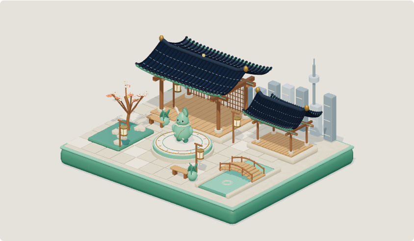
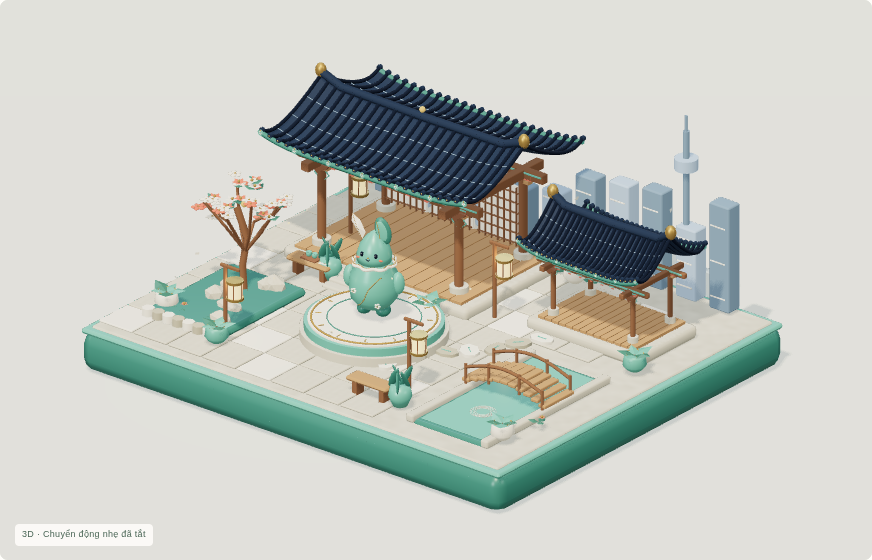
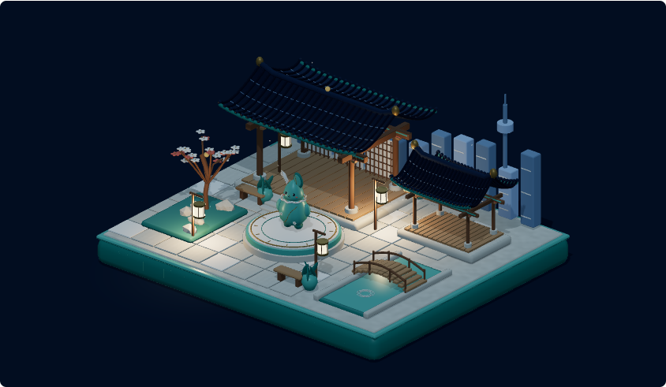
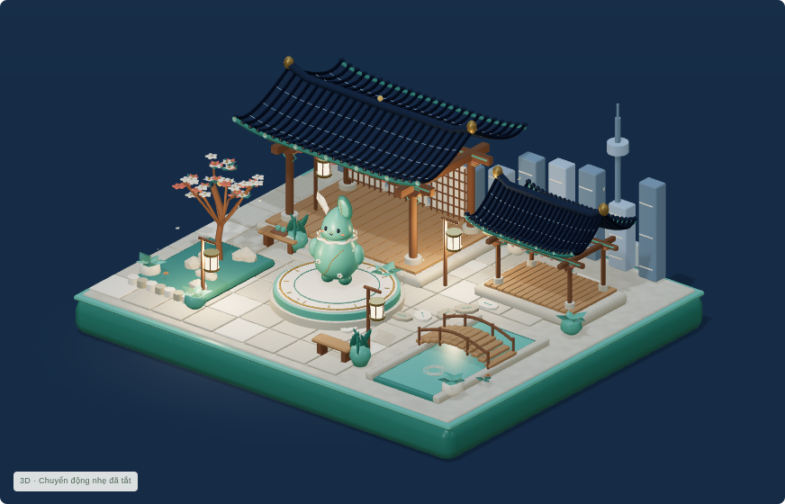
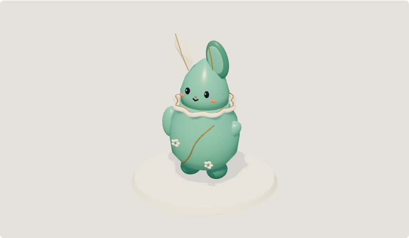
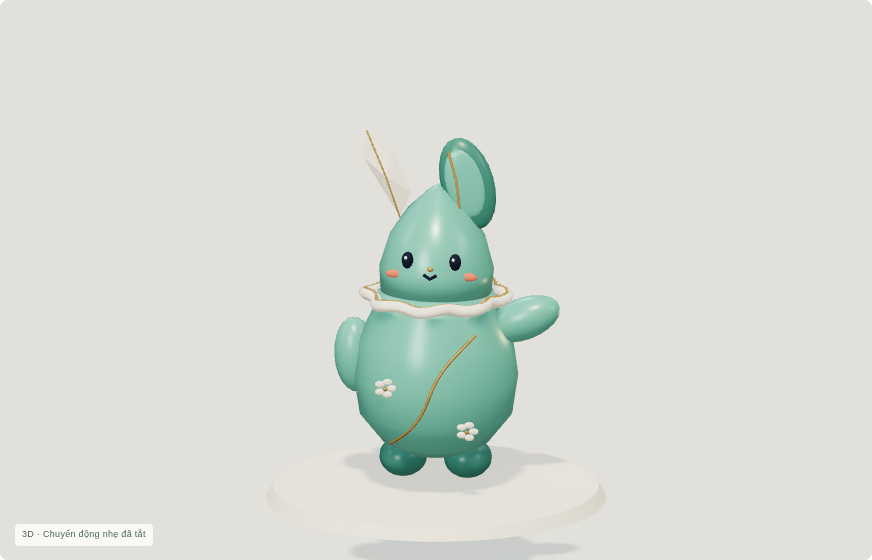
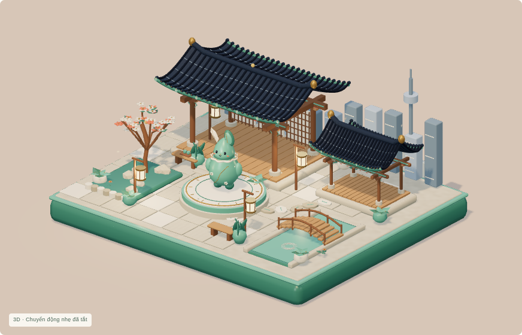
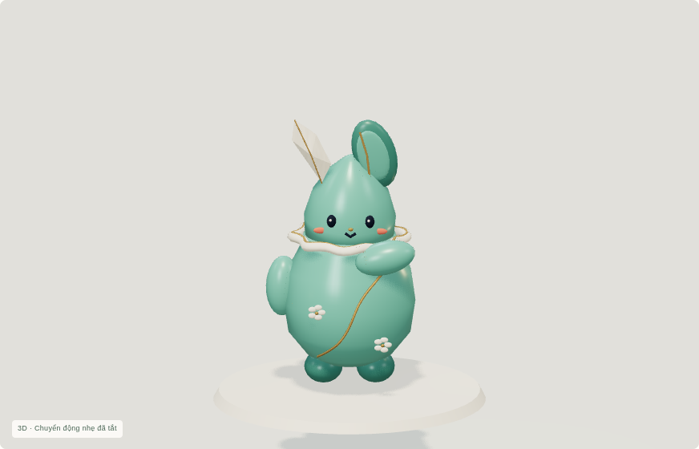
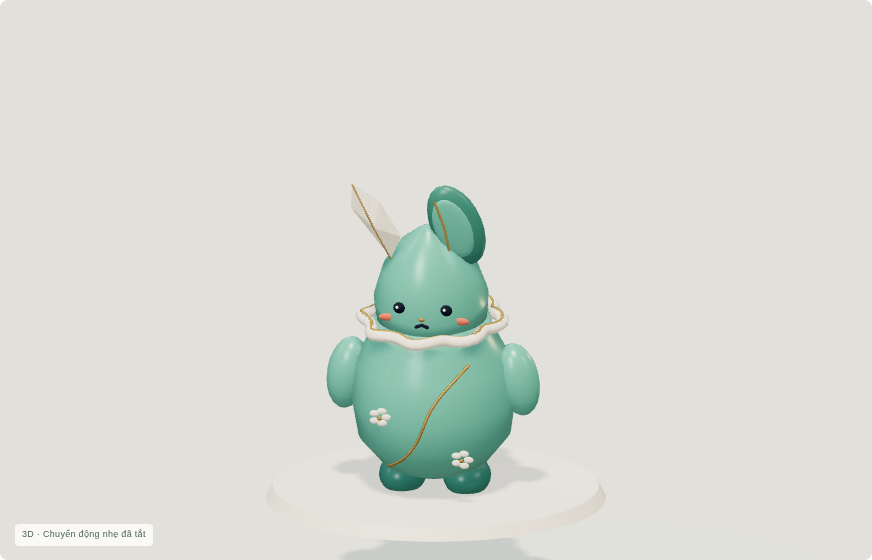
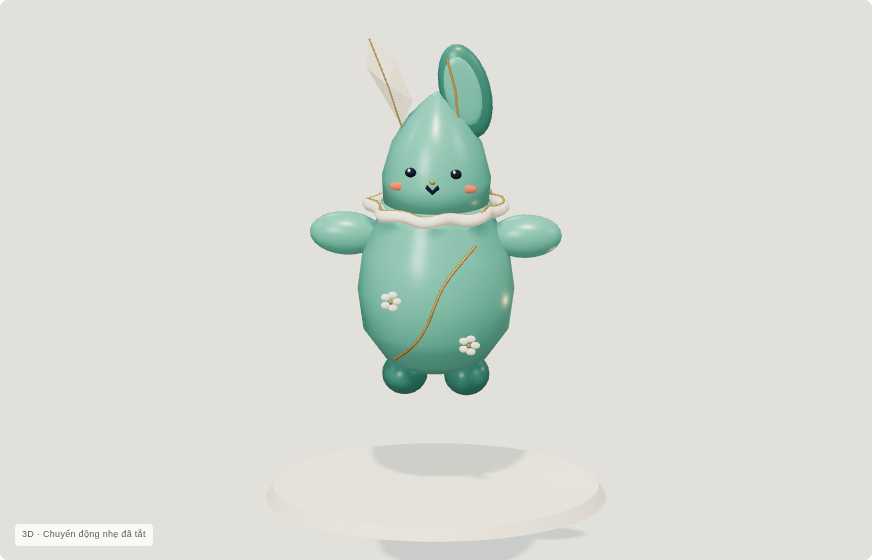

# Korean Arena 3D Studio v0.3 — Living Hanok Showcase

Bản v0.3 đã được bạn cho phép xuất bản và đã kiểm tra render thật tại [https://anapaulagatti.github.io/3D-pharse5-/](https://anapaulagatti.github.io/3D-pharse5-/). [Bằng chứng kiểm tra công khai](pages-release/VISUAL_REVIEW.md). Không có Hangul Garden hay district mới.

## Trước / sau

Ảnh trước là bản v0.2 đã kiểm tra trên website công khai. Ảnh sau là WebGL thật của bản v0.3 production, cùng độ rộng trình duyệt 1280px; vùng trình bày tăng từ 844×490 lên 872×560 và camera được bố cục lại.

| | v0.2 | v0.3 |
|---|---|---|
| Ngày |  |  |
| Đêm |  |  |
| Mascot chào |  |  |

## Bộ ảnh v0.3

| Chiều ấm | Hero toàn cảnh |
|---|---|
|  |  |

| Suy nghĩ | Buồn nhẹ | Ăn mừng |
|---|---|---|
|  |  |  |

[Điện thoại](final-render/mobile.png) · [Hero điện thoại](final-render/mobile-hero.png) · [Fallback](final-render/mobile-fallback.png) · [Mái hanok](final-render/roof-detail.png) · [Vườn mận](final-render/garden-detail.png).

## Xem chuyển động và tương tác

[Video chuyển động thật](living-hanok-motion.mp4). Video H.264 42 giây ghi trình duyệt WebGL thực, đã xem các frame giải mã và bỏ đoạn tải/resize ban đầu, không ghép mockup; độ mượt của GPU phần mềm cloud không đại diện điện thoại thật.

[Tải gói tương tác v0.3](../../downloads/v0.3/living-hanok-v0.3-review.zip). Giải nén toàn bộ, Windows mở `START_WINDOWS.cmd`; macOS/Linux chạy `python3 start.py` trong thư mục vừa giải nén. Cần Python 3; trình duyệt tự mở app. Không cần Node, Blender hoặc Internet. Mở `index.html` trong trình xem source của ChatGPT/GitHub không render app.

Đèn, cây và mascot có phản ứng khi chạm; các nút dưới khung xem cung cấp cùng tương tác. Camera điện ảnh là tùy chọn và nhường lại khi bạn kéo xoay. Reduced motion mặc định theo hệ điều hành; tạm dừng và offscreen dừng chuyển động. Điện thoại mặc định chất lượng thấp; khung diorama cao 260px để tránh khoảng trống thừa, khung mascot vẫn giữ đủ chiều cao cho động tác.

## Nguồn và giới hạn

Toàn bộ .blend/GLB/texture/animation/export v0.2 và artifact public được giữ nguyên (37 checksum). Lớp Hanok mới là asset bổ sung riêng, 527,852 byte / 13,312 tam giác / 21 primitives; các biểu cảm/gaze/hand gesture được bổ sung ở runtime trên bản copy của sáu clip gốc. Không thay GLB gốc, không thêm thư viện, âm thanh hoặc dịch vụ trả phí.

Kiểm tra production/typecheck, GLB Validator, hành vi browser và audit được lưu trong thư mục này. `final-render/verification.json` là báo cáo cuối; các `review-pass-*` và lượt bị gián đoạn được giữ làm lịch sử, không dùng để khẳng định đã đạt. FPS điện thoại/phần cứng thật chưa được đo. Bản fallback dùng các ảnh render gốc đã duyệt.

Bạn đã cho phép xuất bản v0.3; bản HTML được triển khai nguyên checksum đã duyệt. Dừng tại milestone này, chờ phản hồi hình ảnh tiếp theo của bạn.
