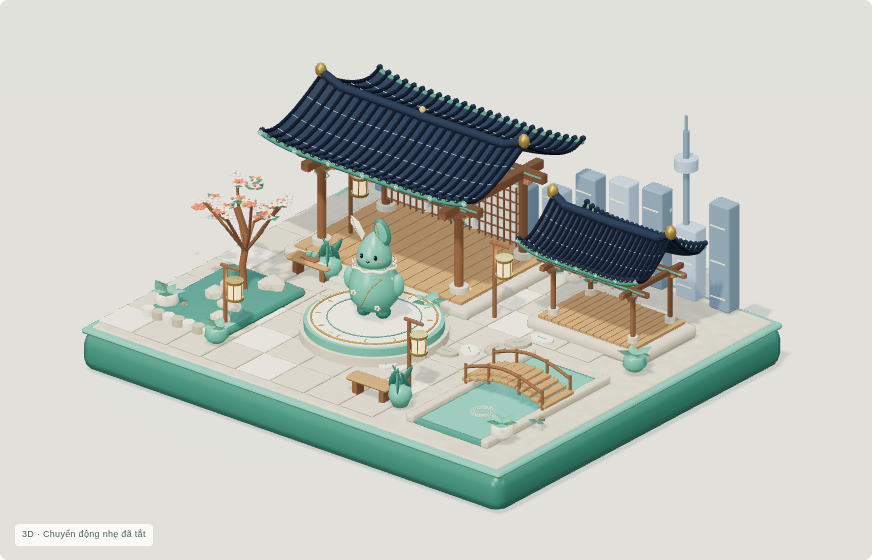
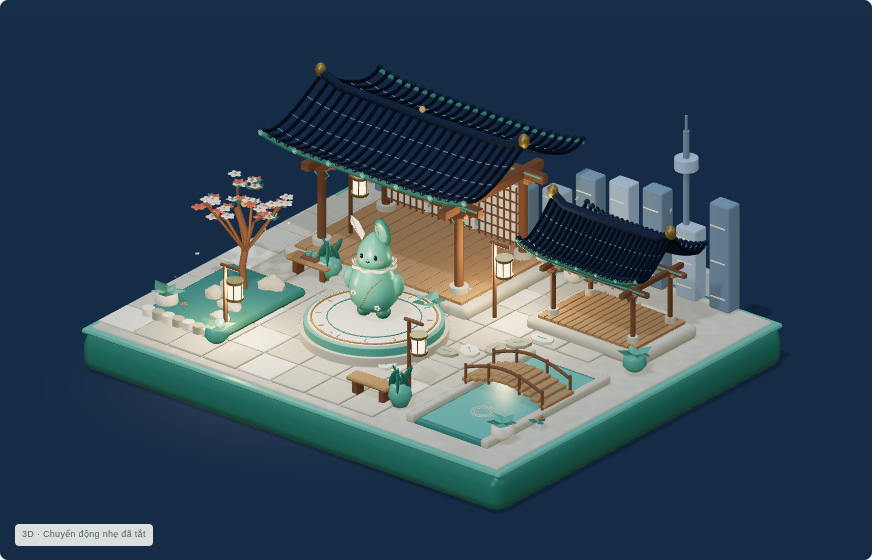
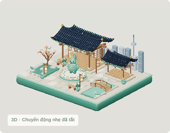

# Public Living Hanok v0.3 verification

**View the actual interactive scene:** [https://anapaulagatti.github.io/3D-pharse5-/](https://anapaulagatti.github.io/3D-pharse5-/).

User explicitly requested v0.3 publication. [GitHub Actions run 38507114065](https://github.com/Anapaulagatti/3D-pharse5-/actions/runs/38507114065) completed package/deploy successfully at source `264734a7fc76e8ad00f238a402d7bc37695ecdee`; deployment 7056177598 reports success and this public URL.

Anonymous HTTPS returned 200 text/html on the normal URL and the release cache-refresh URL. Both HTML responses match the previously reviewed 8,213,753-byte v0.3 artifact SHA `0ce49e58b26baa3802bc6e22fa4cab91d7181232e0069adcedd4f9353270c2d6` exactly. The site publishes only index.html/.nojekyll, with embedded JavaScript, CSS, all three validated GLBs and original textures/PNG fallbacks. No private source files or credentials are included; license/provenance checks passed. Original v0.2 .blend/GLB/textures/animations, source showcase and all 37 baseline files remain unchanged.

All **11 real public browser checks passed**, covering six distinct live clips, actual mascot click/keyboard reactions and native return to idle, lantern/tree response and ambient motion, orbit/reset/focus/cinematic path, day/evening/night, low/medium/high quality, responsive 390×844 view, live OS reduced-motion changes, pause/offscreen resume and WebGL PNG fallback. Zero critical page/console errors or missing resources. See [verification.json](render/verification.json). TLS verification stayed enabled; no new runtime libraries or assets were regenerated.

The assistant inspected the actual public hero/evening/night/greeting renders, changing Celebration capture pair, mobile hero and fallback images. These show Hanok geometry and celadon character, readable warm night light, recognizably changing character poses and responsive phone/fallback presentation. This is public WebGL output, not HTML-source review.

| Day hero | Night |
|---|---|
|  |  |

| Greeting | Phone hero |
|---|---|
|  |  |

[Evening](render/evening.png) · [Full phone](render/mobile.png) · [Phone fallback](render/mobile-fallback.png) · [Motion frame A](render/live-celebration-a.png) / [B](render/live-celebration-b.png).

Software-rendered cloud Chromium proves functionality, not physical-phone/GPU FPS. No 60 FPS claim. If a browser holds the older page, refresh or use [https://anapaulagatti.github.io/3D-pharse5-/?release=0ce49e58](https://anapaulagatti.github.io/3D-pharse5-/?release=0ce49e58).

**STOP** for the user's visual feedback. No Hangul Garden or additional district.
