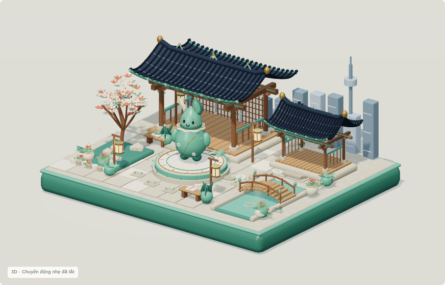
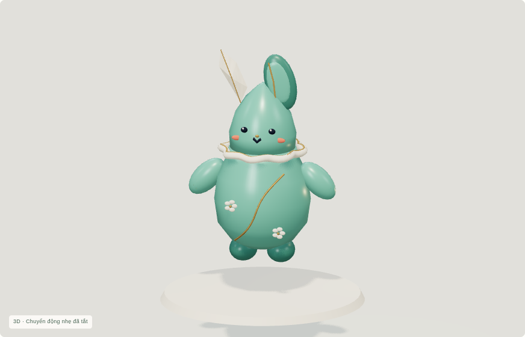
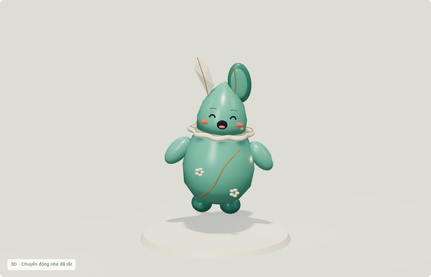
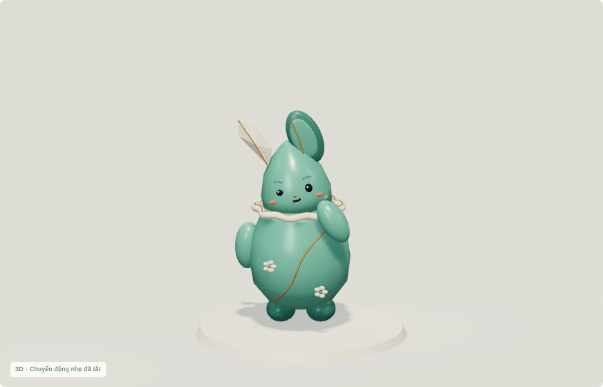
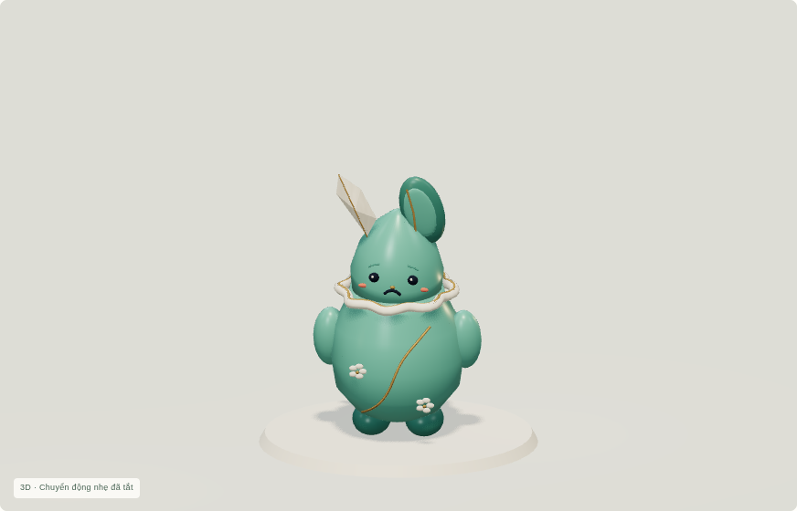
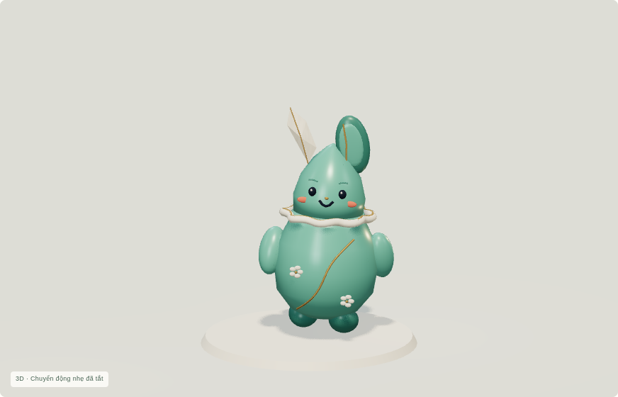
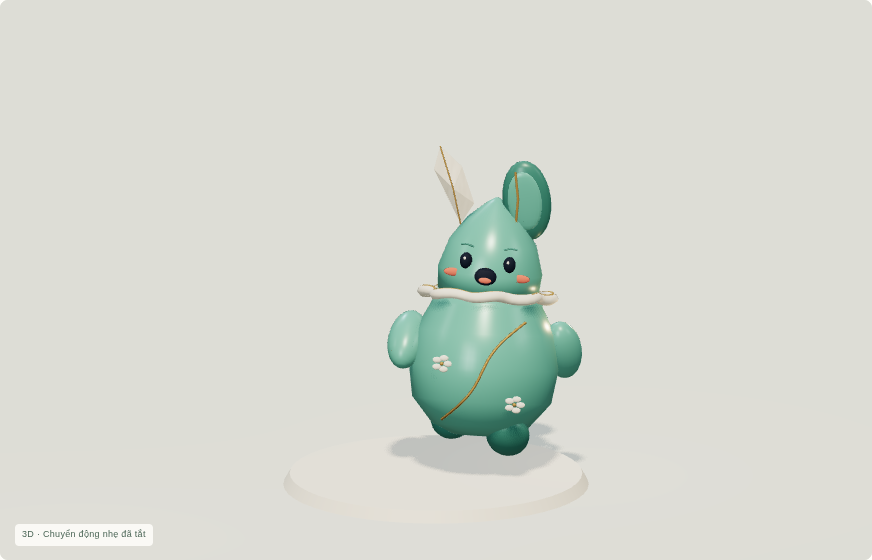
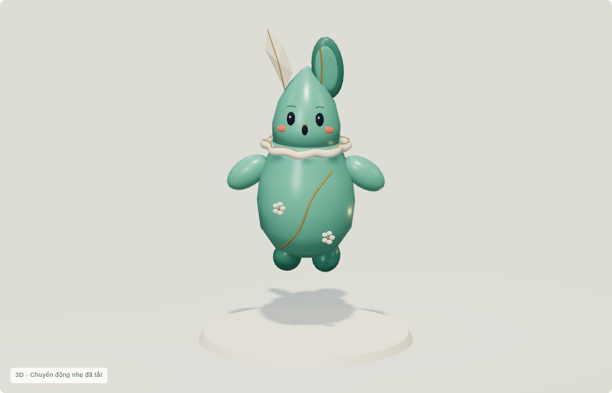

# Korean Arena 3D Studio v0.4 — Living Hanok Showcase

Bản v0.4 để bạn duyệt; website công khai vẫn là v0.3 đã duyệt. Không có district mới. Báo cáo `VERIFICATION_SUMMARY.json` ghi trạng thái kiểm chứng cuối; các lượt thất bại/gián đoạn được giữ riêng làm lịch sử.

## Trước / sau

Ảnh trước là v0.3 đã kiểm chứng trên Pages, ảnh sau là render WebGL thật v0.4. Không dùng concept hoặc hình ảnh giả làm bằng chứng 3D.

| | v0.3 | v0.4 |
|---|---|---|
| Ngày |  |  |
| Đêm |  |  |
| Vui |  |  |

## Biểu cảm và động tác

| Vui | Suy nghĩ | Buồn |
|---|---|---|
|  |  |  |

| Đi dạo | Chạy vui | Nhảy |
|---|---|---|
|  |  |  |

[Chào và nháy mắt](final-render/mascot-greeting.png) · [Ăn mừng](final-render/mascot-celebration.png) · [Tò mò](final-render/mascot-curious.png) · [Phản ứng chạm](final-render/mascot-clickreaction.png) · [Thả lỏng](final-render/mascot-returntoidle.png).

## Hanok và bố cục

[Chiều ấm](final-render/evening.png) · [Toàn trang desktop](final-render/desktop.png) · [Mái và cửa vào](final-render/roof-detail.png) · [Vườn và tán mận](final-render/garden-detail.png) · [Đài gốm](final-render/dais-detail.png) · [Điện thoại](final-render/mobile.png) · [Hero điện thoại](final-render/mobile-hero.png) · [Mascot điện thoại](final-render/mobile-mascot.png) · [Fallback](final-render/fallback.png).

Phần mới giữ nền kiến trúc v0.2 và các chi tiết v0.3: tán hoa mận có ba cụm chuyển động độc lập, chóp mái celadon, khung lối vào, lan can, bậc sân, viền đài, lối đá có trang trí, bình cây, cụm hoa thấp, gối giấy hanji, núm cầu và skyline có cửa sổ. Các phần tĩnh gộp theo vật liệu; dải trang trí nhỏ dùng 24 đoạn thay vì 64.

## Xem chuyển động và tương tác

[Video chuyển động v0.4](living-hanok-v04-motion.mp4) ghi các frame trình duyệt thực sau khi tải xong, theo timestamp gốc, không tăng tốc hoặc tạo frame giả. Các frame giải mã được kiểm tra trong `capture/`. Tốc độ renderer phần mềm cloud không đại diện điện thoại thật.

[Tải gói v0.4 tương tác](../../downloads/v0.4/living-hanok-v0.4-review.zip). Giải nén toàn bộ; Windows mở `START_WINDOWS.cmd`, macOS/Linux chạy `python3 start.py`. Cần Python 3; không cần Node, Blender hoặc Internet. Trình duyệt mở ứng dụng qua HTTP; ChatGPT/GitHub thường chỉ hiển thị source khi mở trực tiếp index.html.

Chạm mascot cho phản ứng nhảy nhỏ. Các nút Đi dạo / Chạy vui / Nhảy lên / Vẫy chào / Ăn mừng chạy một lượt, chuyển qua Thả lỏng rồi Idle. Dropdown giữ trạng thái biểu diễn để so sánh. Biểu cảm mắt/mày/miệng đi theo clip trong GLB. Khi giảm chuyển động, giữ pose tĩnh có biểu cảm; không tự bỏ tùy chọn hệ điều hành. Đèn và cây có phản ứng khi chạm; camera điện ảnh vẫn là tùy chọn và nhường cho thao tác xoay.

## Nguồn / kiểm chứng / giới hạn

`assets/v0.4/source-blend/` giữ Blender chỉnh sửa được; `exports/v0.4/asset-manifest.json` ghi checksum, clip, geometry, bounds và provenance. Hai GLB v0.4 là `mascot-living` (12 clip) và `hanok-living` (CanopyWind). Source/export/artifact v0.2/v0.3 được giữ nguyên; không có dịch vụ trả phí hay dependency mới.

Bản ứng viên có JavaScript/CSS/GLB/PNG nhúng, đã kiểm tra riêng dưới repository subpath qua chính ZIP static. Bản công khai v0.3 không bị thay. Build/Validator/browser evidence và ảnh nằm trong thư mục này; giới hạn/chi phí render ghi tại PERFORMANCE_REPORT.md. Chưa đo FPS GPU/điện thoại thật; không cam kết 60 FPS. Fallback dùng ảnh render v0.2 gốc đã duyệt, không giả làm render v0.4.

Dừng tại Big Update v0.4, chờ phản hồi của bạn trước khi xuất bản bản cập nhật hoặc xây district mới.
