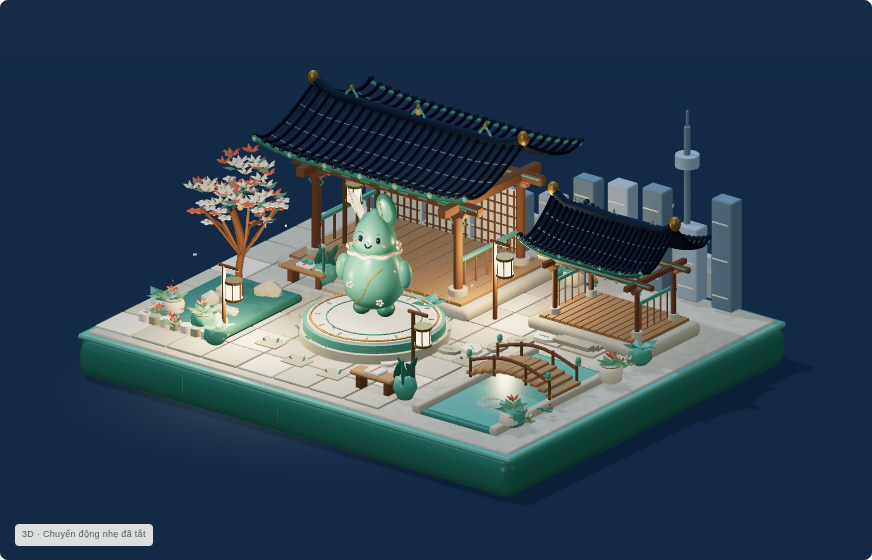
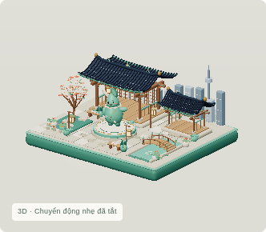

# Public Living Hanok v0.4 verification

**View the actual interactive showcase:** [https://anapaulagatti.github.io/3D-pharse5-/](https://anapaulagatti.github.io/3D-pharse5-/). Cache-refresh URL: [https://anapaulagatti.github.io/3D-pharse5-/?release=cd238a4c](https://anapaulagatti.github.io/3D-pharse5-/?release=cd238a4c).

The user explicitly authorized publication of v0.4. [Actions run 38530210414](https://github.com/Anapaulagatti/3D-pharse5-/actions/runs/38530210414) completed package/deploy successfully at source `d4fecaa40d631d14fdb9120cf09b3cf24c4d576d`. Deployment 7059737978 reports success and the authoritative URL above.

Normal and cache-refresh anonymous HTTPS responses both returned **200 text/html**, 10,213,265 bytes, matching the exact reviewed v0.4 HTML SHA `cd238a4c79f378d05eea098ec3f55c207c24c91444afce459d1345c012572846`. Static site contains only index.html/.nojekyll; JavaScript/CSS and ten verified original GLB/PNG/texture assets are embedded/Blob URLs, so repository subpath works without external asset bundles. Source/.blend/previous exports/showcases/lockfiles preserved. Two authorized deployment configuration updates have exact before/after hashes recorded; remaining 41 baseline files unchanged. SDK license/provenance/known credential/private-content audit passed.

**All 10 actual public browser stages passed**: day/evening/night and hero; twelve distinct native face/body poses and advancing live motion; actual mascot mesh reaction and keyboard wave returning through ReturnToIdle to Idle; lantern/tree mesh feedback and ambient motion; pause and changing OS reduced-motion preference; camera orbit/reset/focus/optional cinematic yield; low/medium/high quality and 390×844 hero/Jump portrait; actual offscreen pause/resume; missing-WebGL original PNG fallback. Zero critical page/console errors or missing resources. [Full browser report](render/verification.json).

The assistant inspected actual public hero/night/Happy/Thinking, live Walk pair and Run/Jump frames, mobile hero/portrait and fallback images. These show real Hanok geometry, distinct eyes/mouth/body expressions, changing limbs and airborne jump, readable lighting and responsive presentation. Verification is of the running public WebGL app, not raw HTML source.

| Hero | Night |
|---|---|
|  |  |

| Happy | Phone hero |
|---|---|
|  |  |

[Evening](render/evening.png) · [Thinking](render/mascot-thinking.png) · [Walk A](render/live-walk-a.png) / [B](render/live-walk-b.png) · [Run](render/live-run-a.png) · [Jump](render/live-jump-b.png) · [Phone portrait](render/mobile-mascot.png) · [Fallback](render/fallback.png).

Production build/typecheck and five GLBs Validator **0 errors/0 warnings** rechecked before deployment. Original v0.4 artwork/model bytes were not rebuilt or regenerated for release. TLS verification stayed enabled. SwiftShader cloud QA proves functionality; physical-phone/GPU FPS remains unmeasured, with no 60 FPS claim. Fallback intentionally uses the preserved original base poster.

**STOP** for further user visual feedback. No Hangul Garden or additional district.
