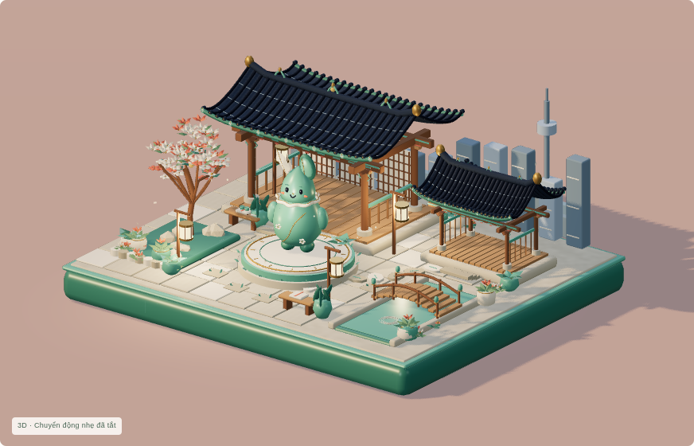
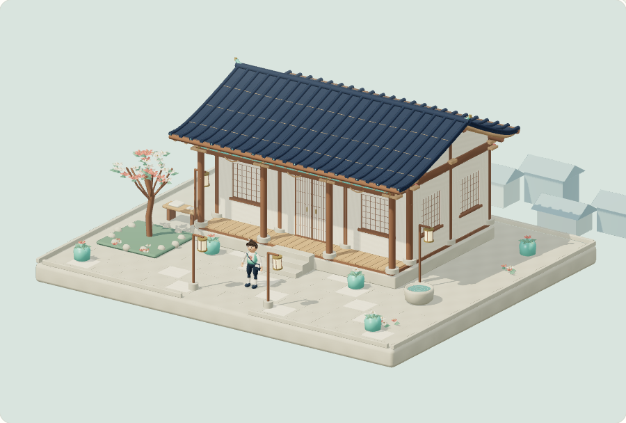

# Before / after — actual rendered applications

These are genuine browser screenshots, not concept art. v0.4 is preserved at checkpoint/v0.4-pre-reforge-005 (9cc1381). v0.5 sources and all intermediate rejected visual passes remain recoverable in Git.

| v0.4 published baseline | v0.5 Joseon Fantasy Reforge |
|---|---|
|  |  |
|  |  |

v0.4 used an open pavilion and the Ceramic Seed Spirit. v0.5 has four real facades, closed gables, a supported roof, a raised floor with stairs, sliding entry doors, interior desks and original courtyard dressing. Nari uses one real28-joint skin,20 authored skeletal clips and10 facial morphs. The Ceramic Seed Spirit remains an optional unchanged legacy GLB download.

The new face's first-pass chin artifact was visible in actual Low and Medium renders; analytic stylized surface normals removed the voxel/warp crease. It was not accepted on an automated animation test alone. The quantization transform issue affecting ripples and door offsets was also found visually and fixed before release.

No physical-device FPS claim. Cloud screenshots use Chromium/SwiftShader, different viewport/camera from the earlier release; this comparison demonstrates art/structure, not a controlled performance benchmark.
