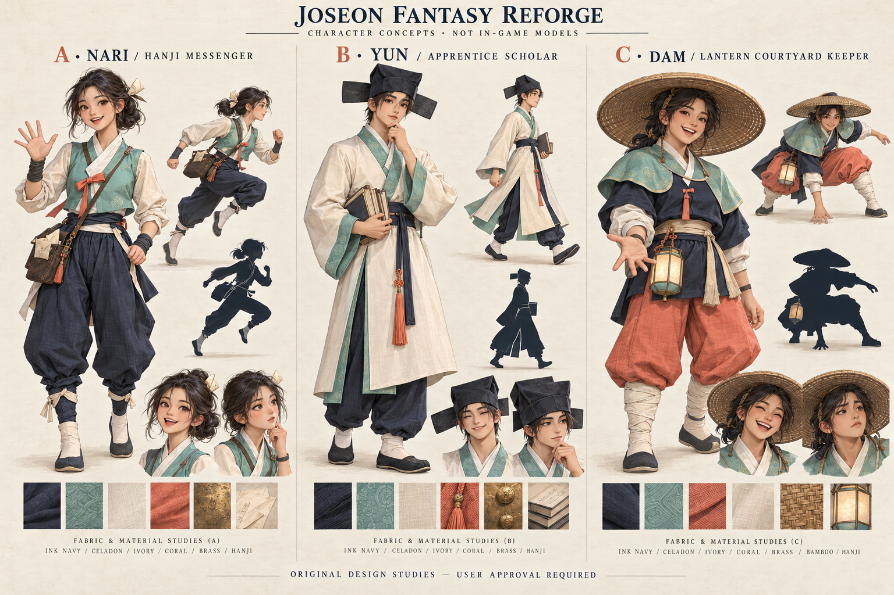

# Joseon Fantasy Reforge — Gate A ready for selection

This is the completed concept/audit delivery for Gate A. **User concept approval is pending.** v0.5 is not built, playable, production-verified or publicly deployed.

## Review the three options

[Open the full-size original concept board](../../concepts/v0.5/character-concepts.png).

| Choice | Character | Principal tradeoff |
|---|---|---|
| **A — Nari, recommended** | Hanji messenger, short celadon vest, navy baji, paper pin and flat letter satchel | Most readable leg/arm motion; simplest clothing rig; adjust baggy trousers for clear knees |
| B — Yun | Apprentice scholar, angular cloth cap, long split ivory robe and books | Strong scholarly identity; skirt/sleeves require more deformation and leg-readability work |
| C — Dam | Warm courtyard keeper, broad bamboo hat, navy top/coral trousers and small lantern | Strong round silhouette and night identity; brim/accessory clearance and face visibility need extra care |

Full original concepts, eight-criterion comparison, provisional costs and production risks: [CONCEPT_REVIEW.md](../../concepts/v0.5/CONCEPT_REVIEW.md). Scores are editorial estimates, not measured animation/render quality.

## Architectural rebuild prepared

[Dimensioned plan and development gates](../../docs/v0.5/ARCHITECTURE_REBUILD_PLAN.md). Proposed12×10m courtyard,6.4×3.8m fully enclosed straight-line Hanok, raised maru/veranda/stairs, complete four sides, real sliding doors and simplified interior. Explicit foundation→stone shoes→columns→beams→purlins→rafters→roof support chain; future actual360° inspection before materials. A1.45m human and0.24m capsule establish doorway and route scale. These are plans, not graybox proof.

## Before: actual v0.4 evidence inspected

The saved screenshots below are from the actual public v0.4 browser run, retained unchanged. The current public HTML was independently fetched and matched the same approved checksum. They establish the before state only.

| Actual current environment | Actual current character run pose |
|---|---|
|  |  |

Visible issues and inspected sources are documented in [AUDIT.md](AUDIT.md): incomplete house envelope, missing roof framing and a transform-based legacy mascot. All five real Blender sources were opened read-only; all five GLBs were parsed. None has been regenerated or replaced.

## Preservation, checks and limits

- v0.4 recoverable baseline: `9cc1381792b768f1e973d45b3421d24eb514c0d5`; tag `checkpoint/v0.4-pre-reforge-005` independently verified on origin.
- Complete Gate A delivery checkpoint `a6c1959c0e7ab1247505f1ecb330d2a89cb90fb6` was pushed and independently matched origin/main; [remote proof](remote-checkpoint.json). Latest Pages run stayed38530210414, no new deployment.
- Gate A preparation checkpoint `e0a7828fec814397bc5609cfb0a49f64414d24cc` independently matched origin/main before concept generation.
- [75-file preservation inventory](preserved-v04.json), [source read-only audit](blender-source-audit.json), [actual GLB structure](existing-glb-inspection.json), [public/remote starting state](v04-start-state.json), and [Gate A verification](gate-a-verification.json).
- No runtime/app/modeling-source/dependency/lockfile/deployment changes at this gate. No new `.blend` or `.glb` exported, no new animation/controller claimed. No v0.5 build/Validator/gameplay/mobile acceptance claim; those require implemented gates B–E.
- New PNG and original generation prompt/provenance are saved in concepts/v0.5. No external game assets/reference images were supplied. Fine illustration details/proportions will be adapted for a real rig after approval.
- Existing public v0.4 stays at https://anapaulagatti.github.io/3D-pharse5-/; no workflow dispatch and no deployment-input change. FPS on target hardware remains unmeasured.

## Explicit decision gate

The user's [section15 Gate A](../../docs/reviews/REFORGE_V05_USER_REQUEST.md) says: **“Stop for the user's concept approval before committing to an expensive final character build.”**

Choose A, B or C, with desired changes. Save the response before final character production. Do not automatically choose the recommended concept, regenerate the existing art or publish v0.5. No new learning district is authorized.
