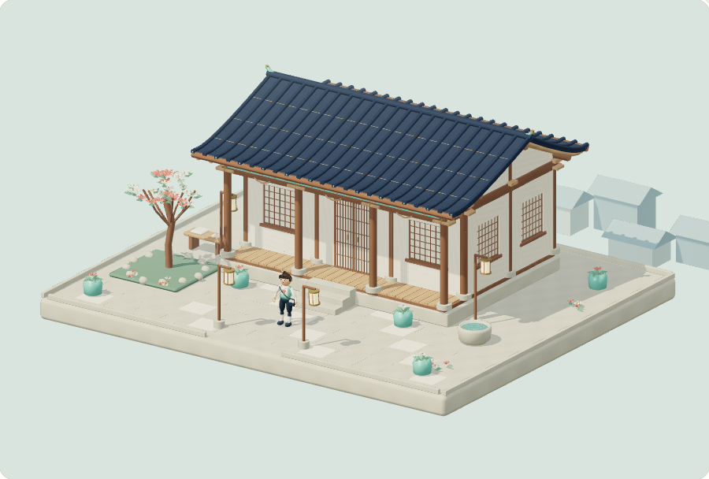
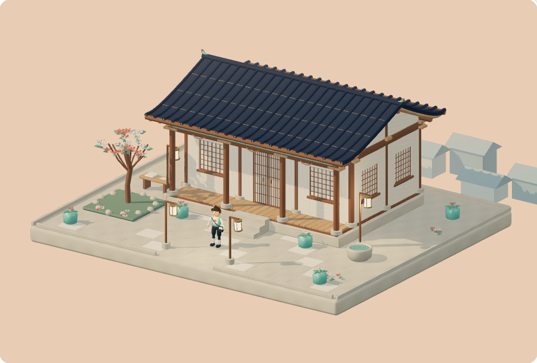
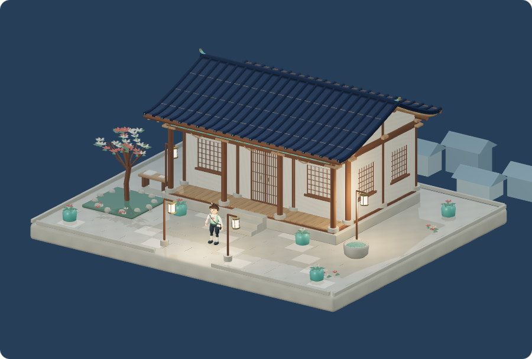
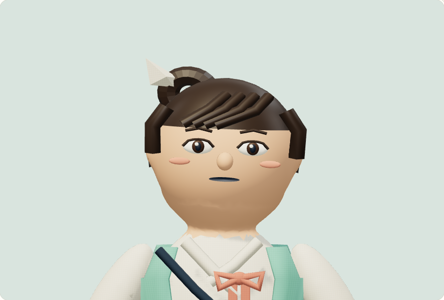
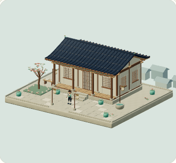

# Korean Arena v0.5 — Joseon Fantasy Reforge

Gates A–E complete. User approved Nari (concept A) and explicitly authorized completion plus public v0.5 publication. Exact verified static HTML: `082c661b5da2b4c8e66e81b2f52405ef460947bfeff27e2fd6fe771b2e3c716f` (13,543,219 bytes). Deployment is a separate step; actual status is recorded in pages-release/deployment.json only after verified.

## Actual visual results

[Before/after](BEFORE_AFTER.md) · [All10expressions](gate-e/gallery/faces.png) · [All20poses](gate-e/gallery/poses.png) · [Four character sides](gate-e/gallery/views.png) · [Moving-frame pairs](gate-e/gallery/motion.png) · [Actual86s gameplay video](joseon-reforge-v05-gameplay.mp4).

Full architecture front/rear/left/right/roof/roof-column connection/interior views are in gate-d/final-layer-review. Actual real-time video preserves185original compositor JPEGs and original VFR intervals, with ≥5s walking, ≥5s running, jump/land, greeting/celebration, real stairs/door entry and Idle facial changes. Decoded representative frames were opened; celebration review uses genuine frame88 after the default midpoint landed in later walking. Partial failed recordings and failed visual/test passes are retained and clearly labeled.

## Verified behavior

- Complete solid four-sided Hanok with continuous roof support, raised floors/stairs, true panel doors and interior desks; final169support pairs0bounds gaps, supplemented by actual views.
- Nari28-joint genuine skin, normalized≤4weights,20native skeletal clips,10facial morphs; all20live pairs advance mixer time and actual pixels. Bone-heat fixes prior underarm wedges; analytic head normals improve the chin surface.
- Native9play checks and6full-world physics checks: walk/run/start/stop, real jump/land, stairs, closed door collision, E open/entry, gestures→Idle, pause, OS reduced preference and390px pointer input.
-12actual world/accessibility checks: quality budgets, pointer orbit, real lantern/tree-mesh reactions,3native wind tracks, bounded effects Off, paused mixers, real OS preference changes, mobile layout, actual offscreen suspend/resume, real WEBGL_lose_context fallback and WebGL-unavailable fallback.
-8checks on exact safely extracted HTML through the included HTTP launcher: correct200text/html + independent same-URL SHA256, actual rendered scene, face, lighting, moving mixer, keyboard movement, mobile and real fallback. No critical console errors or missing resources.
- Production/typecheck, two final GLB Validator0errors/0warnings, packed/embedded original256px PBR maps, public two-file allowlist/secrets/source-map checks. Four asset byte hashes verified before embedding. Repository-subpath proof uses /3D-pharse5-/.

## Performance and scope

Measured render counts: Low57draws/99,012triangles; Medium/High133draws/195,524triangles including shadow rendering. Native asset geometry is99,308triangles before selective Low foliage. World5,714,488B, Nari2,923,840B. Low removes expensive normal-map/environment/point-light/shadow features; source maps and high-quality presentation retained.

The cloud software renderer is visibly slow; the video keeps that timing. No physical phone/GPU FPS claim; QA-004 remains hardware profiling. Portrait/presets remain simple inspection tools, not a full commercial game camera. No new district, paid service, backend or audio. All previous assets/Blender sources remain recoverable. v0.4 standalone SHA cd238a4c remains unchanged; the authorized deployment workflow update is the only changed protected release input.

STOP after the authorized release and public visual verification. Wait for user feedback before further art or districts.
