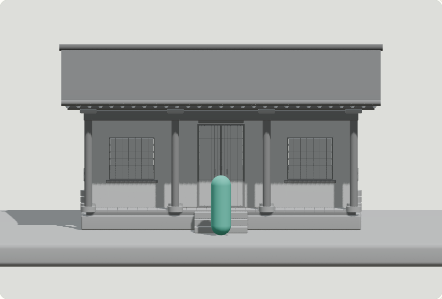
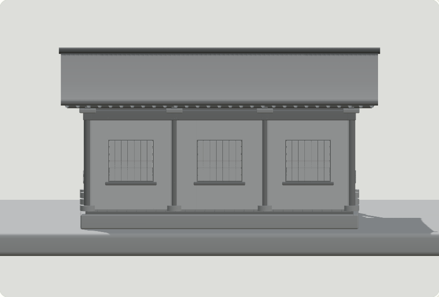
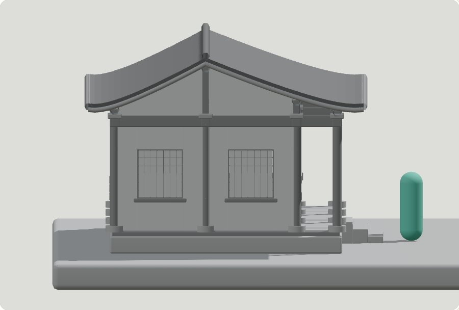
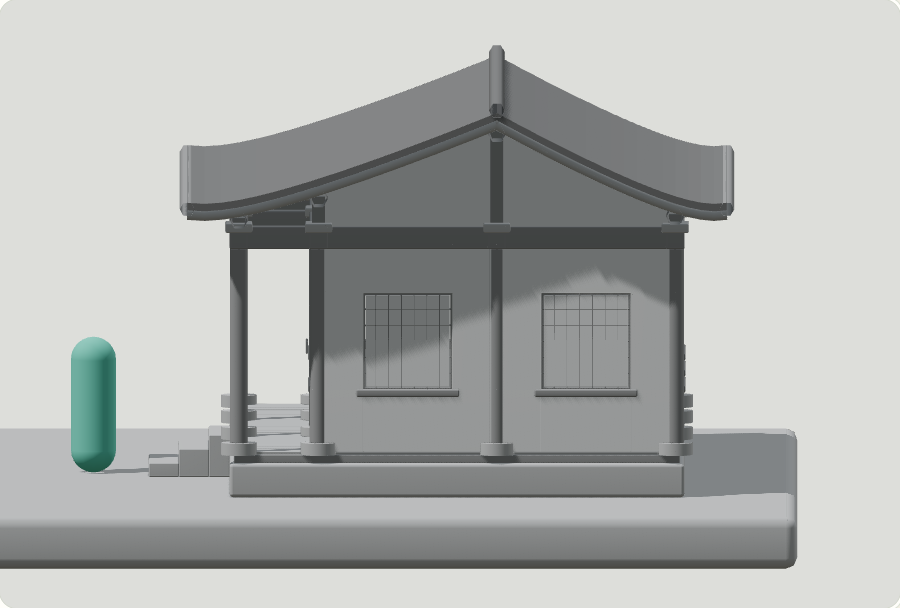
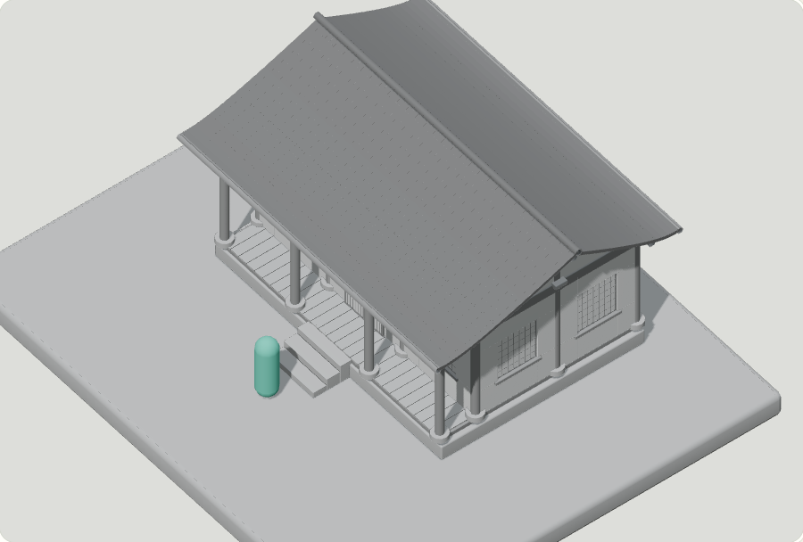
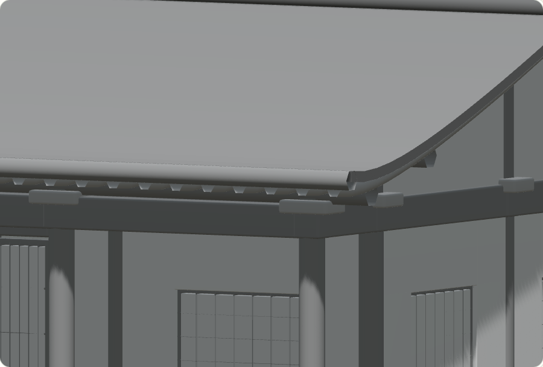
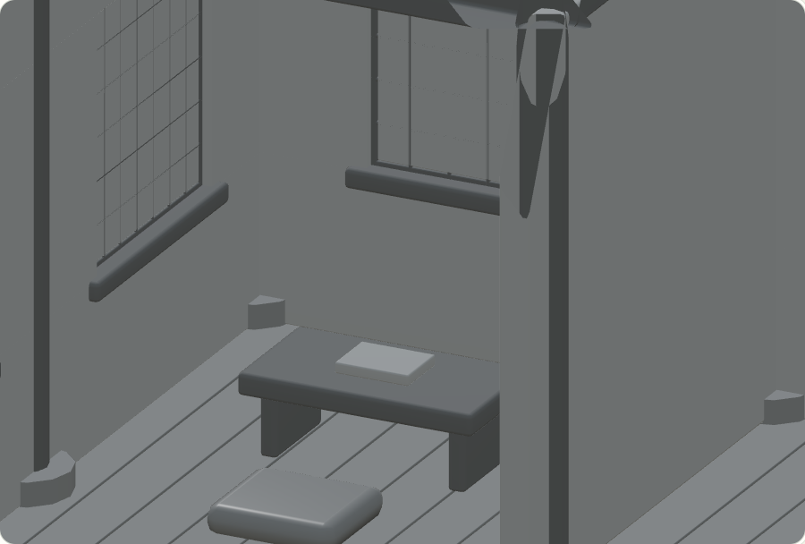
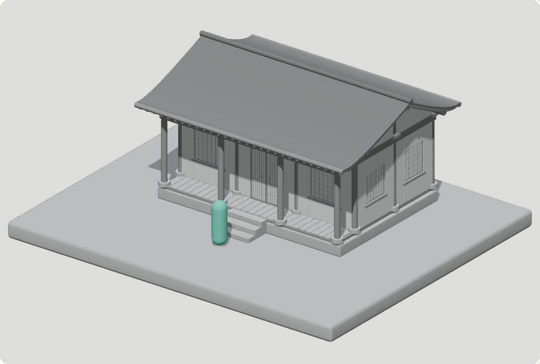

# Gate B — verified four-sided Hanok graybox

**Gate B passed.** Neutral structure only; Nari, gameplay, materials/art polish and final acceptance remain Gates C–E. User approved A in concepts/v0.5/APPROVAL.json; do not ask again.

| Front | Rear |
|---|---|
|  |  |
|  |  |
|  |  |
|  |  |

[360° structure inspection](structure-360.mp4):24 actual browser-rendered camera angles,15° apart, encoded at4 source views/s. This is a stepped inspection presentation, not real-time gameplay/FPS measurement. Actual source PNGs retained. [390px phone viewport](render/mobile.png).

New editable source: assets/v0.5/source-blend/hanok-graybox.blend. Validated GLB2,142,648bytes, actual module bounds/colliders/support/door manifest in exports/v0.5. Geometry is complete on front/rear/left/right, with closed gables, real wall thickness/apertures/lattice windows/sliding doors, raised floors and stairs, and room desk/book/cushion. Roof-to-column chain has actual beams/struts/purlins/rafters. A1.45m capsule provides scale only; it is not Nari.

Verification: production/typecheck PASS; Khronos Validator0errors/0warnings;33 real Chromium screenshots plus corrected roof recheck, zero critical console/resource errors,209 support bounding-box pair checks0gaps. Actual images opened and inspected; bounding boxes are broad-phase evidence and not structural-engineering certification. Low12draws/51,908triangles with proxy; Medium24/103,816including shadows. Software-rendered cloud functionality is not hardware/physical-phone FPS acceptance.

First pass (render-pass-1) is retained: inherited auto margin collapsed canvas to300px and inspection camera showed too much facade. Fixed width100% and moved actual interior camera through the door; roof fit widened after human review found a clipped ridge. No assertion disabled. Blender logs probe unavailable optional Draco; export uses plain GLB and Validator confirms no decoder dependency.

All75 protected v0.4 source/art/lock/deployment hashes remain unchanged. Candidate is isolated at internal `?candidate=v05`; no user-facing cloud loopback link or public v0.5 deployment. Save a recoverable Git checkpoint, then continue Gate C.
