# Gate C — functional skinned Nari and playable slice

**Gate C passed. Gate D art polish and Gate E final acceptance remain.** This is not a finished or publicly published v0.5 release.

Approved A identity: celadon short vest/ivory crossed collar, navy baji, coral goreum, low hair knot/paper pin and letter satchel. Original continuous anatomical mesh, real28bone armature, normalized maximum4deform influences/no unweighted vertices,1exported skin,20authored bone clips and facial morphs; source retains editable NLA/weights. Plain GLB2,173,544bytes,24,308triangles,6material primitives. Validator0errors/0warnings. Source .blend and GLB are versioned separately from all earlier approved assets.

## Actual motion and face review

[Current rig verification](final-rig-review/verification.json):4front/side/rear views,20static poses,10distinct close-up expressions and20genuine moving pairs (74actual PNGs). All clip names/bone/morph bindings came from the real served GLB. No critical console/resource errors. Actual images opened and inspected; final artistic material/shadow refinement is still required.

| Greeting / current corrected shoulders | Real different gait samples |
|---|---|
| 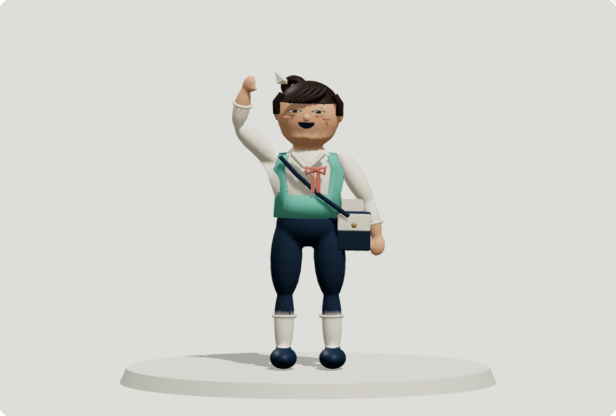 | 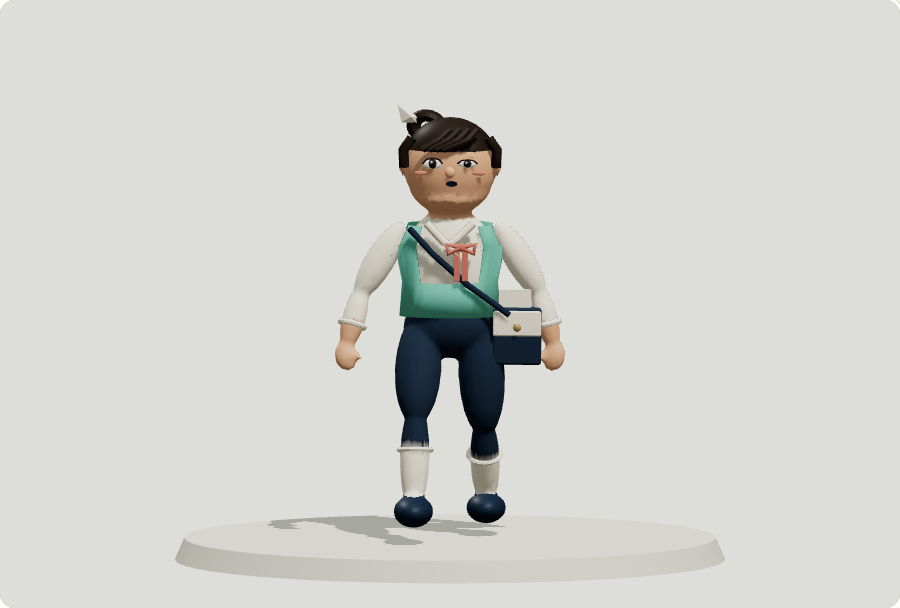 |
| 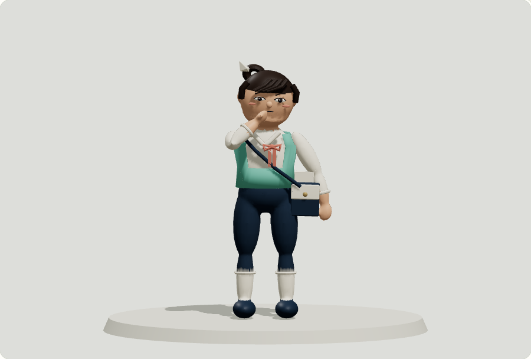 | 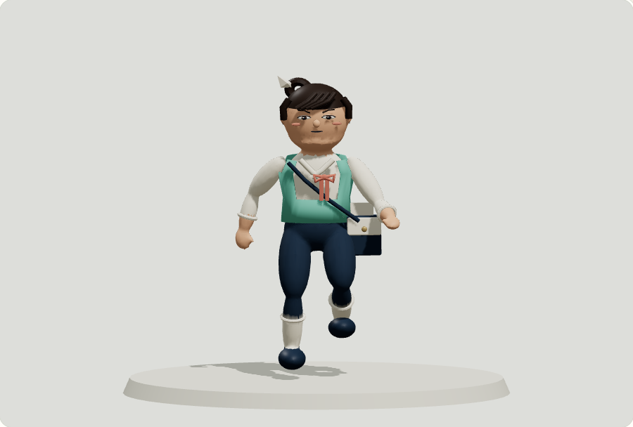 |
| 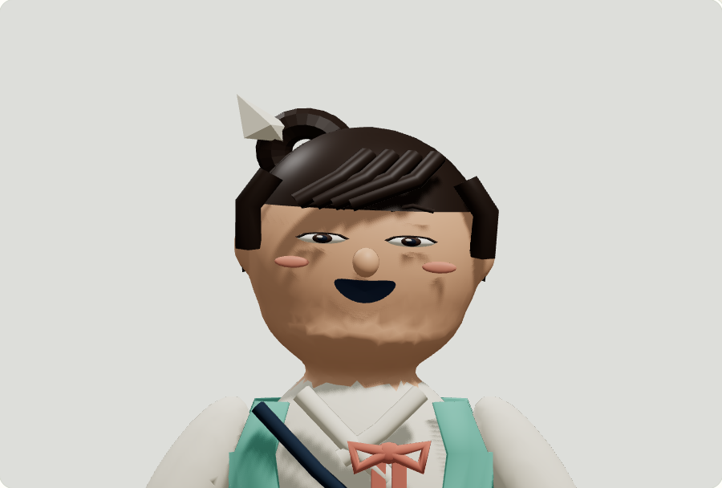 | 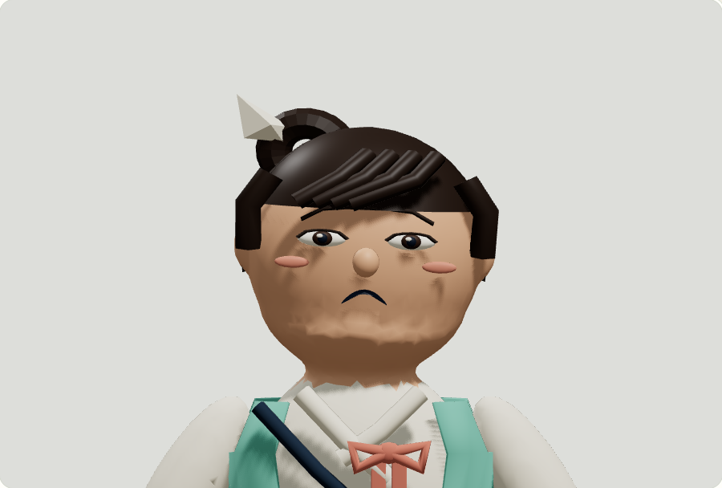 |

The current face has coarse micro-feature/self-shadow at close range; this is a recorded **Gate D presentation issue**, not claimed finished art. All expressions have genuinely different eye/brow/mouth geometry. No texture or particle hides a rig defect.

## Actual playable browser proof

[Native checks](play-pass-4/verification.json):9checks PASS using actual keyboard/pointer/DOM controls. WASD/arrow input, Shift run, Space physics jump, E sliding-door interaction, world heading, stairs/raised floor/collision, native one-shot→Idle, pause/resume, live OS reduced-motion changes and390px touch controls. Static pose selection is available with reduced motion; necessary input-driven movement stays functional. No hardware FPS claim.

| Actual walk upstairs | Actual run in courtyard |
|---|---|
| 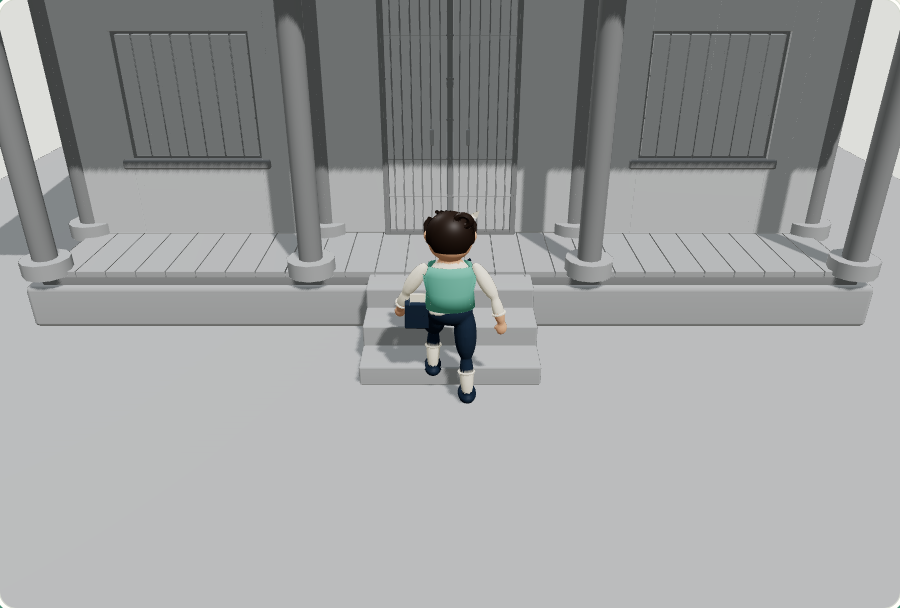 | 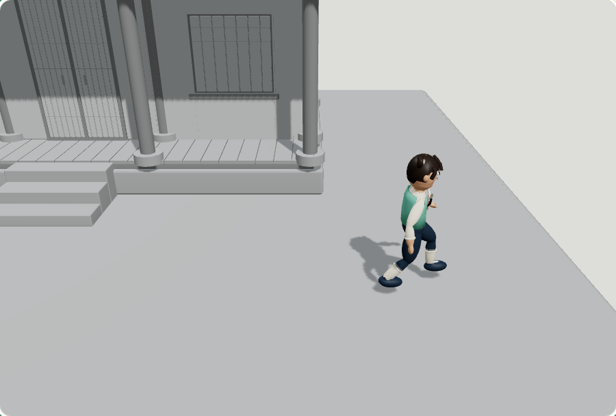 |
| 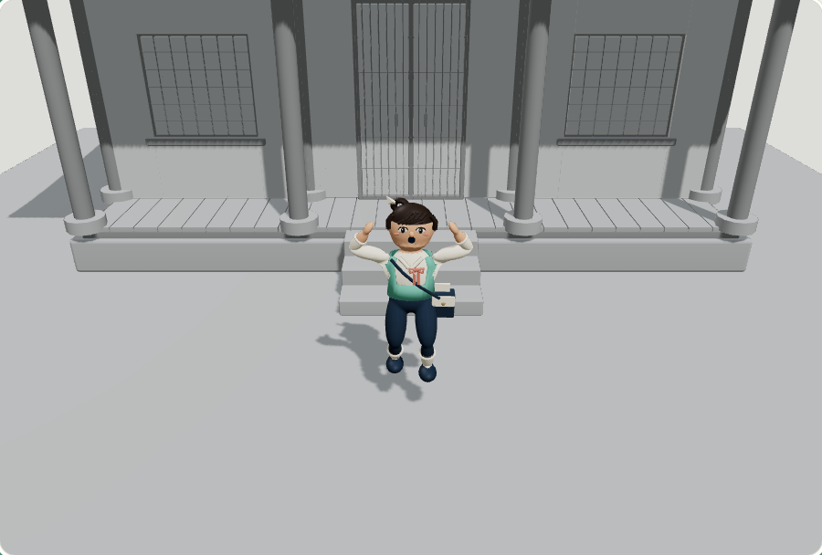 | 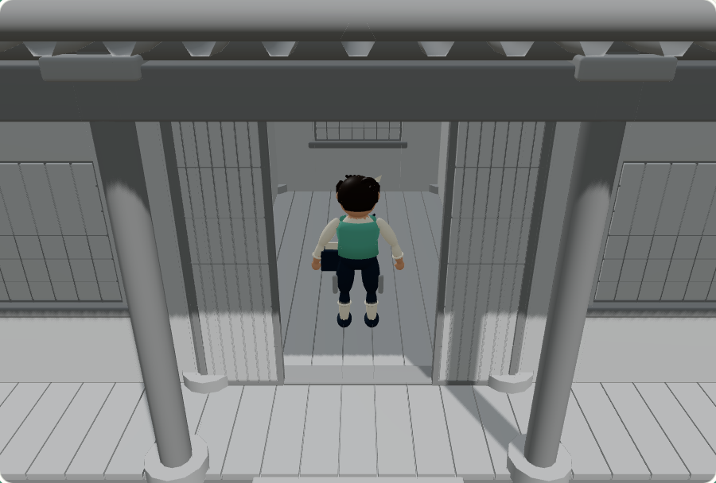 |
| 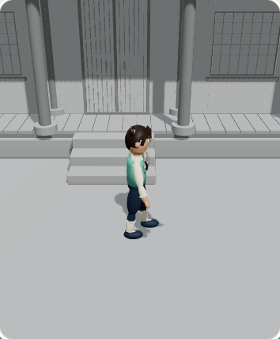 | 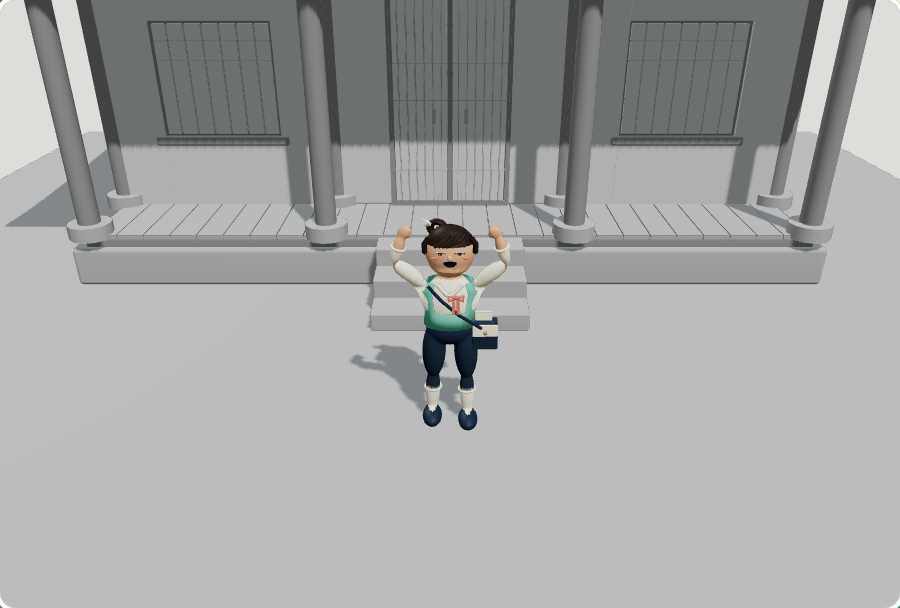 |

Airborne proof is captured by pressing the app's actual Pause control during a native Space jump; actor world Y is greater than0.025m and freezes visibly above the ground, then resumes and lands. The earlier pass3 jump screenshot completed after landing and is explicitly **not** counted as airborne visual proof. Genuine real-time gameplay capture remains Gate E.

Controller uses bounded1/60simulation steps, authored stride-matched in-place motion (~0.815m/s walk,2.438m/s run), kinematic capsule against actual exported collider bounds, ground/stair contract and analytic stance-foot correction over differing treads. Shared physics assertions verify closed door, opened staircase/interior, floor overlap against real exported geometry, rear wall,0.472m jump/landing and release stop. No physics engine dependency added.

## Failure history and correction

Initial Euclidean weights captured hip/vest/underarm vertices with nearby hands. Actual initial/corrected/rig-review images exposed stretched wedges despite automated clip/morph passes. Those reports are marked VISUAL_DEFORMATION_REJECTED and retained. Body now uses Blender bone-heat diffusion, excluding accessory/root/finger controls from that solve, normalized/limited4; torso garments and props have explicit appropriate weights. [Current extreme key poses](boneheat-keyposes/inspection.json) and full review confirm the wedges are gone.

Play passes1/2 failed Run because a real canvas lifecycle defect switched to fallback during intentional remount/mode change. Reset now keeps the renderer; ContextGuard removes its context-loss listener on teardown. New native passes3/4 verify reset/view changes and all controls. Failures retained; no assertion was removed. [Diagnosis](context-reset-diagnosis.json).

## Next gate

Preserve Gate B graybox and this functional Nari as recoverable versions. Build **separate art exports** for full tiled/material Hanok/living courtyard and Nari material refinement, then inspect day/evening/night, final structure/character/world/mobile/effects. Address coarse face shadow, finish actual fallback posters and camera transitions. Production/Validator/browser/media/package/privacy/subpath verification and review checkpoint are Gate E. Public v0.4 and all75protected files remain unchanged; no v0.5 publication permission.
